# TripMate：可验证约束的中文行程规划 Agent

TripMate 是一个中文行程规划 Agent。用户用自然语言描述出行需求，可以分多轮补充或修改，系统输出一份逐日行程：城际交通、酒店、三餐、景点，以及它们之间的市内交通。系统在公开基准 [ChinaTravel](https://github.com/LAMDA-NeSy/ChinaTravel)（ICLR 2026）上开发和评测。

核心思路是**让 LLM 只负责理解需求，可验证的部分交给程序**：

- **理解需求**：LLM 把口语化的需求编译成结构化约束（TripSpec → 官方 DSL）；
- **规划**：符号规划器按沙盒里的真实数据排出行程，时间、交通和费用都由程序计算；
- **校验与修复**：每份计划都经过官方常识规则和约束执行器校验，失败时按错误类型修复；
- **记忆**：分层记忆让多轮对话中的约束和用户偏好能延续下去。

**技术栈**：Python 3.12 · LangGraph · DeepSeek（deepseek-flash，关闭 thinking）· jieba + BM25 · bge-small-zh · SQLite · Pydantic · pytest

## 结果

| 指标（ChinaTravel human-154，test 只运行一次） | 本系统 | 官方 ReAct 复现（同模型） | 论文参考值（模型不同） |
|---|---|---|---|
| FPR（全部约束通过率） | **79.22%**（95% CI 72.73–85.71） | 0.00%（McNemar p=3.76e-37） | ReAct one-shot 2.6；NeSy Planning 37.0 |
| 每条查询输入 token | 1,526（1.28 次 LLM 调用） | 345,447（53.41 次调用） | ReAct one-shot 约 1,058K |

- **多轮**（由 human-154 派生的 154 段对话）：FPR 76.62%（95% CI 69.48–83.12），同一批查询的单轮结果为 79.22%，差异不显著（p=0.481）。
- **检索**（POI-Ret test）：nDCG@10 为 hybrid 0.419、BM25 0.297、稠密 0.383。
- **消融**（dev）：把同样的约束和候选交给 LLM 直接写计划，FPR 只有 1.67%，本系统为 100%（dev_mini 60 条配对）；改用纯规则解析需求后，FPR 从 95.56% 降到 82.89%。
- **成本**：全部实验的 API 费用为 15.179 元（按高峰价核算）。

完整结果、置信区间、失败分析和消融见 [reports/final/summary.md](reports/final/summary.md)。

## 工作台界面

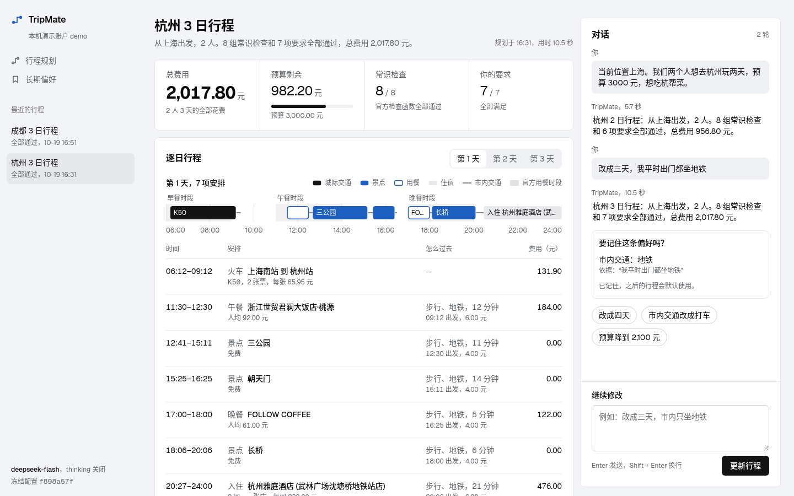

本地运行的单页工作台（Python 标准库 HTTP 服务 + 原生 HTML/CSS/JS，无构建步骤）：

- 左侧主栏是费用与校验概览、逐日行程和校验结果，右侧是用自然语言多轮描述需求的对话区；
- 时间轴上标出了官方规则规定的三餐时段，能直接看到每项安排为什么符合规则；
- 页面同时展示 8 组官方常识检查和每项需求约束的结果、修复过程、系统理解出的需求字段及其来源；
- LLM 提出的长期偏好要在页面上确认后才会写入，写入后可以在"长期偏好"页查看版本记录，也可以删除。

| 逐日行程：时间轴、明细与费用构成 | 规则校验与系统理解的需求 |
|---|---|
| 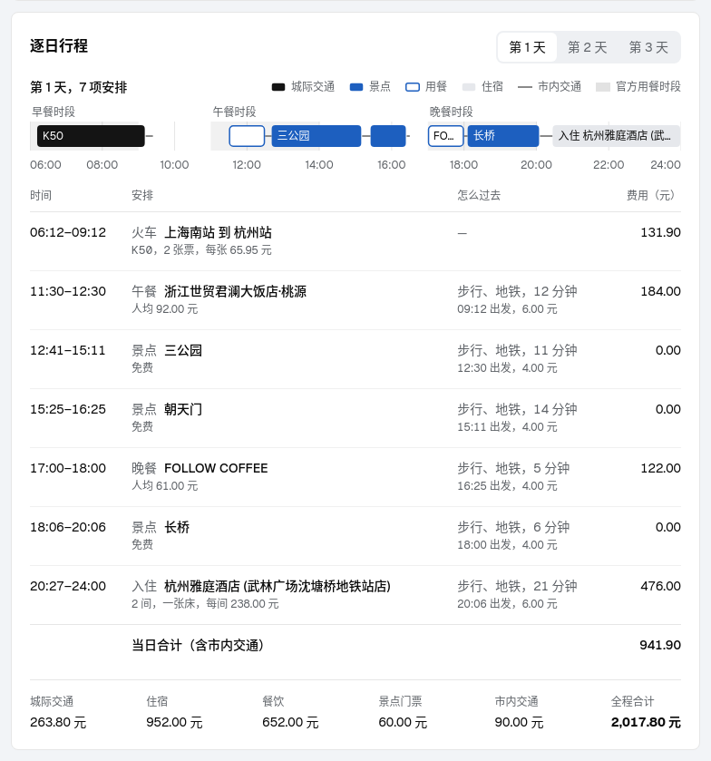 | 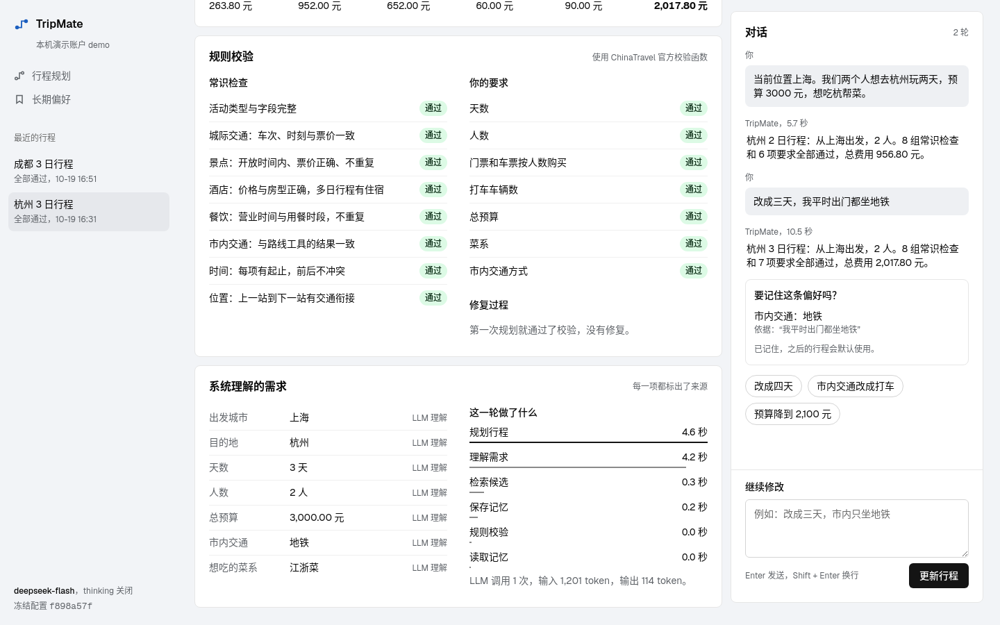 |
| 新行程：示例需求与待运行的检查 | 长期偏好：确认后写入，保留版本记录 |
| 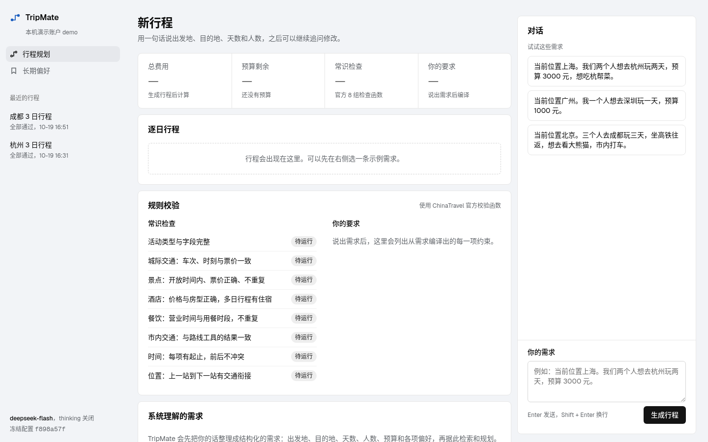 | 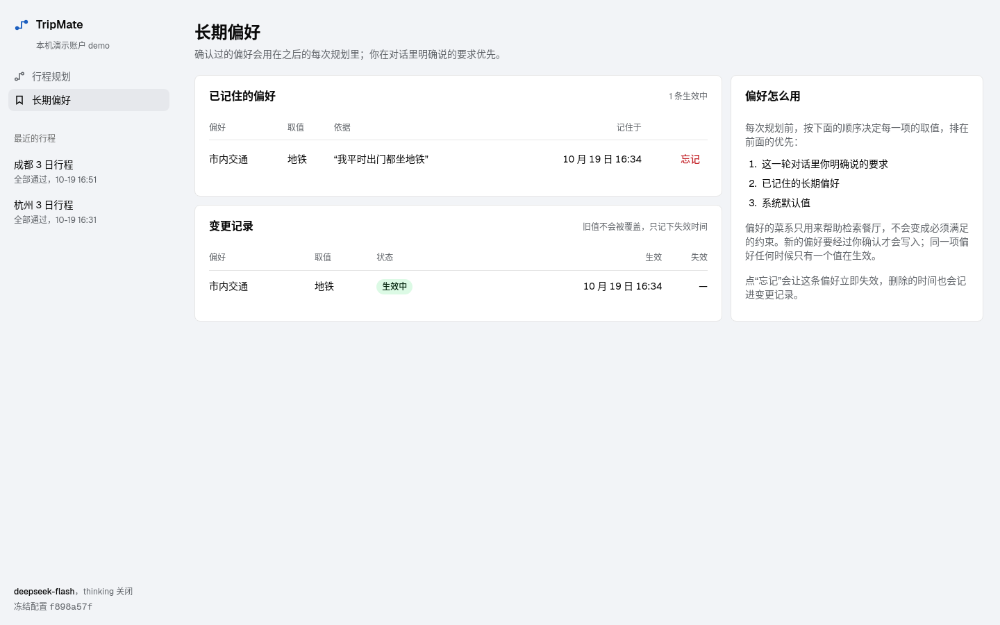 |

<p>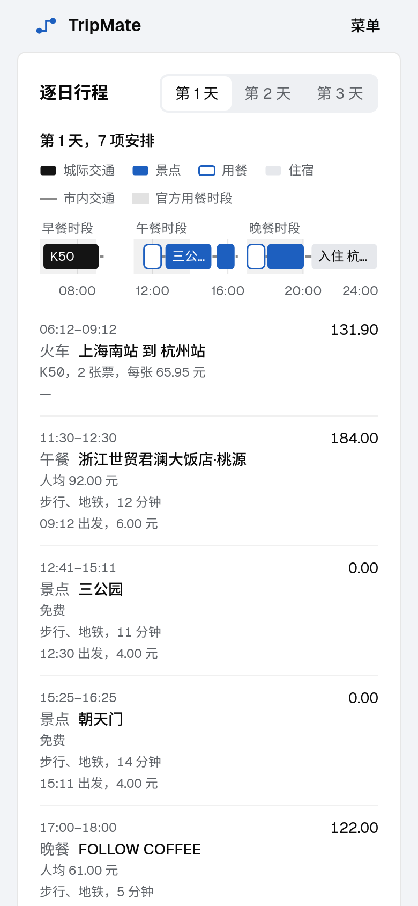</p>

```bash
source scripts/planner_env.sh
python -m tripmate_planner.web.server          # 打开 http://127.0.0.1:8765
python -m tripmate_planner.web.server --rule   # 不调用 API，只用规则解析需求
```

## 总体架构

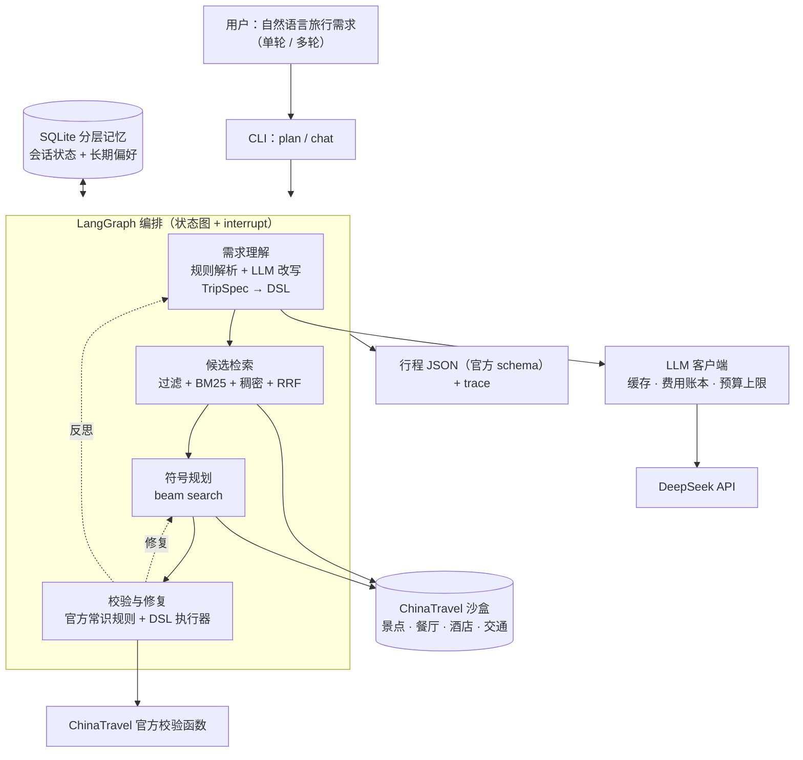

一轮对话的处理过程：

1. 读取记忆；
2. 把需求解析成 TripSpec，并与记忆合并；
3. 编译成 DSL 约束；
4. 检索候选 POI；
5. 规划行程；
6. 校验，失败时修复后重新规划，必要时让 LLM 带着失败原因重新理解需求；
7. 确认并保存偏好，输出计划。

整个过程中，LLM 只出现在第 2 步（以及第 6 步的反思）。

## 主要模块

### 1. 编排层：LangGraph 状态图

[`tripmate_planner/graph.py`](tripmate_planner/graph.py)

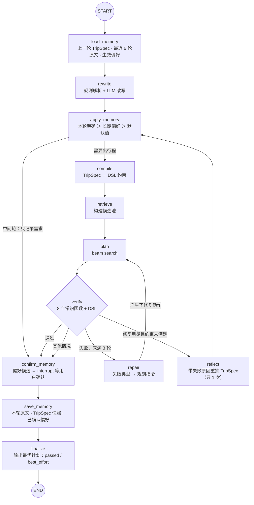

- 每个节点只做一件事，节点之间通过类型明确的状态对象传递数据；每个节点的耗时都记入 trace，便于分析失败原因和性能瓶颈。
- 修复与反思都有上限：最多 3 轮修复，加 1 次反思。整个过程中会一直记录目前最好的计划，所以即使最终没有通过全部约束，也能输出最接近的结果（best_effort）。
- 长期偏好写入前用 LangGraph 的 `interrupt` 暂停，等用户确认后再继续。`chat` 命令里会逐条询问用户，评测时自动确认。
- 多轮对话中，中间轮只更新需求、不出行程，最后一轮才完整规划。

### 2. 需求理解：规则解析 + LLM 改写

[`tripmate_planner/spec/`](tripmate_planner/spec/)

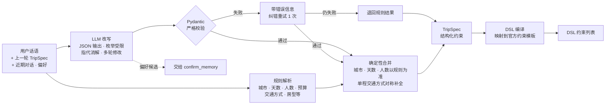

- **TripSpec** 是整个系统的"需求表示"，用 Pydantic 定义，字段包括目的地、天数、人数、预算、交通方式、必去景点、菜系、酒店特色等。取值受沙盒枚举约束，LLM 不能编造不存在的类型。
- **规则和 LLM 互补**：规则解析稳定、零成本，负责显式字段；LLM 负责口语化表达、指代（例如"还是上次那家"）和多轮修改。两者按字段合并，并记录每个字段的来源。
- **DSL 编译是确定性的**：同一个 TripSpec 总是生成同一组官方约束，用等价性测试与官方约束对齐。
- 每次查询通常只调用 1 次 LLM：test 上平均 1.28 次调用、1,526 输入 token，同模型 ReAct 为 53.41 次、345,447 token，输入 token 少两个数量级。

### 3. 候选检索：召回前过滤的混合检索

[`tripmate_planner/retrieval/`](tripmate_planner/retrieval/)

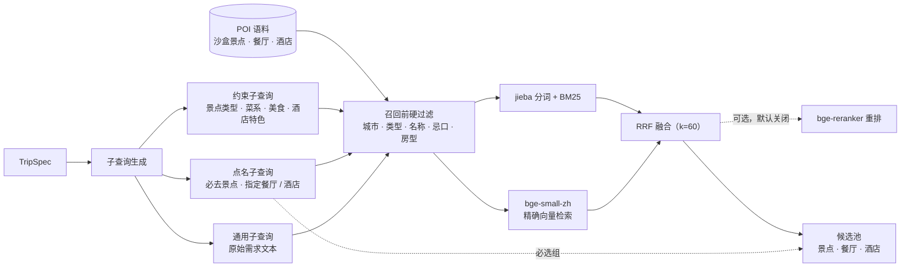

- **先过滤再召回**：硬约束（城市、类型、忌口等）在召回前就过滤掉，返回结果不会违反约束，也不会出现召回后再过滤导致候选不够的情况。
- **两路召回互补**：BM25 擅长精确的名称和关键词，稠密检索擅长语义相近的描述，两者用 RRF 按排名融合，不需要调分数权重。
- 语料规模不大，所以用精确向量检索，不引入向量数据库。重排能进一步提升检索质量，但 CPU 上延迟过高，经评测后默认关闭，可通过配置开启。
- "必去景点""指定餐厅"等点名约束会单独形成必选组，规划器必须把它们排进行程。

### 4. 规划、校验与修复

[`tripmate_planner/plan/`](tripmate_planner/plan/) · [`verify/`](tripmate_planner/verify/) · [`repair/`](tripmate_planner/repair/)

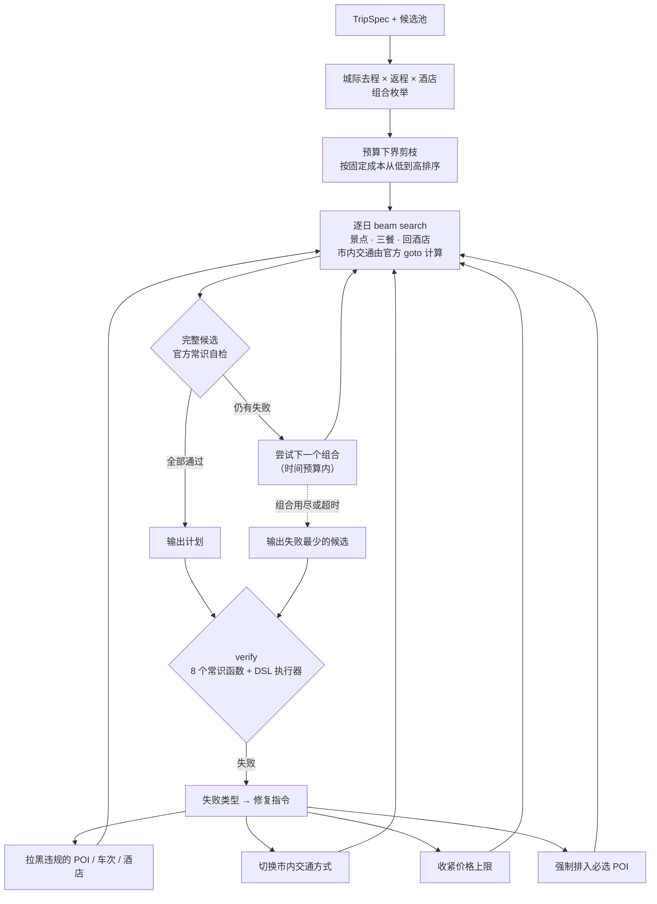

- **规划器完全确定**，不调用 LLM：先枚举城际交通和酒店组合，用预算下界剪掉不可能满足预算的组合，再逐日做 beam search 排景点和三餐。打分综合相关度、交通耗时、价格和必选约束。
- **用时间轴模拟保证常识正确**：开放时间、用餐时段、前后位置衔接、交通耗时和费用都按沙盒数据逐段推算，所以常识规则的通过率很高。dev 消融中，让 LLM 直接排时间时，几乎每份计划都违反时间顺序。
- **校验直接复用官方函数**：8 个常识检查函数加官方 DSL 执行器，与评测标准完全一致。
- **修复是结构化的**：把失败类型映射成规划指令（拉黑、换交通方式、收紧价格、强制必选），再重新规划，不靠 LLM 去"改计划"。

### 5. 分层记忆

[`tripmate_planner/memory/store.py`](tripmate_planner/memory/store.py) · [`spec/memory_merge.py`](tripmate_planner/spec/memory_merge.py)

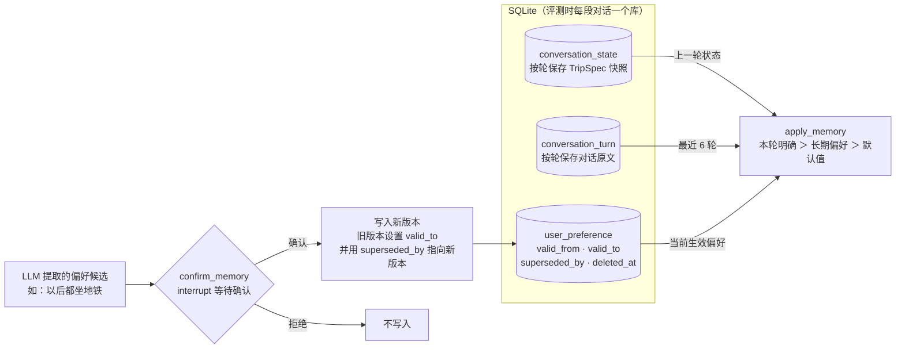

- **短期记忆（会话状态）**：每一轮都保存一份 TripSpec 快照，下一轮在此基础上增量修改，例如"改成三天""不要火锅了"。每轮一个版本，任意一轮的状态都能追溯。
- **长期记忆（用户偏好）**：跨会话生效的偏好（交通方式、忌口、房型、节奏等）只有经用户确认才写入。每条偏好都带有效期，更新时不覆盖旧值，而是形成版本链，可以回答"某个时间点生效的是哪条偏好"。同一用户同一项偏好，同一时间只有一条生效，由唯一索引保证。
- **合并规则是确定性的**：本轮明确说的优先，其次是长期偏好，最后是默认值；"偏好的菜系"只作为检索的软提示，不作为硬约束。
- **为什么用 SQLite**：单机部署、零运维，每段对话一个库，天然隔离，评测可以复现。dev 消融中，关闭会话记忆后多轮 FPR 从 98.33% 降到 0.00%，说明会话状态是多轮对话的前提。

### 6. LLM 客户端与评测工具

[`tripmate_planner/llm/`](tripmate_planner/llm/) · [`tripmate_planner/eval/`](tripmate_planner/eval/)

| 组件 | 作用 |
|---|---|
| 统一 LLM 客户端 | 所有请求都经过这个客户端：强制关闭 thinking，带重试和 schema 纠错重试；本地响应缓存支持读写、只回放和关闭三种模式 |
| 费用账本与预算 | 每次调用都记录 token 数（含 API 端缓存命中）和费用，按阶段设预算上限，超限立即停止 |
| 官方评测封装 | 直接调用官方评测函数，可对任意子集计算 DR / EPR / LPR / FPR，与官方命令行结果逐项一致 |
| 回放包 | 导出 test 运行用到的全部 LLM 响应；不调用 API 就能重跑单轮 test，并逐条比对计划和指标 |
| 统计与报告 | bootstrap 置信区间、配对 McNemar 检验、消融报告，以及最终汇总报告的自动生成 |

## 目录结构

```
tripmate_planner/
  graph.py            LangGraph 编排
  cli.py              命令行：plan（单轮）/ chat（多轮，交互确认偏好）
  web/                本地工作台：标准库 HTTP 服务、视图整理、静态页面
  spec/               TripSpec、规则解析、LLM 改写、DSL 编译、记忆合并
  retrieval/          POI 语料、分词、BM25、稠密检索、RRF、重排
  plan/               时间轴模拟、打分、beam search
  verify/ repair/     官方校验封装、修复动作
  memory/             SQLite 记忆库
  llm/                DeepSeek 客户端、响应缓存、费用账本
  eval/               基准评测、消融、多轮评测、基线复现、报告与回放
configs/planner/      冻结配置 full.json 与消融配置
data/                 数据划分、派生的检索集与多轮集
reports/              各阶段 dev 报告；最终结果在 reports/final/
tests_planner/        离线单元测试
app/                  v0 原型（已冻结）
```

## 快速开始

```bash
source scripts/planner_env.sh          # 环境变量；只从 .env 读取 LLM_API_KEY
bash scripts/setup_planner.sh          # 官方仓库、沙盒数据、查询数据集与模型（固定版本）
python scripts/check_planner_env.py

# 单轮规划
python -m tripmate_planner.cli plan --text "当前位置上海。我们两个人想去杭州玩两天，预算 3000 元，想吃杭帮菜。"
# 多轮对话（偏好写入前会逐条询问确认）
python -m tripmate_planner.cli chat --user demo --conversation c1
# 网页工作台
python -m tripmate_planner.web.server

pytest tests_planner -q                # 离线测试
python -m tripmate_planner.eval.run_benchmark --config configs/planner/full.json --split dev --run-id my-dev
python -m tripmate_planner.eval.mt_eval --config configs/planner/full.json --split dev --run-id my-mt-dev

# 不调用 API，用回放包重跑 test 并比对结果（单轮逐条一致，多轮的说明见 summary 第 7 节）
python -m tripmate_planner.eval.replay --tag <任意后缀>
python -m tripmate_planner.eval.final_summary
```

依赖版本固定在 `configs/planner/versions.json` 与 `requirements-planner.lock` 中；冻结配置及其哈希见 `reports/final/FREEZE.json`。

## v0 原型（已冻结）

`app/` 下是早期的 v0 原型："周末出游管家"，由 FastAPI、LangGraph worker、PostgreSQL 和 Redis 组成。v0 已冻结，除修复多轮 bug 的一行改动外不再修改。v0 的设计文档在 `docs/` 下，开头都有冻结标注。

审阅 v0 时发现了以下问题，这也是做 v1 的原因：

| 问题 | 位置 |
|---|---|
| 同一会话的第二条消息一定失败（`CHECKPOINT_SCOPE_MISMATCH`），多轮不可用。**已修复**：`app/agent/worker.py` 一行改动，并补了回归测试 `tests/unit/test_checkpoint_thread_key.py` | `app/agent/runs.py`；`app/agent/worker.py` |
| "向量"是哈希 n-gram 加手写同义词，不是语义模型 | `app/knowledge/embedding.py` |
| RAG 评测没有区分度：只判断"查询里是否出现标题城市名"的规则基线，recall@5 就能达到 1.0，高于系统本身的 0.9444 | `knowledge/evaluation/travelplanner-validation.json` |
| 线上知识库只有 4 个 chunk，回答是模板字符串 | `knowledge/sources/tripmate-core.json`；`app/agent/graph.py` |
| LLM 只做意图分类和槽位排序；工具选择的结果被丢弃；没有查询改写，prompt 中也没有对话历史 | `app/agent/graph.py` |
| citation_locatability 拿同一候选的哈希和自己比较，结果恒为 1.0 | `app/knowledge/index.py` |

## 数据与许可

- ChinaTravel 的代码采用 MIT 许可，数据采用 CC BY 4.0。本项目使用官方仓库 @f445e00、HF 查询数据集 @a7d893a 和沙盒数据 @885c7da，都由安装脚本下载，不随仓库分发。`data/` 下的检索集和多轮集由 ChinaTravel 派生。
- 模型：BAAI/bge-small-zh-v1.5、BAAI/bge-reranker-base，版本固定见 versions.json。

```bibtex
@inproceedings{shao2026chinatravel,
  title     = {ChinaTravel: An Open-Ended Travel Planning Benchmark with Compositional Constraint Validation for Language Agents},
  author    = {Jie-Jing Shao and Bo-Wen Zhang and Xiao-Wen Yang and Baizhi Chen and Siyu Han and Pang Jinghao and Wen-Da Wei and Guohao Cai and Zhenhua Dong and Lan-Zhe Guo and Yu-Feng Li},
  booktitle = {The Fourteenth International Conference on Learning Representations},
  year      = {2026},
  url       = {https://openreview.net/forum?id=0YRVlxY9BH}
}
```
