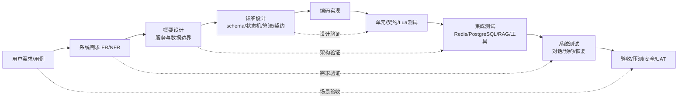
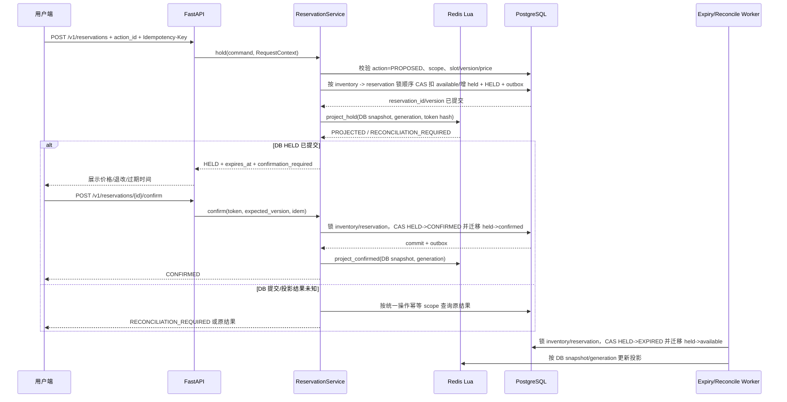
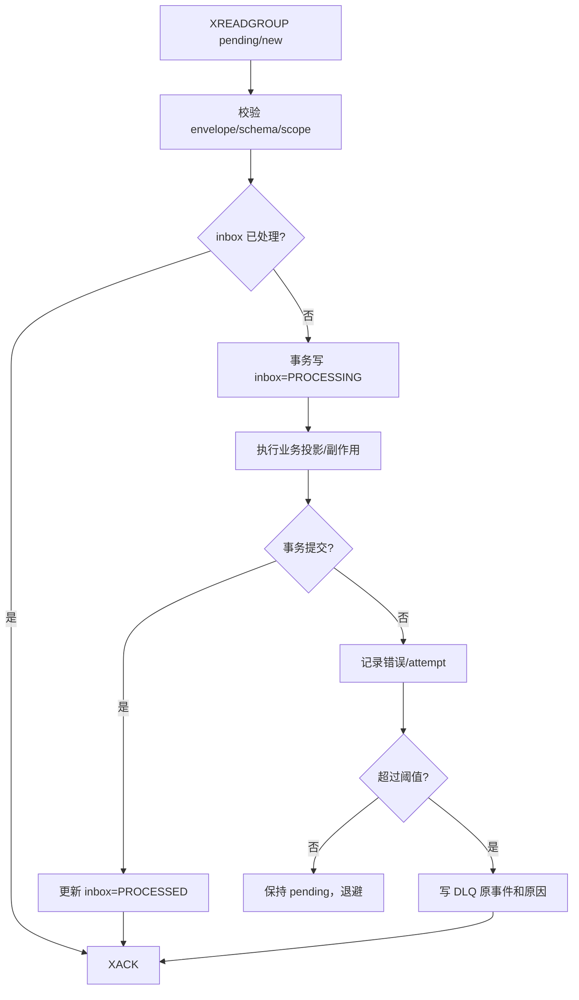
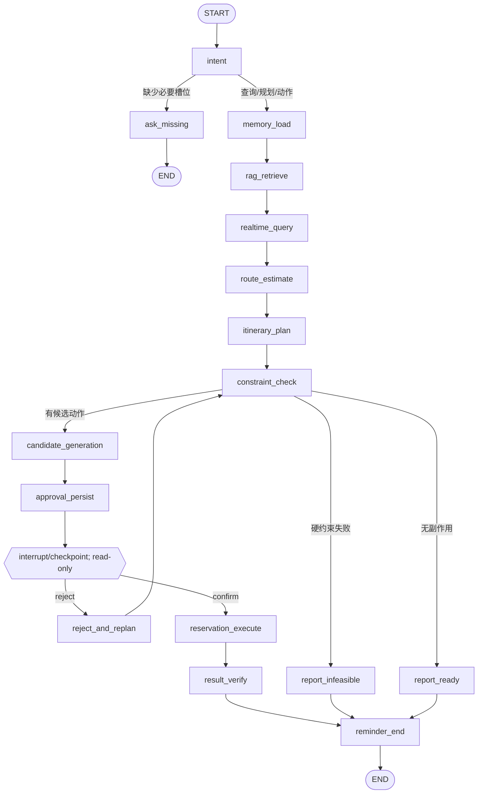
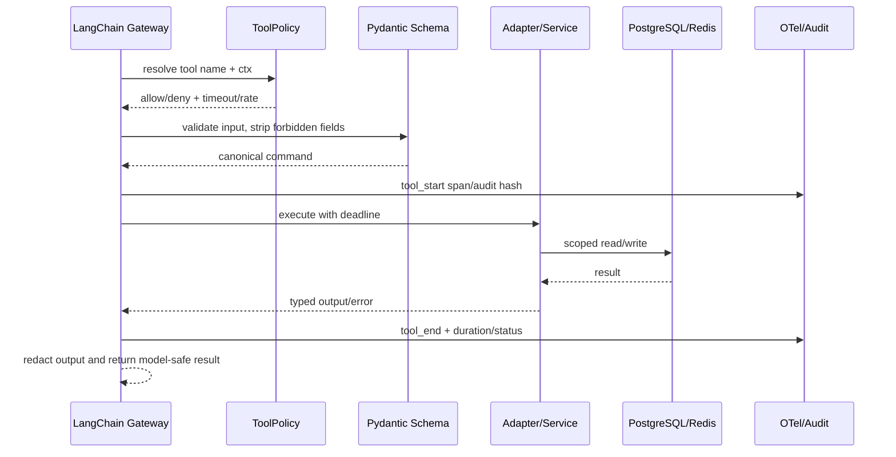

> 本文描述 v0 原型（已冻结）。v1 实施与结果见 docs/optimization-plan.md 与 reports/final/summary.md。

# TripMate 周末出游管家 Agent 详细设计说明书

| 项目 | 内容 |
|---|---|
| 项目名称 | TripMate 周末出游管家 Agent |
| 文档类型 | 详细设计说明书 |
| 文档版本 | 0.2 |
| 设计状态 | 目标详细设计；当前实现和验证状态见 `docs/implementation-notes.md` |
| 需求基线 | `docs/requirements-analysis.md` v0.2 |
| 概要设计基线 | `docs/overview-design.md` v0.2 |
| 技术栈 | Python 3.12、FastAPI、LangChain、LangGraph、Redis Stack、PostgreSQL、OpenTelemetry、Docker Compose |

## 1. 文档目的与设计边界

### 1.1 目的

本文是概要设计到编码、单元测试和集成测试之间的详细设计基线。它把服务边界、领域规则、数据库字段、Redis 序列化、Lua 投影/协调操作、LangGraph 节点、工具 schema、API 请求/响应、事件消费和故障恢复细化到可以由开发人员直接实现和由测试人员直接编写夹具的程度。

本文描述目标设计，不代表所有设计点均已编码或经过测试。项目定位是本地实习作品，重点为 Agent 设计，不要求上线；现状以 `docs/implementation-notes.md` 为准。

本文给出接口、数据结构、SQL/Lua/伪代码和测试设计，不直接实现业务源码。任何实现行为必须可以追溯到需求分析中的 `FR-*`/`NFR-*` 或概要设计章节，不能把模型输出当作库存、金额、时间冲突、权限或订单事实。

### 1.2 适用范围

详细设计覆盖：

- 用户、租户、共享 Trip、偏好和短期会话记忆；
- Attraction、ActivitySlot、Inventory、Reservation、AgentRun、AgentAction 领域对象；
- PostgreSQL 权威事务、唯一约束、版本 CAS 和迁移顺序；
- Redis String、Hash、RedisJSON、Stream、Consumer Group、Sorted Set、Lua 和 Vector Search；
- LangGraph 意图识别、记忆、RAG、实时查询、路线、规划、约束、确认、中断恢复和结果验证；
- LangChain 工具网关、参数校验、权限、超时、幂等和审计；
- FastAPI `/v1` API、SSE、错误码、request_id 和 `Idempotency-Key`；
- outbox/inbox、pending 恢复、DLQ、提醒、过期释放、库存对账和 OpenTelemetry；
- V 模型单元、契约、集成、系统、压测、故障注入、安全和用户验收测试设计。

不在本详细设计中实现真实支付、身份证件/银行卡、真实第三方生产库存、完整地图导航、签证、医疗或保险决策。首期库存由本地可复现模拟服务提供；真实供应商接入必须重新评审幂等、预占、退款、合规和 SLA。

### 1.3 设计依据和追踪规则

1. `requirements-analysis.md` 是业务需求和验收的唯一基线。
2. `overview-design.md` 是服务划分、数据边界、状态机、命名和部署的上一级设计基线。
3. 本文使用“设计 ID”标识实现单元：`DD-DOM-*`（领域）、`DD-DB-*`（数据库）、`DD-REDIS-*`、`DD-RES-*`、`DD-EVT-*`、`DD-AGT-*`、`DD-TOOL-*`、`DD-RAG-*`、`DD-API-*`、`DD-OPS-*`、`DD-TEST-*`。
4. 需求追踪矩阵位于第 19 节。测试名称代表应创建的测试，不代表测试已经通过；所有性能和质量目标须以固定环境的报告为准。

### 1.4 V 模型落点



详细设计的每个副作用边界必须有一个可断言的状态、版本、事件或审计结果；测试优先验证这些确定性结果，而不是只比较最终自然语言。

## 2. 统一技术约定

### 2.1 Python 与异步模型

- Python 3.12，业务代码使用 `async def`；FastAPI、asyncpg/SQLAlchemy Async、redis-py asyncio、HTTPX AsyncClient 统一异步调用。
- LLM、外部 HTTP、Redis 和 PostgreSQL 客户端都必须配置连接/读取/总超时；禁止在事件循环中运行同步网络或 CPU 密集操作。
- 纯领域规则（状态迁移、约束计算、金额汇总、key 编码）保持无 IO 的同步函数，便于单元测试。
- 依赖通过构造函数注入：`RequestContext`、`Clock`、`IdGenerator`、repositories、adapters 和 `Tracer` 在应用边界装配。
- 使用 `ruff`/`mypy`/`pytest` 作为 CI 门禁；具体工具版本锁定在 `pyproject.toml`，文档不预设未验证的版本号。

### 2.2 标识、时间和金额

| 项目 | 规则 |
|---|---|
| ID | UUID v4 或服务端生成的 UUID；不使用用户输入作为主键。事件、request、run、action、reservation 使用独立 ID。 |
| 时间 | 数据库使用 `timestamptz`，API 使用 RFC 3339；所有比较先转换为带时区的 UTC instant，展示时使用 Trip timezone。 |
| 日期 | 行程日期是 `date` 加 `timezone`，不得把日期直接当 UTC 午夜；开放时间跨午夜需显式标记。 |
| 金额 | Python `Decimal` + PostgreSQL `numeric(12,2)`；币种必填；金额由价格快照和确定性服务计算，LLM 不能计算后覆盖。 |
| 数量 | 非负整数；人数、容量、available/held/confirmed 都执行上限和非负校验。 |
| 版本 | 所有可变聚合使用 `version bigint`，创建为 1，每次成功状态变更加 1；CAS 失败返回 `VERSION_CONFLICT`。 |
| 内容 hash | SHA-256 十六进制小写；用于参数、文档、脱敏文本和事件一致性检查，不用于安全 token 替代。 |
| 随机 token | `secrets.token_urlsafe(32)` 生成；数据库和日志只保存 hash。HTTP 幂等键、action_id、confirmation token、hold token、event_id 分开生成和校验，任何 token 都不复用另一种标识。 |

### 2.3 RequestContext

每一次 HTTP、Agent 节点、工具调用和 Stream 消费都创建或继承以下上下文：

```python
class RequestContext(TypedDict):
    request_id: str
    trace_id: str
    tenant_id: UUID
    user_id: UUID | None
    roles: tuple[str, ...]
    run_id: UUID | None
    thread_id: str | None
    trip_id: UUID | None
    reservation_id: UUID | None
    idempotency_key: str | None
    operation: str | None
    action_id: UUID | None
    confirmation_token_hash: str | None
    hold_token_hash: str | None
    deadline: datetime
    source: Literal["http", "agent", "worker", "replay"]
```

上下文从认证令牌、路径资源和服务端状态获得。模型输入中不得提供或覆盖 `tenant_id`、`user_id`、roles、权限、deadline、token、价格或库存版本。worker 消费事件时从事件 envelope 恢复 scope，再与数据库聚合的租户字段交叉校验。

### 2.4 统一错误模型

```python
class ErrorBody(BaseModel):
    code: str
    message: str
    retryable: bool
    details: dict[str, object] = {}

class ErrorEnvelope(BaseModel):
    request_id: str
    trace_id: str
    error: ErrorBody
```

标准错误码分组：

| 分组 | 错误码 | HTTP | 可重试 |
|---|---|---:|---|
| 输入/权限 | `INVALID_ARGUMENT`、`MISSING_FIELD`、`UNAUTHORIZED`、`TENANT_SCOPE_DENIED`、`TOOL_NOT_ALLOWED` | 400/401/403 | 否 |
| 资源/状态 | `NOT_FOUND`、`VERSION_CONFLICT`、`RESERVATION_STATE_CONFLICT`、`TRIP_INFEASIBLE`、`THREAD_BUSY`、`STALE_LEASE` | 404/409/422 | 通常否，需重新读取/排队 |
| 库存/幂等 | `INVENTORY_NOT_ENOUGH`、`HOLD_EXPIRED`、`IDEMPOTENCY_REPLAY`、`DUPLICATE_ACTION` | 409/422 | 按业务决定 |
| 依赖 | `DEPENDENCY_TIMEOUT`、`DEPENDENCY_UNAVAILABLE`、`LLM_TIMEOUT`、`RAG_NOT_READY` | 502/503 | 是，带退避 |
| 保护 | `RATE_LIMITED`、`PAYLOAD_TOO_LARGE`、`CHECKPOINT_SCHEMA_MISMATCH` | 429/413/409 | 限流按 Retry-After |
| 系统 | `INTERNAL_ERROR`、`RECONCILIATION_REQUIRED`、`DLQ_REPLAY_REQUIRED` | 500/503 | 由服务策略决定 |

异常映射在 `app/api/errors.py` 集中完成，领域服务只抛出带 code/details 的 typed exception；不把堆栈、SQL、外部 URL、prompt 或 secret 返回客户端。

## 3. 详细模块边界与依赖规则

### 3.1 分层规则

```text
api -> application -> domain
api -> schemas/security/observability
application -> repositories/ports
infrastructure(adapters) -> ports
agent -> application/tools/checkpoint
workers/events -> application/repositories
domain -X-> FastAPI/LangChain/Redis/PostgreSQL
```

- `domain` 只依赖标准库和领域 value objects。
- `application` 定义 use case 和事务顺序，依赖 port，不直接构造 Redis/PostgreSQL 客户端。
- `persistence`、`tools/adapters`、`events` 实现 port；不能反向调用 LangGraph 节点。
- `agent` 可以请求只读工具或候选动作工具；确认后的副作用必须经过 `application`/`reservation` 服务。
- `api` 只做协议转换和认证依赖，不在路由中直接操作数据库表或 Redis key。

### 3.2 关键接口（port）

```python
class TripRepository(Protocol):
    async def get_for_read(self, ctx: RequestContext, trip_id: UUID) -> Trip: ...
    async def create_draft(self, ctx: RequestContext, command: CreateTrip) -> Trip: ...
    async def update_with_cas(self, ctx: RequestContext, trip: Trip, expected_version: int) -> Trip: ...

class ReservationService(Protocol):
    async def hold(self, ctx: RequestContext, command: HoldReservation) -> ReservationResult: ...
    async def confirm(self, ctx: RequestContext, command: ConfirmReservation) -> ReservationResult: ...
    async def cancel(self, ctx: RequestContext, command: CancelReservation) -> ReservationResult: ...
    async def expire(self, ctx: RequestContext, reservation_id: UUID, token_hash: str) -> None: ...

class KnowledgeRetriever(Protocol):
    async def search(self, ctx: RequestContext, query: KnowledgeQuery) -> CitationResult: ...

class CheckpointStore(Protocol):
    async def put(self, ctx: RequestContext, thread_id: str, state: AgentState) -> str: ...
    async def get_latest(self, ctx: RequestContext, thread_id: str) -> AgentState | None: ...

class EventPublisher(Protocol):
    async def publish_outbox_batch(self, limit: int) -> int: ...
```

port 方法不接受模型原始 JSON；先在 schema 层解析，再转为 command/value object。返回 domain result，API 层负责序列化。

### 3.3 事务边界

| 用例 | 一个 PostgreSQL 事务内的操作 | 事务外操作 |
|---|---|---|
| 创建 Trip | tenant/member 校验、Trip、初始 item、outbox、audit | Agent 规划、SSE |
| 保存偏好 | scope 校验、旧版本关闭/软删除、新版本写入、audit、outbox | Redis memory 更新、向量 tombstone |
| hold | 操作幂等读取；按 `inventory -> reservation` 锁顺序更新 PostgreSQL `available/held`、写 `reservation=HELD`、outbox 和 expiry 任务；事务提交后更新 Redis 投影 | SSE、通知、Redis 投影失败后的 reconciliation |
| confirm | reservation/action/confirmation 校验、inventory CAS、reservation 状态、trip_item、outbox、audit | Stream 发布、提醒 ZSet |
| cancel | 状态/退改校验、reservation CAS、inventory 回收、outbox、audit | 通知和报表 |
| 消费事件 | claim/更新 inbox lease+fencing、业务投影/副作用、audit、inbox processed | `XACK` |
| 创建/恢复 Run | `agent_run`、`agent.run.requested.v1` outbox、消息幂等记录 | worker lease、Graph 执行、SSE |
| 知识发布 | manifest、chunk 元数据、active alias 的唯一切换、audit | 向量写入、外部抓取 |

任何跨 Redis/PostgreSQL 的操作都必须有补偿状态和对账入口；不能声称分布式“恰好一次”。

## 4. 领域详细设计

### 4.1 枚举和状态值

实现使用字符串枚举，并在 PostgreSQL 建立 CHECK 或 enum migration：

```python
TripStatus = Literal["DRAFT", "PLANNING", "READY", "INFEASIBLE", "CONFIRMED", "COMPLETED", "CANCELLED"]
ReservationStatus = Literal["AVAILABLE", "HELD", "CONFIRMED", "COMPLETED", "CANCELLED", "EXPIRED", "WAITLISTED"]
RunStatus = Literal["RUNNING", "WAITING_CONFIRMATION", "COMPLETED", "FAILED", "CANCELLED"]
ActionStatus = Literal["PROPOSED", "CONFIRMED", "REJECTED", "EXECUTED", "FAILED"]
SlotStatus = Literal["ACTIVE", "SOLD_OUT", "CLOSED"]
InventoryStatus = Literal["ACTIVE", "PAUSED", "RECONCILING"]
ConstraintState = Literal["PASS", "FAIL", "UNKNOWN", "NOT_EVALUATED"]
```

### 4.2 状态迁移表

| 聚合 | 当前 | 事件/命令 | 守卫 | 下一状态 |
|---|---|---|---|---|
| Trip | `DRAFT` | `start_planning` | 输入完整，owner 有权限 | `PLANNING` |
| Trip | `PLANNING` | `plan_feasible` | 所有硬约束 PASS | `READY` |
| Trip | `PLANNING` | `plan_infeasible` | 至少一个硬约束 FAIL/UNKNOWN | `INFEASIBLE` |
| Trip | `READY` | `confirm_trip` | 版本匹配，方案仍有效 | `CONFIRMED` |
| Trip | `CONFIRMED` | `complete_trip` | 日期已过且无未完成预约 | `COMPLETED` |
| Trip | `READY/CONFIRMED` | `cancel_trip` | owner/admin 且无不可取消项 | `CANCELLED` |
| Reservation | `AVAILABLE` | `hold` | slot active、数量足、版本匹配 | `HELD` |
| Reservation | `HELD` | `confirm` | token、action、版本、确认记录有效 | `CONFIRMED` |
| Reservation | `HELD` | `expire` | token 匹配且 `now >= hold_expires_at` | `EXPIRED` |
| Reservation | `CONFIRMED` | `cancel` | 退改政策允许、版本匹配 | `CANCELLED` |
| Reservation | `CONFIRMED` | `complete` | 活动结束且服务已核销 | `COMPLETED` |
| Reservation | `AVAILABLE` | `waitlist` | 不足且用户选择候补 | `WAITLISTED` |
| Reservation | `WAITLISTED` | `promote` | 新库存足且需再次确认的规则满足 | `CONFIRMED` |
| AgentRun | `RUNNING` | `approval_required` | 有副作用 action | `WAITING_CONFIRMATION` |
| AgentRun | `WAITING_CONFIRMATION` | `resume_confirm` | action hash、用户 scope、版本有效 | `RUNNING` |
| AgentRun | `WAITING_CONFIRMATION` | `resume_reject` | action 属于当前 run | `RUNNING` |
| AgentRun | `RUNNING` | `finish` | result verified | `COMPLETED` |
| AgentRun | `RUNNING` | `fail/cancel` | 依赖失败或用户取消 | `FAILED/CANCELLED` |

状态转换函数只接收当前聚合、命令和 `expected_version`，返回新聚合及 domain event；非法边抛出 `RESERVATION_STATE_CONFLICT`，不得由 LLM 自动修正。

预约表只在请求通过 hold 后创建 `HELD` 记录，状态图中的 `AVAILABLE` 表示 activity slot/inventory 的可售条件，不是 reservation 表中的持久化行。库存不足时可以创建 `WAITLISTED` 记录，但它不占用 `available/held/confirmed` 数量。

### 4.3 领域 value objects

```python
class Money(BaseModel):
    amount: Decimal = Field(ge=Decimal("0"), decimal_places=2)
    currency: constr(pattern=r"^[A-Z]{3}$")

class CancellationRule(BaseModel):
    cutoff_at: datetime
    refund_percent: Decimal = Field(ge=Decimal("0"), le=Decimal("100"))
    reason_code: str

class CancellationPolicySnapshot(BaseModel):
    policy_id: str
    policy_version: str
    timezone: str
    effective_from: datetime
    effective_to: datetime | None
    rules: tuple[CancellationRule, ...]
    source: Literal["catalog", "operator"]

class CancellationDecision(BaseModel):
    allowed: bool
    refund_percent: Decimal = Field(ge=Decimal("0"), le=Decimal("100"))
    reason_code: str
    policy_version: str

class TimeWindow(BaseModel):
    start_at: datetime
    end_at: datetime
    timezone: str

    @model_validator(mode="after")
    def valid_order(self) -> "TimeWindow":
        if self.end_at <= self.start_at:
            raise ValueError("end_at must be after start_at")
        return self

class Scope(BaseModel):
    tenant_id: UUID
    user_id: UUID | None
    trip_id: UUID | None

class Versioned[T](BaseModel):
    id: UUID
    version: int = Field(ge=1)
```

示例中的泛型和装饰器表达设计意图，实际代码按 Python 3.12/Pydantic v2 语法调整；所有 schema 需覆盖边界值、时间区间、币种、长度和 scope 校验。

### 4.4 硬约束算法

约束评估器接收 `TripPlan`、`TripInput`、实时 facts、已确认预约和当前时间，按固定顺序执行：

```text
1. 校验日期、timezone、party_size、budget_limit 的输入范围。
2. 对每个 item 验证 start < end，且属于 Trip 日期范围。
3. 查询/读取开放时间事实；没有实时结果则 HARD=UNKNOWN。
4. 按开始时间排序，检查 item overlap 和 route arrival >= next.start。
5. 对每个需预约 item 校验 inventory.available >= party_size，版本必须记录。
6. 汇总 deterministic price snapshot；total_cost > budget_limit 则 HARD=FAIL。
7. 检查已确认 reservation 的时间和 slot 不被移除或覆盖。
8. 计算软偏好得分（步行、室内比例、饮食等），只影响排序，不覆盖硬约束。
9. 任一硬约束 FAIL/UNKNOWN => feasible=false，状态 INFEASIBLE。
```

天气超时可以使天气相关软偏好变为 `UNKNOWN`；如果用户把天气设为硬约束，则方案必须是 `INFEASIBLE` 或要求用户确认继续。预算、库存、订单状态和时间冲突不允许由模型重写。

### 4.5 TripPlan 规范

```python
class ActivityPlanItem(BaseModel):
    sequence_no: int = Field(ge=1)
    attraction_id: UUID | None
    slot_id: UUID | None
    title: str
    window: TimeWindow
    cost: Money
    route_from_previous_minutes: int | None = Field(default=None, ge=0)
    indoor: bool | None
    reservation_required: bool
    inventory_version: int | None
    activity_version: int | None
    constraint_status: ConstraintState
    citation_ids: list[str]

class TripPlan(BaseModel):
    trip_id: UUID | None
    destination: str
    date: date
    timezone: str
    party_size: int = Field(gt=0)
    items: list[ActivityPlanItem]
    total_cost: Money
    hard_constraints: list[dict[str, object]]
    soft_preferences: list[dict[str, object]]
    feasible: bool
    citations: list["Citation"]
    generated_at: datetime
    planner_version: str
```

Agent 只能填充景点描述、排序理由、引用和解释字段；`cost`、route minutes、inventory version 和 constraint status 必须来自工具/确定性 evaluator。

## 5. PostgreSQL 详细设计

### 5.1 Schema、迁移和租户隔离

数据库使用 `tripmate` schema；迁移文件按 `V001__extensions.sql`、`V002__tenant_user.sql`、`V003__catalog.sql`、`V004__trip.sql`、`V005__inventory_reservation.sql`、`V006__agent_memory.sql`、`V007__knowledge.sql`、`V008__event_audit.sql` 编号。每次 migration 必须可前向执行、在 CI 的空库和上一版本 fixture 上执行，并提供必要的回滚/补偿说明。

推荐启用 `citext`、`pgcrypto`；PostGIS 仅在部署决策确认后启用。租户过滤在 repository 中强制执行；如果生产环境启用 RLS，则每个连接事务设置受验证的 `app.tenant_id`，不能接受客户端直接设置的任意值。

```sql
CREATE SCHEMA IF NOT EXISTS tripmate;

CREATE TABLE tripmate.tenant (
    tenant_id uuid PRIMARY KEY DEFAULT gen_random_uuid(),
    name text NOT NULL UNIQUE,
    status text NOT NULL CHECK (status IN ('ACTIVE','SUSPENDED','DELETED')),
    version bigint NOT NULL DEFAULT 1 CHECK (version > 0),
    created_at timestamptz NOT NULL DEFAULT now(),
    updated_at timestamptz NOT NULL DEFAULT now()
);

CREATE TABLE tripmate.user_profile (
    user_id uuid PRIMARY KEY DEFAULT gen_random_uuid(),
    tenant_id uuid NOT NULL REFERENCES tripmate.tenant(tenant_id),
    display_name text NOT NULL CHECK (length(display_name) <= 120),
    locale text NOT NULL DEFAULT 'zh-CN',
    timezone text NOT NULL DEFAULT 'Asia/Shanghai',
    redacted_contact jsonb NOT NULL DEFAULT '{}'::jsonb,
    status text NOT NULL CHECK (status IN ('ACTIVE','DISABLED','DELETED')),
    version bigint NOT NULL DEFAULT 1 CHECK (version > 0),
    created_at timestamptz NOT NULL DEFAULT now(),
    updated_at timestamptz NOT NULL DEFAULT now(),
    UNIQUE (tenant_id, user_id)
);
CREATE INDEX user_profile_scope_idx
    ON tripmate.user_profile (tenant_id, status, updated_at);
```

示例 SQL 表达字段和约束方向，实际 migration 需要为所有表补充审计触发器、updated_at 维护方式、外键删除策略和数据保留策略。默认外键使用 `ON DELETE RESTRICT`；用户删除通过脱敏/软删除完成，防止历史预约失去审计主体。

### 5.2 业务表字段设计

#### 5.2.1 Trip 和目录

```sql
CREATE TABLE tripmate.attraction (
    attraction_id uuid PRIMARY KEY DEFAULT gen_random_uuid(),
    tenant_id uuid NOT NULL REFERENCES tripmate.tenant(tenant_id),
    external_source text NOT NULL,
    external_id text NOT NULL,
    city text NOT NULL,
    name text NOT NULL,
    category text NOT NULL,
    latitude numeric(9,6),
    longitude numeric(9,6),
    description text,
    source_version text NOT NULL,
    status text NOT NULL CHECK (status IN ('ACTIVE','HIDDEN','DELETED')),
    version bigint NOT NULL DEFAULT 1,
    created_at timestamptz NOT NULL DEFAULT now(),
    updated_at timestamptz NOT NULL DEFAULT now(),
    UNIQUE (tenant_id, attraction_id),
    UNIQUE (tenant_id, external_source, external_id)
);

CREATE TABLE tripmate.activity_slot (
    slot_id uuid PRIMARY KEY DEFAULT gen_random_uuid(),
    tenant_id uuid NOT NULL REFERENCES tripmate.tenant(tenant_id),
    attraction_id uuid NOT NULL,
    external_id text,
    start_at timestamptz NOT NULL,
    end_at timestamptz NOT NULL,
    capacity integer NOT NULL CHECK (capacity > 0),
    price numeric(12,2) NOT NULL CHECK (price >= 0),
    currency char(3) NOT NULL,
    activity_version bigint NOT NULL DEFAULT 1,
    status text NOT NULL CHECK (status IN ('ACTIVE','SOLD_OUT','CLOSED')),
    version bigint NOT NULL DEFAULT 1,
    created_at timestamptz NOT NULL DEFAULT now(),
    updated_at timestamptz NOT NULL DEFAULT now(),
    CHECK (end_at > start_at),
    UNIQUE (tenant_id, slot_id),
    UNIQUE (tenant_id, external_id, start_at)
);
ALTER TABLE tripmate.activity_slot
    ADD CONSTRAINT activity_slot_attraction_scope_fk
    FOREIGN KEY (tenant_id, attraction_id)
    REFERENCES tripmate.attraction (tenant_id, attraction_id);

CREATE TABLE tripmate.trip (
    trip_id uuid PRIMARY KEY DEFAULT gen_random_uuid(),
    tenant_id uuid NOT NULL REFERENCES tripmate.tenant(tenant_id),
    owner_user_id uuid NOT NULL,
    destination text NOT NULL,
    start_date date NOT NULL,
    end_date date NOT NULL,
    timezone text NOT NULL,
    party_size integer NOT NULL CHECK (party_size > 0 AND party_size <= 100),
    budget_limit numeric(12,2) CHECK (budget_limit >= 0),
    currency char(3),
    companion_type text,
    status text NOT NULL CHECK (status IN ('DRAFT','PLANNING','READY','INFEASIBLE','CONFIRMED','COMPLETED','CANCELLED')),
    version bigint NOT NULL DEFAULT 1 CHECK (version > 0),
    created_at timestamptz NOT NULL DEFAULT now(),
    updated_at timestamptz NOT NULL DEFAULT now(),
    CHECK (end_date >= start_date),
    UNIQUE (tenant_id, trip_id),
    FOREIGN KEY (tenant_id, owner_user_id) REFERENCES tripmate.user_profile(tenant_id, user_id)
);

CREATE TABLE tripmate.trip_member (
    tenant_id uuid NOT NULL REFERENCES tripmate.tenant(tenant_id),
    trip_id uuid NOT NULL,
    user_id uuid NOT NULL,
    role text NOT NULL CHECK (role IN ('OWNER','EDITOR','VIEWER')),
    status text NOT NULL CHECK (status IN ('INVITED','ACTIVE','REMOVED')),
    created_at timestamptz NOT NULL DEFAULT now(),
    PRIMARY KEY (tenant_id, trip_id, user_id),
    FOREIGN KEY (tenant_id, trip_id) REFERENCES tripmate.trip(tenant_id, trip_id),
    FOREIGN KEY (tenant_id, user_id) REFERENCES tripmate.user_profile(tenant_id, user_id)
);

CREATE TABLE tripmate.trip_item (
    trip_item_id uuid PRIMARY KEY DEFAULT gen_random_uuid(),
    tenant_id uuid NOT NULL REFERENCES tripmate.tenant(tenant_id),
    trip_id uuid NOT NULL,
    sequence_no integer NOT NULL CHECK (sequence_no > 0),
    attraction_id uuid,
    slot_id uuid,
    start_at timestamptz NOT NULL,
    end_at timestamptz NOT NULL,
    cost numeric(12,2) NOT NULL DEFAULT 0 CHECK (cost >= 0),
    currency char(3),
    constraint_status text NOT NULL CHECK (constraint_status IN ('PASS','FAIL','UNKNOWN','NOT_EVALUATED')),
    reservation_id uuid,
    version bigint NOT NULL DEFAULT 1,
    created_at timestamptz NOT NULL DEFAULT now(),
    updated_at timestamptz NOT NULL DEFAULT now(),
    CHECK (end_at > start_at),
    UNIQUE (tenant_id, trip_id, sequence_no),
    FOREIGN KEY (tenant_id, trip_id) REFERENCES tripmate.trip(tenant_id, trip_id),
    FOREIGN KEY (tenant_id, attraction_id) REFERENCES tripmate.attraction(tenant_id, attraction_id),
    FOREIGN KEY (tenant_id, slot_id) REFERENCES tripmate.activity_slot(tenant_id, slot_id)
);
```

`trip_item.reservation_id` 在 reservation 表创建后通过后置 `ALTER TABLE` 添加 `FOREIGN KEY (tenant_id, reservation_id) REFERENCES tripmate.reservation(tenant_id, reservation_id)`；为允许行程草案没有 slot，`attraction_id`/`slot_id` 不能同时为空的规则在应用 domain validator 中执行，并在 migration 中按项目选定的草案语义补充 CHECK。

所有被复合外键引用的聚合都必须先建立租户复合唯一键：`(tenant_id, attraction_id)`、`(tenant_id, slot_id)`、`(tenant_id, trip_id)`、`(tenant_id, user_id)`。下面的 SQL 片段省略的索引不得省略这些约束；单列 UUID 外键一律禁止进入 migration。

#### 5.2.2 库存和预约

```sql
CREATE TABLE tripmate.inventory (
    inventory_id uuid PRIMARY KEY DEFAULT gen_random_uuid(),
    tenant_id uuid NOT NULL REFERENCES tripmate.tenant(tenant_id),
    slot_id uuid NOT NULL,
    total_quantity integer NOT NULL CHECK (total_quantity >= 0),
    available_quantity integer NOT NULL CHECK (available_quantity >= 0),
    held_quantity integer NOT NULL DEFAULT 0 CHECK (held_quantity >= 0),
    confirmed_quantity integer NOT NULL DEFAULT 0 CHECK (confirmed_quantity >= 0),
    status text NOT NULL CHECK (status IN ('ACTIVE','PAUSED','RECONCILING')),
    version bigint NOT NULL DEFAULT 1 CHECK (version > 0),
    created_at timestamptz NOT NULL DEFAULT now(),
    updated_at timestamptz NOT NULL DEFAULT now(),
    CHECK (available_quantity + held_quantity + confirmed_quantity = total_quantity),
    UNIQUE (tenant_id, inventory_id),
    UNIQUE (tenant_id, slot_id),
    FOREIGN KEY (tenant_id, slot_id) REFERENCES tripmate.activity_slot(tenant_id, slot_id)
);

CREATE TABLE tripmate.reservation (
    reservation_id uuid PRIMARY KEY DEFAULT gen_random_uuid(),
    tenant_id uuid NOT NULL REFERENCES tripmate.tenant(tenant_id),
    trip_id uuid NOT NULL,
    user_id uuid NOT NULL,
    slot_id uuid NOT NULL,
    quantity integer NOT NULL CHECK (quantity > 0),
    price_snapshot numeric(12,2) NOT NULL CHECK (price_snapshot >= 0),
    currency char(3) NOT NULL,
    status text NOT NULL CHECK (status IN ('HELD','CONFIRMED','COMPLETED','CANCELLED','EXPIRED','WAITLISTED')),
    hold_token_hash char(64),
    hold_expires_at timestamptz,
    route text NOT NULL,
    operation text NOT NULL,
    idempotency_key text NOT NULL,
    request_hash char(64) NOT NULL,
    parameters_hash char(64) NOT NULL,
    activity_version bigint NOT NULL,
    inventory_version bigint NOT NULL,
    policy_version text NOT NULL,
    policy_snapshot jsonb NOT NULL,
    version bigint NOT NULL DEFAULT 1 CHECK (version > 0),
    created_at timestamptz NOT NULL DEFAULT now(),
    updated_at timestamptz NOT NULL DEFAULT now(),
    UNIQUE (tenant_id, reservation_id),
    UNIQUE (tenant_id, user_id, route, operation, idempotency_key),
    FOREIGN KEY (tenant_id, trip_id) REFERENCES tripmate.trip(tenant_id, trip_id),
    FOREIGN KEY (tenant_id, user_id) REFERENCES tripmate.user_profile(tenant_id, user_id),
    FOREIGN KEY (tenant_id, slot_id) REFERENCES tripmate.activity_slot(tenant_id, slot_id)
);
CREATE INDEX reservation_expiry_idx
    ON tripmate.reservation (tenant_id, status, hold_expires_at)
    WHERE status = 'HELD';
CREATE INDEX reservation_slot_status_idx
    ON tripmate.reservation (tenant_id, slot_id, status);

ALTER TABLE tripmate.trip_item
    ADD CONSTRAINT trip_item_reservation_scope_fk
    FOREIGN KEY (tenant_id, reservation_id)
    REFERENCES tripmate.reservation(tenant_id, reservation_id);

CREATE TABLE tripmate.reservation_confirmation (
    confirmation_id uuid PRIMARY KEY DEFAULT gen_random_uuid(),
    tenant_id uuid NOT NULL REFERENCES tripmate.tenant(tenant_id),
    reservation_id uuid NOT NULL,
    action_id uuid NOT NULL,
    confirmed_by uuid NOT NULL,
    confirmed_at timestamptz NOT NULL,
    confirmation_hash char(64) NOT NULL,
    expires_at timestamptz NOT NULL,
    consumed_at timestamptz,
    status text NOT NULL CHECK (status IN ('CONSUMED','REJECTED','EXPIRED','REVOKED')),
    version bigint NOT NULL DEFAULT 1 CHECK (version > 0),
    UNIQUE (tenant_id, action_id),
    FOREIGN KEY (tenant_id, reservation_id) REFERENCES tripmate.reservation(tenant_id, reservation_id),
    FOREIGN KEY (tenant_id, confirmed_by) REFERENCES tripmate.user_profile(tenant_id, user_id),
    CHECK (expires_at >= confirmed_at),
    CHECK (consumed_at IS NOT NULL)
);

CREATE TABLE tripmate.idempotency_record (
    tenant_id uuid NOT NULL REFERENCES tripmate.tenant(tenant_id),
    user_id uuid NOT NULL,
    route text NOT NULL,
    operation text NOT NULL,
    key_hash char(64) NOT NULL,
    request_hash char(64) NOT NULL,
    http_status smallint NOT NULL,
    result_json jsonb NOT NULL,
    resource_type text,
    resource_id uuid,
    expires_at timestamptz NOT NULL,
    created_at timestamptz NOT NULL DEFAULT now(),
    updated_at timestamptz NOT NULL DEFAULT now(),
    PRIMARY KEY (tenant_id, user_id, route, operation, key_hash),
    FOREIGN KEY (tenant_id, user_id) REFERENCES tripmate.user_profile(tenant_id, user_id)
);
CREATE INDEX idempotency_expiry_idx
    ON tripmate.idempotency_record (expires_at);
```

数据库 CHECK 约束防止单行负数并强制 `available + held + confirmed = total`。hold/confirm/expire/cancel 都在同一 PostgreSQL 事务中按 `inventory -> reservation` 锁顺序完成数量迁移、状态 CAS、版本递增和 outbox 写入；Redis hold 与 stock 是事务提交后的可重建投影。任何跨 Redis/PostgreSQL 的未知结果都写 reconciliation 状态，不以 Redis 结果覆盖数据库事实。

#### 5.2.3 Agent、记忆、知识和事件

```sql
CREATE TABLE tripmate.agent_run (
    run_id uuid PRIMARY KEY DEFAULT gen_random_uuid(),
    tenant_id uuid NOT NULL REFERENCES tripmate.tenant(tenant_id),
    user_id uuid NOT NULL,
    trip_id uuid,
    thread_id text NOT NULL,
    intent text NOT NULL,
    status text NOT NULL CHECK (status IN ('RUNNING','WAITING_CONFIRMATION','COMPLETED','FAILED','CANCELLED')),
    checkpoint_ref text,
    awaiting_action_id uuid,
    lease_owner text,
    lease_until timestamptz,
    fencing_version bigint NOT NULL DEFAULT 0,
    requested_event_id uuid,
    last_error_code text,
    version bigint NOT NULL DEFAULT 1,
    created_at timestamptz NOT NULL DEFAULT now(),
    updated_at timestamptz NOT NULL DEFAULT now(),
    UNIQUE (tenant_id, run_id),
    UNIQUE (tenant_id, requested_event_id),
    FOREIGN KEY (tenant_id, user_id) REFERENCES tripmate.user_profile(tenant_id, user_id),
    FOREIGN KEY (tenant_id, trip_id) REFERENCES tripmate.trip(tenant_id, trip_id)
);
CREATE INDEX agent_run_thread_idx ON tripmate.agent_run (tenant_id, thread_id, created_at DESC);
CREATE UNIQUE INDEX agent_run_active_thread_uq
    ON tripmate.agent_run (tenant_id, thread_id)
    WHERE status IN ('RUNNING', 'WAITING_CONFIRMATION');

CREATE TABLE tripmate.agent_action (
    action_id uuid PRIMARY KEY DEFAULT gen_random_uuid(),
    tenant_id uuid NOT NULL REFERENCES tripmate.tenant(tenant_id),
    run_id uuid NOT NULL,
    action_type text NOT NULL,
    parameters_hash char(64) NOT NULL,
    status text NOT NULL CHECK (status IN ('PROPOSED','CONFIRMED','REJECTED','EXECUTED','FAILED')),
    action_fingerprint char(64) NOT NULL,
    idempotency_key text,
    request_hash char(64),
    result_json jsonb,
    version bigint NOT NULL DEFAULT 1,
    created_at timestamptz NOT NULL DEFAULT now(),
    updated_at timestamptz NOT NULL DEFAULT now(),
    UNIQUE (tenant_id, run_id, action_id),
    UNIQUE (tenant_id, run_id, action_fingerprint),
    UNIQUE (tenant_id, action_id),
    FOREIGN KEY (tenant_id, run_id) REFERENCES tripmate.agent_run(tenant_id, run_id)
);

CREATE TABLE tripmate.action_confirmation (
    confirmation_id uuid PRIMARY KEY DEFAULT gen_random_uuid(),
    tenant_id uuid NOT NULL REFERENCES tripmate.tenant(tenant_id),
    action_id uuid NOT NULL,
    user_id uuid NOT NULL,
    token_hash char(64) NOT NULL,
    parameters_hash char(64) NOT NULL,
    issued_at timestamptz NOT NULL,
    expires_at timestamptz NOT NULL,
    consumed_at timestamptz,
    status text NOT NULL CHECK (status IN ('ISSUED','CONSUMED','REJECTED','EXPIRED','REVOKED')),
    version bigint NOT NULL DEFAULT 1 CHECK (version > 0),
    UNIQUE (tenant_id, confirmation_id),
    UNIQUE (tenant_id, action_id),
    FOREIGN KEY (tenant_id, action_id) REFERENCES tripmate.agent_action(tenant_id, action_id),
    FOREIGN KEY (tenant_id, user_id) REFERENCES tripmate.user_profile(tenant_id, user_id),
    CHECK (expires_at > issued_at),
    CHECK ((status = 'ISSUED' AND consumed_at IS NULL) OR (status <> 'ISSUED' AND consumed_at IS NOT NULL))
);
CREATE INDEX action_confirmation_expiry_idx
    ON tripmate.action_confirmation (tenant_id, status, expires_at)
    WHERE status = 'ISSUED';

ALTER TABLE tripmate.agent_run
    ADD CONSTRAINT agent_run_awaiting_action_fk
    FOREIGN KEY (tenant_id, run_id, awaiting_action_id)
    REFERENCES tripmate.agent_action(tenant_id, run_id, action_id);

ALTER TABLE tripmate.reservation_confirmation
    ADD CONSTRAINT reservation_confirmation_action_fk
    FOREIGN KEY (tenant_id, action_id)
    REFERENCES tripmate.agent_action(tenant_id, action_id);

CREATE TABLE tripmate.inbox_event (
    event_id uuid NOT NULL,
    consumer text NOT NULL,
    tenant_id uuid NOT NULL REFERENCES tripmate.tenant(tenant_id),
    status text NOT NULL CHECK (status IN ('RECEIVED','PROCESSING','PROCESSED','DLQ')),
    attempt_count integer NOT NULL DEFAULT 0,
    lease_owner text,
    lease_until timestamptz,
    claim_token uuid,
    fencing_version bigint NOT NULL DEFAULT 0,
    payload_hash char(64) NOT NULL,
    error_code text,
    processed_at timestamptz,
    updated_at timestamptz NOT NULL DEFAULT now(),
    PRIMARY KEY (event_id, consumer)
);

CREATE TABLE tripmate.outbox_event (
    event_id uuid PRIMARY KEY,
    tenant_id uuid NOT NULL REFERENCES tripmate.tenant(tenant_id),
    aggregate_type text NOT NULL,
    aggregate_id uuid NOT NULL,
    aggregate_version bigint NOT NULL,
    event_type text NOT NULL,
    payload jsonb NOT NULL,
    status text NOT NULL CHECK (status IN ('PENDING','PUBLISHED','FAILED')),
    attempts integer NOT NULL DEFAULT 0,
    replay_until timestamptz,
    published_stream text,
    published_stream_id text,
    next_attempt_at timestamptz NOT NULL DEFAULT now(),
    published_at timestamptz,
    created_at timestamptz NOT NULL DEFAULT now()
);
CREATE INDEX outbox_dispatch_idx
    ON tripmate.outbox_event (status, next_attempt_at, created_at);

CREATE TABLE tripmate.outbox_replay_cursor (
    tenant_id uuid NOT NULL REFERENCES tripmate.tenant(tenant_id),
    stream_name text NOT NULL,
    cursor_created_at timestamptz NOT NULL,
    cursor_event_id uuid NOT NULL,
    updated_at timestamptz NOT NULL DEFAULT now(),
    PRIMARY KEY (tenant_id, stream_name)
);

CREATE TABLE tripmate.stream_group_watermark (
    tenant_id uuid NOT NULL REFERENCES tripmate.tenant(tenant_id),
    stream_name text NOT NULL,
    group_name text NOT NULL,
    safe_message_id text NOT NULL,
    updated_at timestamptz NOT NULL DEFAULT now(),
    PRIMARY KEY (tenant_id, stream_name, group_name)
);
```

`user_preference`、`agent_tool_call`、`audit_log`、`conversation_message`、`reminder`、`knowledge_document`、`knowledge_chunk`、`knowledge_manifest`、`evaluation_case` 按概要设计字段创建；敏感值只保存脱敏或加密后的 JSON，原始 prompt 不写 audit。

`outbox_event.replay_until` 定义已发布事件的保留窗口；`outbox_replay_cursor` 记录每个 stream 的重放进度，Redis 丢失后从保留窗口的安全起点重新 `XADD` 原 envelope，保留 `event_id` 并由 inbox 去重。`stream_group_watermark` 只在该 group 的消息连续处理并提交后前移；Stream trim 取所有 group 的最小安全水位，重建期间暂停 trim。

### 5.3 Repository 查询和 CAS

所有 repository 方法都接收 `RequestContext`，查询第一条件必须是 `tenant_id = :ctx_tenant_id`。资源查询同时校验 user/trip membership，且依赖复合外键/RLS 防止跨租户关联。写入采用如下模式：

```sql
UPDATE tripmate.reservation
SET status = :next_status,
    version = version + 1,
    updated_at = clock_timestamp()
WHERE tenant_id = :tenant_id
  AND reservation_id = :reservation_id
  AND status = :expected_status
  AND version = :expected_version
RETURNING *;
```

返回 0 行时先查询当前状态：若幂等键相同则返回历史结果；若版本不同返回 `VERSION_CONFLICT`；若状态不允许返回 `RESERVATION_STATE_CONFLICT`；不得盲目重试写入。

事务模板：

```text
BEGIN
  SET LOCAL statement_timeout = :db_timeout_ms;
  SET LOCAL app.tenant_id = :tenant_id;       -- 若启用 RLS
  SELECT inventory FOR UPDATE;
  SELECT reservation FOR UPDATE;
  validate tenant, action, token, activity_version, inventory_version;
  update inventory and reservation with CAS;
  INSERT outbox_event ...;
  INSERT audit_log ...;
COMMIT
```

使用 `SERIALIZABLE` 只针对高风险对账/初始化场景；正常预约使用 `READ COMMITTED` 加明确行锁和 CAS，减少死锁和重试范围。数据库死锁/serialization failure 由应用做有限次带随机抖动的重试，重试仍使用相同 idempotency key。

## 6. Redis 详细设计

### 6.1 Key 编码规范

逻辑模板为 `tm:{domain}:v1:{env}:...`。在 Redis Cluster 中，库存 aggregate 使用 `{tenant_id:slot_id}` hash tag，例如 `tm:inventory:v1:prod:{tenant_id:slot_id}:stock:{activity_id}:{slot_id}`；同一 Lua 调用的 stock、hold、idem、expiry 和 generation keys 必须使用同一个 `{tenant_id:slot_id}`。Stream、checkpoint 和 alias 不参与库存 Lua。`domain` 和 `env` 是固定配置，不接受用户输入。

| Key | 类型 | 字段/值 | TTL/保留 |
|---|---|---|---|
| `tm:reservation:v1:{env}:{tenant_id:slot_id}:idem:{key_hash}` | String/RedisJSON | `reservation_id`、状态、HTTP 结果、版本、request hash | 幂等窗口加 5 分钟，建议 24h |
| `tm:inventory:v1:{env}:{tenant_id:slot_id}:stock:{activity_id}:{slot_id}` | Hash | `available`、`held`、`confirmed`、`version`、`generation`、`status` | slot 生命周期；可由 DB 重建 |
| `tm:inventory:v1:{env}:{tenant_id:slot_id}:hold:{reservation_id}` | Hash | `token_hash`、slot、quantity、db_version、generation、expires_at | hold TTL + 5min |
| `tm:inventory:v1:{env}:{tenant_id:slot_id}:expiry` | Sorted Set | member=`reservation_id:token_hash:generation`，score=过期 ms | 到期成员处理后删除 |
| `tm:memory:v1:{env}:{tenant}:conversation:{id}` | RedisJSON | 脱敏消息摘要、trip、引用、未解决问题 | 默认 7d，可配置 |
| `langgraph saver namespace` | saver-owned RedisJSON/Hash indexes | checkpoint、channel values、writes、thread_id、tenant scope | 由真实 saver retention/setup 管理，不自定义替代 key |
| `tm:reminder:v1:{env}:{tenant}:due` | Sorted Set | member=`reminder_id:dedup_key`，score=发送 ms | 发送/取消后删除 |
| `tm:rag:v1:{env}:{tenant}:idx:{version}:{chunk}` | Hash/JSON | text、embedding、metadata | 由 manifest 管理 |
| `tm:rag:v1:{env}:{tenant}:alias:active` | String | active index version | 持久保留 |
| `tm:{domain}:v1:{env}:{tenant}:stream:{name}` | Stream | 事件 envelope | MVP 默认关闭自动裁剪；启用后按所有 Consumer Group 的安全水位、DLQ 保留和 outbox replay window 计算 `MINID`，并记录 trim watermark |
| `tm:events:v1:{env}:{tenant}:dlq:{stream}:{event}` | JSON/String | 原始事件引用、错误、attempt、consumer | 按审计保留 |

冒号分隔、字段小写、ID 使用规范化 UUID；key 最大长度、单条 JSON 大小和字符串字符集在 `RedisKeyCodec` 中检查。禁止把完整用户输入、URL、token 原文或任意 JSON path 拼进 key。

### 6.2 数据类型使用规则

- **String**：幂等结果、active alias、限流计数；使用 `SET key value NX EX ttl` 或 Lua，不能使用非原子 `GET` 后 `SET`。
- **Hash**：库存和 hold 的字段级更新；所有数值字段使用十进制字符串，读取后做范围校验。
- **RedisJSON**：结构化 checkpoint、会话摘要、可查询的缓存；只存脱敏字段，schema version 必须随数据保存。
- **Stream/Consumer Group**：业务事件和 Agent run 进度；事件 envelope 必须可独立解析。
- **Sorted Set**：hold expiry、reminder due、重试时间；score 使用 UTC Unix milliseconds。
- **Vector Search**：chunk embedding 与 metadata TAG/TEXT/NUMERIC 过滤；当前事实不进入向量事实路径。

### 6.3 Lua 库存投影脚本设计

脚本由 `redis/scripts/project_hold.lua` 固定版本加载，作用是把已经由 PostgreSQL 提交的库存状态投影到 Redis，并在高并发读取时做快速拒绝；它不创建 PostgreSQL reservation，也不单独代表 hold 成功。应用启动读取 SHA；Redis Cluster 下 stock、hold、idem、expiry 和 generation key 必须使用同一库存 aggregate tag，并做 hash-slot 启动检查。

伪代码：

```lua
-- KEYS[1] stock_hash, KEYS[2] hold_hash, KEYS[3] idem_key,
-- KEYS[4] expiry_zset, KEYS[5] generation_key
-- ARGV: db_generation, available, held, confirmed, db_version,
--       reservation_id, token_hash, quantity, expires_at_ms,
--       result_json, ttl_ms, request_hash
local generation = redis.call('GET', KEYS[5]) or '-1'
if generation ~= ARGV[1] then return { 'GENERATION_CONFLICT', generation } end
local old = redis.call('GET', KEYS[3])
if old and not string.find(old, ARGV[12], 1, true) then
  return { 'IDEMPOTENCY_KEY_REUSE' }
end
redis.call('HSET', KEYS[1], 'available', ARGV[2], 'held', ARGV[3],
  'confirmed', ARGV[4], 'version', ARGV[5], 'status', 'ACTIVE')
redis.call('HSET', KEYS[2], 'reservation_id', ARGV[6], 'token_hash', ARGV[7],
  'quantity', ARGV[8], 'db_version', ARGV[5], 'expires_at_ms', ARGV[9],
  'generation', ARGV[1])
redis.call('PEXPIRE', KEYS[2], tonumber(ARGV[11]) + 300000)
redis.call('SET', KEYS[3], ARGV[10], 'PX', tonumber(ARGV[11]) + 300000)
redis.call('ZADD', KEYS[4], ARGV[9], ARGV[6] .. ':' .. ARGV[7])
if old then return { 'IDEMPOTENT', old } end
return { 'PROJECTED', ARGV[5], ARGV[9] }
```

MVP 不在 PostgreSQL 事务前调用会改变库存投影的 Redis 库存协调脚本；hold 成功判定只来自 PostgreSQL 事务，提交后才执行 `project_hold`。投影脚本即使命中旧 idem 结果也必须重写 DB snapshot/hold，保证 Redis 丢失后的 replay/rebuild 不被 `IDEMPOTENT` 快速返回短路；应用先比较 request hash。若未来增加 Redis admission，必须把结果标为 `PENDING_DB`，以同一操作幂等键落库并覆盖未知提交/孤儿 hold/代际 fencing 测试后才能启用。脚本版本、SHA、generation 和返回码写入 `agent_tool_call`/audit。

### 6.4 Lua 释放脚本设计

`release.lua` 只删除与指定 `reservation_id + token_hash + generation` 对应的 Redis hold/expiry 投影，并把 stock 重建为调用方传入的 PostgreSQL 聚合值。它不自行 `available += quantity`，避免在 confirm/expire 竞态中释放已确认库存。token/generation 不匹配返回 `TOKEN_MISMATCH`/`GENERATION_CONFLICT` 且无副作用；已处理返回 `ALREADY_RELEASED`。只有 PostgreSQL `HELD -> EXPIRED/CANCELLED` CAS 成功且提交后，expiry worker 才能调用该脚本。

`project_confirmed` 在 PostgreSQL `HELD -> CONFIRMED` 提交后使用同一 generation 重写 stock snapshot，并删除该 reservation 的 hold/expiry member；如果 Redis 操作失败只进入 replay/reconciliation，不回滚或反向修改已确认的 PostgreSQL 结果。

### 6.5 Checkpoint 序列化

Checkpoint 使用锁定版本的 `langgraph-redis` saver，不自定义替代 checkpoint 表。部署启动必须对真实 saver 调用 `setup()`，校验 checkpoint/channel-values/writes 索引和 TTL；调用 graph 时始终提供 `configurable.thread_id=tenant:{tenant_id}:...`，并把租户/用户 scope 与 `agent_run` 交叉校验。应用可在 state 中保存 `schema_version`、脱敏 AgentState、工具结果引用和 hash，但必须保留 saver 的 pending writes 语义。

读取时验证 schema、tenant/thread、state hash、Run version 和 pending writes；不兼容返回 `CHECKPOINT_SCHEMA_MISMATCH` 并转为人工重试，不从损坏状态执行预约。Checkpoint retention、删除和 Redis 重建必须通过 saver API/索引完成，不能只写自定义 RedisJSON key。

## 7. 预约、库存和取消详细设计

### 7.1 查询库存

`check_ticket_inventory` 的执行顺序：

1. 解析 `slot_id/date/quantity`，校验 `quantity` 在 1–100、日期与 Trip 匹配。
2. 以 tenant scope 查询 `activity_slot` 和 `inventory`，读取 activity version、slot window、price/currency、DB inventory version。
3. 优先读取 Redis stock 仅用于低延迟展示；缓存缺失/版本不一致时回源 PostgreSQL 并按版本重建 stock。
4. 返回 `InventorySnapshot`，包含 `available_quantity`、`price_snapshot`、`activity_version`、`inventory_version`、`queried_at`、`source` 和 `stale=false/true`。
5. Snapshot 仅用于生成候选和展示，确认时必须重新校验。

```python
class InventorySnapshot(BaseModel):
    slot_id: UUID
    available_quantity: int = Field(ge=0)
    requested_quantity: int = Field(gt=0)
    price: Money
    activity_version: int
    inventory_version: int
    slot_window: TimeWindow
    queried_at: datetime
    source: Literal["postgres", "redis_revalidated"]
    stale: bool = False
```

### 7.2 Hold/confirm/cancel 主流程



#### Hold 命令规则

- `action_id` 必须属于当前 run/user/tenant，状态是用户已批准的 `CONFIRMED`（或由同一事务完成 `PROPOSED -> CONFIRMED`），`parameters_hash` 与服务端 canonical JSON 一致；候选 `PROPOSED` 不得进入 hold。
- 服务端重新查询价格、activity version、inventory version 和退改政策；客户端/LLM 提交的版本只作为 expected value，不能强制接受过期事实。
- 生成 `reservation_id` 和 `hold_token`；数据库只写 `sha256(token)`。先在 PostgreSQL 事务中锁 inventory/reservation，执行 `available -= quantity; held += quantity`、写 `reservation=HELD`、outbox 和 expiry 记录，提交后才把聚合快照投影到 Redis；响应 token 只返回一次。
- Redis Lua 返回 `PROJECTED` 只表示投影成功；PostgreSQL 事务提交结果未知时先查询统一操作幂等记录，确认提交成功后再重试投影，未确认前进入 `RECONCILIATION_REQUIRED`，禁止盲目 release、再次 hold 或返回成功。
- `hold_expires_at = now + configured_hold_ttl`，TTL 至少覆盖用户确认交互，但不超过业务政策限制。

#### Confirm 命令规则

确认 API 需要 `reservation_id`、已认证 action/短期 confirmation command、`expected_version` 和相同 `Idempotency-Key`。事务依次：验证用户和 action；按 `inventory -> reservation` 锁定；校验 `HELD`、未过期、token hash、activity version、inventory version、数量、价格 hash；更新 `held_quantity--/confirmed_quantity++`、reservation `CONFIRMED`、action `EXECUTED`、trip item link；写 `reservation.confirmed.v1`、audit 和 reminder outbox。只有事务提交成功后才更新 Redis 投影；发布失败由 outbox 重试。

#### Cancel 命令规则

取消前读取 reservation 保存的 `policy_snapshot`，由确定性的 `CancellationPolicyEvaluator` 按 UTC instant 转换到 snapshot timezone，选择第一个满足 `now < cutoff_at` 的规则并返回 `CancellationDecision`；RAG citation 只作为解释，不能改变结果。hold 时把当前有效 policy version/snapshot 固化到 reservation，后续规则发布不改变已有订单。`HELD -> CANCELLED/EXPIRED` 回收 `held`，`CONFIRMED -> CANCELLED` 回收 `confirmed`，均按 `inventory -> reservation` 锁顺序在一个事务中 CAS、写退款结果（首期模拟）、audit 和 outbox。提交后更新 Redis 投影。`CANCELLED/COMPLETED` 再取消返回稳定结果或 `RESERVATION_STATE_CONFLICT`，不重复回收库存。

### 7.3 Idempotency 设计

`Idempotency-Key` 由客户端生成但必须通过长度/字符集校验；先将 `(tenant_id,user_id,route,operation,raw_key)` canonicalize 后计算 `key_hash`，统一 scope 为 `(tenant_id,user_id,route,operation,key_hash)`，数据库保存 `request_hash` 和稳定 HTTP/业务结果。Redis fast path 命中时也必须比较 request_hash；不能只根据 key 返回缓存结果。处理步骤：

```text
1. 查询 PostgreSQL 统一 scope；已有记录且 request_hash 相同，返回原 HTTP 状态和业务结果。
2. 已有记录但 request_hash 不同，返回 `IDEMPOTENCY_KEY_REUSE`。
3. Redis idem key 作为快速短路，必须保存并比较 request_hash，不作为最终事实。
4. 新请求在 operation idempotency 表/业务表唯一约束中写入；并发撞 unique violation 时回读原结果。
5. 网络超时重试只使用相同 key；客户端不得生成新 key 规避未知结果。
```

同一 key 的 HTTP 状态和业务结果稳定；日志只记录 key hash。HTTP 幂等键、action_id、confirmation token、hold token 和事件 `event_id` 各有独立 scope、hash 和生命周期，不能复用。事件 envelope 使用独立 `event_id`，inbox 以 `(consumer,event_id)` 去重。

### 7.4 超时释放、恢复和对账

`HoldExpiryWorker` 从 PostgreSQL 索引扫描 `status=HELD AND hold_expires_at <= now()`（Redis ZSet 仅加速候选发现），先按 `inventory -> reservation` 锁顺序执行 `HELD -> EXPIRED` CAS 和 `held -> available` 数量迁移，写 outbox 并提交；然后按 DB snapshot/generation 更新或清理 Redis 投影。worker 崩溃可重复扫描；confirm 先赢时 expiry CAS 失败且绝不 release；expiry 先赢时 confirm CAS 失败且不能恢复订单。孤儿 Redis hold（找不到 DB reservation）在过 grace period 后按 generation fencing 删除并审计。

对账周期和批量大小是配置项。对账计算：

```text
db_available + db_held + db_confirmed = total
redis_available/held/confirmed 与 DB snapshot 比较
```

发现差异时：在 PostgreSQL 将 slot/inventory CAS 到 `RECONCILING` 并递增 `reconciliation_generation` -> 所有新 hold/confirm 检查该状态/generation 并拒绝 -> 记录 audit -> 以 PostgreSQL 聚合重建 Redis -> 校验仍无旧 generation worker 写入 -> CAS 恢复 `ACTIVE`。DB reservation 恢复事实；有 DB 记录的 hold 按状态保留，无 DB reservation 的孤儿 hold 在 grace period 后释放。对账期间不允许 hold、confirm 或 expire worker直接写旧投影；冲突时重试当前 generation。

## 8. Redis Streams、Outbox 和 Worker 详细设计

### 8.1 事件 envelope

事件以 JSON 字符串写入 Stream；Stream field 使用 `event_id`、`event_type`、`event_version`、`tenant_id`、`aggregate_id`、`occurred_at`、`payload` 等，payload 仍需通过 Pydantic `EventEnvelope` 验证。

```python
class EventEnvelope(BaseModel):
    event_id: UUID
    event_type: str  # e.g. reservation.confirmed.v1
    event_version: int = Field(ge=1)
    occurred_at: datetime
    tenant_id: UUID
    aggregate_type: str
    aggregate_id: UUID
    aggregate_version: int = Field(ge=1)
    request_id: str
    run_id: UUID | None = None
    operation: str | None = None
    idempotency_key_hash: str | None = None
    original_event_id: UUID | None = None
    trace_id: str
    attempt: int = Field(ge=1)
    producer: str
    payload: dict[str, object]
```

事件类型必须带版本后缀；不兼容字段创建新事件版本，消费者按 `event_version` 拒绝未知版本并进 DLQ。payload 不包含 token 原文、完整偏好、地址、密码、银行卡、原始 prompt 或未脱敏 citation 文本。

### 8.2 Stream/Group 配置

| Stream key | 事件 | Group | 消费者职责 |
|---|---|---|---|
| `tm:reservation:v1:{env}:{tenant}:stream:reservations` | `reservation.proposed/held/confirmed/cancelled/expired/waitlisted.v1` | `reservation-audit`、`reservation-notification` | 审计投影、提醒/通知；不重复修改预约事实 |
| `tm:inventory:v1:{env}:{tenant}:stream:inventory` | `inventory.checked/held/released/reconciled.v1` | `inventory-reconcile`、`inventory-metrics` | 对账和指标 |
| `tm:reminder:v1:{env}:{tenant}:stream:reminders` | `reminder.scheduled/due/sent/failed.v1` | `reminder-sender`、`audit` | 发送提醒、审计 |
| `tm:knowledge:v1:{env}:{tenant}:stream:knowledge` | `knowledge.sync_started/index_built/alias_switched/rollback.v1` | `knowledge-monitor` | 监控 manifest/alias |
| `tm:agent:v1:{env}:{tenant}:stream:runs` | `agent.run.requested/run_started/tool_start/tool_end/citation/approval_required/done/error.v1` | `run-worker`、`run-observer`、`sse-relay` | Run 调度、SSE、评估和观测 |

Stream 名称、group 名和消费者名放在配置中；部署初始化是幂等的 `XGROUP CREATE ... MKSTREAM`，已存在错误转为成功。每个 group 使用独立 `consumer_name=service-pod-id`，不共享数据库连接上下文。

### 8.3 Outbox 发布器

业务事务写入 outbox 后，`OutboxPublisher` 每 100–500ms 批量执行：

```text
1. SELECT PENDING/FAILED rows WHERE next_attempt_at <= now()
   ORDER BY created_at FOR UPDATE SKIP LOCKED LIMIT N。
2. 将 payload 重新通过 EventEnvelope 校验，追加 trace/request 关联。
3. XADD 对应 Stream；Redis 成功后 UPDATE outbox status=PUBLISHED、published_stream/id、replay_until。
4. Redis 失败则 attempts++、next_attempt_at=backoff(attempts)，事务提交，后续重试。
5. 达到 outbox 最大 attempts 标记 FAILED、写告警和 audit；不能丢弃原 payload。`PUBLISHED` 记录在 replay window 内保留，Redis 重建时按 aggregate/version 和安全 watermark 重新 XADD，消费者依靠 event_id inbox 去重。
```

发布和状态更新不是跨系统原子操作：如果 XADD 成功而 DB 更新超时，下一次可能重复发布；消费者必须使用 event_id inbox 去重。若 DB 提交成功而 XADD 失败，outbox 保持 PENDING，业务事务不回滚。

### 8.4 消费者处理和 ACK



消费者处理成功后才 `XACK`。`inbox_event` 的唯一键 `(event_id, consumer)` 保护重复事件；领取时写入 `lease_owner/lease_until/claim_token/fencing_version`，业务事务提交必须匹配该 fencing。只有同一 consumer 已 `PROCESSED` 才可直接 ACK。`PROCESSING` 超过 lease 时间由恢复任务认领并重新执行，旧 owner 即使恢复也不能提交，必须检查业务聚合版本和 idempotency。

### 8.5 Pending、重试和 DLQ

- 启动时读取 `XPENDING`，每 30 秒调用 `XAUTOCLAIM`，认领 idle 超过 `pending_claim_idle_ms` 的消息。
- 每次失败在 inbox `attempt_count + 1`，同时写 metrics；重试 delay 为带抖动的指数退避并受最大等待限制。
- 默认超过 5 次进入 DLQ；阈值为配置项，不能在代码中硬编码多个值。
- DLQ 记录原 stream/group/message-id、原始 event hash、最后错误码、堆栈 hash、consumer、attempt、first_seen/last_seen；原始 payload 使用租户隔离 key 保存。
- 重放必须通过运维授权或测试命令，生成新的 replay event_id 但携带 `original_event_id`，再次经过 inbox/CAS/幂等；不能直接改 DB 绕过业务服务。
- `MAXLEN` 不能按单个 group 的已 ACK 数裁剪；维护每个 stream/group 的消费安全水位，只有 message-id 早于所有 group 水位且已进入 outbox replay window 才允许删除。Redis 重建前暂停 trim，重建后校验 watermark。

### 8.6 Reminder Worker

提醒创建确认后：DB 写 `reminder(status=SCHEDULED,dedup_key,notification_id)` 和 outbox；publisher 后将 member 加入 due ZSet。worker 扫描 `score <= now`，用 DB lease/fencing 抢占发送；外部通知适配器必须使用稳定 `notification_id` 作为供应商幂等键。发送成功后 DB CAS `SCHEDULED -> SENT`、写事件并删除 ZSet member；发送结果未知时查询供应商/发送记录，不盲目重发。发送失败进入 `RETRYING`，超过阈值 `FAILED` 和 DLQ。重复 worker 只会有一个 lease，重试使用相同 `dedup_key/notification_id`。

## 9. LangGraph Agent 详细设计

### 9.1 AgentState schema

```python
from typing import Annotated

class RealtimeFact(BaseModel):
    fact_type: Literal["weather", "opening_hours", "route", "inventory"]
    value: dict[str, object]
    source: str
    queried_at: datetime
    expires_at: datetime | None
    status: Literal["OK", "UNKNOWN", "STALE", "ERROR"]

class Citation(BaseModel):
    document_id: str
    chunk_id: str
    title: str
    source: str
    source_version: str
    source_url: str
    heading: str | None
    excerpt: str
    content_sha256: str
    index_version: str
    score: float | None
    retrieved_at: datetime

class ReservationAction(BaseModel):
    action_id: UUID
    action_type: Literal["propose_reservation", "confirm_reservation", "cancel_reservation", "save_preference", "create_reminder"]
    reservation_id: UUID | None
    slot_id: UUID | None
    quantity: int | None
    canonical_parameters: dict[str, object]
    parameters_hash: str
    price_snapshot: Money | None
    policy_citation_ids: list[str]
    requires_confirmation: bool = True
    status: ActionStatus

# `canonical_parameters` 的模型可见字段只允许 trip_id、slot_id、quantity、reason 和引用 ID；
# price、activity/inventory version、tenant/user、token 和 status 由服务端补齐后计算 hash。

class AgentState(TypedDict):
    schema_version: int
    run_id: UUID
    thread_id: str
    tenant_id: UUID
    user_id: UUID
    trip_id: UUID | None
    intent: str | None
    user_input_redacted: str
    missing_slots: list[str]
    memory_refs: list[str]
    retrieved_citations: list[Citation]
    realtime_facts: Annotated[list[RealtimeFact], merge_realtime_facts]
    route_estimates: Annotated[list[dict[str, object]], merge_route_estimates]
    trip_plan: TripPlan | None
    constraint_result: ConstraintResult | None
    pending_actions: list[ReservationAction]
    awaiting_action_id: UUID | None
    completed_tool_refs: Annotated[dict[str, str], merge_tool_refs]
    errors: list[dict[str, str]]
    node: str
    checkpoint_version: int
```

每个节点只能更新它声明的 state keys；通过 `StatePatch` 做白名单校验，禁止节点随意覆盖 `tenant_id/user_id/run_id` 或删除已完成工具引用。checkpoint 写入前执行 Pydantic validation 和脱敏。

### 9.2 图构建和节点契约



节点契约如下：

| 节点 | 读取 | 写入 | 失败/路由 |
|---|---|---|---|
| `intent` | redacted message、当前 Trip | `intent`、missing slots | schema 失败 -> `FAILED`；缺槽 -> ask |
| `memory_load` | conversation key、user preference | memory refs、脱敏上下文 | Redis 缺失可 DB 回源；跨 scope -> security error |
| `rag_retrieve` | intent、destination、query | citations、index version | index not ready -> UNKNOWN citation，非动态事实 |
| `realtime_query` | attraction/slot/date | weather/opening/inventory facts | timeout -> UNKNOWN；库存错误停止动作 |
| `route_estimate` | item coordinates/time | route estimates | timeout -> UNKNOWN/soft conflict |
| `itinerary_plan` | facts、memory、citations | candidate TripPlan | 只组织结果，不创建预约 |
| `constraint_check` | TripPlan、facts、confirmed reservations | ConstraintResult、feasible | deterministic evaluator；FAIL 不可执行 |
| `candidate_generation` | plan、constraint、intent | AgentAction PROPOSED | action canonical hash |
| `approval_persist` | candidate action、policy citations | idempotent action、Run WAITING、SSE event | unique fingerprint + CAS; no business side effect |
| `interrupt_wait` | persisted action、policy citations | interrupt payload only | node may be replayed; no writes/tools |
| `reservation_execute` | confirmed action、token、version | reservation result | API/service recheck all guards |
| `result_verify` | service result | verified facts、error | DB reread; mismatch -> reconciliation |
| `reminder_end` | confirmed reservation/Trip | reminder candidate or run completion | reminder failure不影响订单事实 |

### 9.3 节点实现顺序

每个 node 采用统一包装器：

```text
with node_span(run_id, node_name):
  assert_state_scope(state, ctx)
  state = validate_state(state)
  result = await node_handler(state, ctx)
  patch = allowed_patch(node_name, result)
  append_run_event(tool/node result)
  checkpoint(state + patch)  # 副作用前后按节点策略保存
  return patch
```

只读工具节点可在同一 checkpoint 周期并行执行 weather/opening/inventory，但每个工具结果独立记录 tool_call，并通过 `Annotated` reducer 按查询指纹合并；如果不使用 reducer，则在单个节点内顺序合并。任何一个动态库存调用失败时，后续 `candidate_generation` 不得产生可执行预约。LLM 只输出 intent、解释、景点排序和缺槽位；结构化事实字段必须由 tool result/evaluator 注入。

### 9.4 Interrupt/resume

`approval_persist` 先在 PostgreSQL 以 `(tenant_id,run_id,action_fingerprint)` 唯一约束创建或复用 `agent_action(PROPOSED)`，并创建或复用绑定主体、参数 hash、`token_hash`、`expires_at` 的 `action_confirmation(ISSUED)`；随后以 `agent_run.version` CAS 更新 `WAITING_CONFIRMATION` 和 `awaiting_action_id`，保存 checkpoint 后写 outbox。`interrupt_wait` 随后只读取 action 和确认记录并调用 `interrupt()`；该节点从起点重跑也不会创建 action、确认记录、发布重复审批或调用工具。

确认请求到达后：

```text
1. 根据 run_id/action_id 查询 tenant/user scope、status=WAITING_CONFIRMATION，以及 `action_confirmation(status=ISSUED)`；事务锁定 action、confirmation 和 Run 行。
2. canonicalize 请求参数，与 action/confirmation 的 `parameters_hash` 比较，校验认证主体、token hash、`now < expires_at` 和 confirmation version；不匹配返回 `DUPLICATE_ACTION`/`INVALID_ARGUMENT`，过期先 CAS 为 `EXPIRED` 并写 `consumed_at`。
3. 在同一事务中 CAS `action_confirmation ISSUED -> CONSUMED`（拒绝则为 `REJECTED`，写 consumed_at）和 `action PROPOSED -> CONFIRMED/REJECTED`；确认记录的每次状态变更递增 version，旧 token 不再可用。
4. CAS `agent_run WAITING_CONFIRMATION->RUNNING`，更新 checkpoint_version，并记录 confirmation command 的主体、过期时间和 hash。
5. 调用标准 `Command(resume=...)`；LangGraph 从包含 interrupt 的 `interrupt_wait` 节点起点重跑，只读审批内容，再按已验证的 resume value 路由到 `reservation_execute` 或 `reject_and_replan`。
6. 只读 `completed_tool_refs` 可复用；动态事实过期时显式回到 `realtime_query/constraint_check`，不得跳过 action 状态校验或直接执行。
```

用户拒绝会删除/关闭原 action，图可以重新规划；绝不自动重新提交相同 reservation/cancel/preference action。checkpoint 恢复失败、run version 冲突或确认过期时返回明确错误并要求重新生成候选。

### 9.5 Prompt 和输出约束

系统 prompt 只描述角色、工具用途和输出 schema，不包含用户可控权限。外部网页、RAG chunk、用户消息放在标记为 `untrusted_data` 的消息字段；模型不得把其中的指令当系统指令。LLM 输出必须先通过 JSON schema 和 allowlist，再进入 domain evaluator；解析失败最多重试一次，仍失败转结构化人工可读错误，不调用副作用工具。

## 10. LangChain 工具网关详细设计

### 10.1 Gateway 调用流程



Gateway 不允许在 tool function 中直接读取模型 message、环境变量或任意 URL。每个工具注册 `name`、`schema_version`、`side_effect`、`required_roles`、`timeout_ms`、`retry_policy`、`rate_limit_bucket`、`adapter` 和 `audit_policy`。默认 `side_effect=none`；只有显式确认后的 application command 才允许 `side_effect=write`。

### 10.2 工具输入/输出 schema

以下为实现级字段约定；所有 schema 自动生成 OpenAPI/工具描述，但隐藏服务端注入字段。

```python
class AttractionSearchInput(BaseModel):
    city: str = Field(min_length=1, max_length=80)
    query: str | None = Field(default=None, max_length=200)
    category: list[str] = Field(default_factory=list, max_length=10)
    date: date | None = None
    party_size: int | None = Field(default=None, ge=1, le=100)
    metadata_filter: dict[str, str] = Field(default_factory=dict)

class KnowledgeSearchInput(BaseModel):
    query: str = Field(min_length=1, max_length=500)
    city: str | None = Field(default=None, max_length=80)
    document_type: list[str] = Field(default_factory=list, max_length=10)
    attraction_id: UUID | None = None
    top_k: int = Field(default=5, ge=1, le=20)

class WeatherInput(BaseModel):
    latitude: Decimal
    longitude: Decimal
    start_at: datetime
    end_at: datetime
    timezone: str

class OpeningHoursInput(BaseModel):
    attraction_id: UUID
    date: date
    timezone: str

class RouteInput(BaseModel):
    origin_attraction_id: UUID
    destination_attraction_id: UUID
    mode: Literal["walk", "transit", "car"] = "walk"
    depart_at: datetime | None = None

class InventoryInput(BaseModel):
    slot_id: UUID
    quantity: int = Field(ge=1, le=100)

class BudgetInput(BaseModel):
    trip_id: UUID | None
    item_ids: list[UUID] = Field(min_length=1, max_length=100)
    quantity: int = Field(ge=1, le=100)

class ReservationProposalInput(BaseModel):
    trip_id: UUID
    slot_id: UUID
    quantity: int = Field(ge=1, le=100)
    # price/activity/inventory versions are server-side facts, not model inputs

class ConfirmReservationInput(BaseModel):
    reservation_id: UUID
    action_id: UUID

class CancelReservationInput(BaseModel):
    reservation_id: UUID
    action_id: UUID
    reason: str = Field(min_length=1, max_length=200)

class PreferenceInput(BaseModel):
    key: Literal["budget", "companion_type", "walking_limit", "indoor_ratio", "dietary_restriction"]
    value: dict[str, object]
    source: Literal["user_explicit", "confirmed_trip", "operator"]

class ReminderInput(BaseModel):
    trip_id: UUID
    scheduled_at: datetime
    reminder_type: Literal["departure", "reservation", "weather_check"]
    message_template_id: str = Field(min_length=1, max_length=80)
```

工具输出统一包含 `request_id`、`queried_at`/`computed_at`、`source`、`stale` 和 typed data。输入 schema 不包含 `user_id`、`tenant_id`、`role`、`token`、`price`、`status`、任意 URL、SQL 或 shell 字段；服务端从 context 或数据库取得这些值。

### 10.3 工具清单和实现规则

| 工具 | 读写 | 实现适配器 | 关键规则 |
|---|---|---|---|
| `search_attractions` | 只读 | AttractionRepository + RAG summary | tenant/city/category filter；不返回当前库存 |
| `search_travel_knowledge` | 只读 | `KnowledgeRetriever` | active alias、metadata filter、Citation 可定位；无证据返回 UNKNOWN |
| `get_weather` | 只读 | Open-Meteo adapter | HTTP allowlist、短 TTL、查询时间和 provider status |
| `get_opening_hours` | 只读 | PolicyRepository + versioned evaluator | 规则版本化；动态闭馆公告需 realtime adapter |
| `estimate_route_time` | 只读 | 受控 route adapter | 固定 attraction ID；不得接收任意 URL/坐标越界 |
| `check_ticket_inventory` | 只读 | InventoryService | 返回 snapshot，确认再次读取 |
| `calculate_trip_budget` | 只读计算 | `BudgetCalculator` | Decimal 汇总价格快照；不读取 LLM 数值 |
| `propose_reservation` | 候选写 | AgentActionRepository | 只写 PROPOSED action，不 hold、不扣库存 |
| `confirm_reservation` | 副作用 | ReservationService | 仅 API/action confirmed；幂等/CAS/库存校验 |
| `cancel_reservation` | 副作用 | CancellationService | 仅用户确认；退改策略和状态机 |
| `save_user_preference` | 候选写/确认写 | PreferenceService | 候选阶段只写 action；确认后 DB 版本化、脱敏 |
| `create_trip_reminder` | 候选写/确认写 | ReminderService | 候选阶段无 ZSet；确认后 DB + outbox + ZSet |

`calculate_trip_budget` 虽然没有业务副作用，也不能接收模型任意价格；它只接收 item ID，由服务端读取已经由 inventory/catalog 工具返回的 `Money` snapshot 并使用 Decimal 汇总。`get_opening_hours` 若来源为政策 RAG，只回答政策静态边界；当天临时闭馆必须由实时运营数据 adapter 提供，否则状态为 `UNKNOWN`。

### 10.4 权限、限流和超时

工具策略按 `(tenant_id, user_id, role, tool_name, resource_id)` 检查：

```text
1. allowlist contains tool_name and schema_version
2. role permits operation; write requires action confirmation context
3. resource belongs to tenant and user has trip/member access
4. deadline remaining >= tool minimum timeout
5. rate bucket has capacity; otherwise RATE_LIMITED + Retry-After
6. external URL is adapter-owned allowlist; response size/content type checked
```

读工具可进行一次有限重试（仅网络超时/连接重置）；写工具由业务幂等控制，只按相同 key 重试。所有 tool call 记录 start/end、input hash、output hash、error code、latency 和 trace，不记录 token/敏感原文。

## 11. RAG 详细设计

### 11.1 数据源适配器

| SourceAdapter | 输入 | 标准化输出 | 失败策略 |
|---|---|---|---|
| `OverpassAdapter` | city bbox、query template | attraction/road POI、source version、retrieved_at | 限流/超时重试；保留旧数据 |
| `OpenMeteoMetadataAdapter` | provider metadata | provider capability/attribution | 不写当前天气静态知识 |
| `OfficialPageAdapter` | 固定 URL allowlist | policy/description document、HTTP metadata、content hash | 抓取失败不删除旧 active |
| `CityOpenDataAdapter` | 发布版本/下载 URL | activity/transport document | schema 不匹配进 quarantine |
| `ProjectRuleAdapter` | Git/数据库 fixture version | project rule/simulated activity | commit/version 必填 |
| `RedactedCaseAdapter` | 脱敏历史 trip/case | preference/example document | 删除事件写 tombstone |

每个 adapter 输出 `RawDocument`：`source`、`source_id`、`source_url`、`source_version`、`title`、`content`、`content_type`、`tenant_id`、`user_id?`、`city`、`attraction_id?`、`effective_from/to?`、`retrieved_at`、`raw_sha256`。只有通过 URL allowlist、大小、编码、内容安全和租户归属检查才进入 normalize；用户案例缺少 user scope 或 generation 时拒绝入库。

### 11.2 清洗、chunk 和 metadata

```python
class ChunkRecord(BaseModel):
    document_id: str
    chunk_id: str
    chunk_no: int
    heading: str | None
    text: str = Field(min_length=1, max_length=12000)
    text_sha256: str
    source: str
    source_version: str
    source_url: str
    city: str | None
    attraction_id: str | None
    document_type: str
    language: str
    authority: Literal["official", "open_data", "project", "user_redacted"]
    tenant_id: UUID
    user_id: UUID | None
    deleted_at: datetime | None
    generation: int
    effective_from: date | None
    effective_to: date | None
    index_version: str
```

处理步骤：

1. 去除脚本、导航、广告、隐藏文本和未授权 HTML；保留 heading、表格表头、来源和政策适用日期。
2. 按 heading/语义段落切分，目标 400–800 tokens，重叠 50–100 tokens；退改/预约表格按完整规则行切分，不跨有效期。
3. 对每个 chunk 计算 text hash，写 PostgreSQL `knowledge_chunk`，重复 hash 可复用 embedding。
4. 选择锁定的 embedding model/version，批量生成向量；维度、归一化方式、模型名写入 manifest。
5. 将 vector 和 metadata（tenant_id、user_id、deleted_at、generation）写入新 Redis index version，执行 count/hash/metadata completeness 校验。

`authority=user_redacted` 时 `user_id` 必须非空；公共官方/开放数据 chunk 的 `user_id` 必须为空。检索器拒绝 metadata 缺失、tombstone generation 过期或 tenant/user 不匹配的 chunk。

### 11.3 Redis Vector Search 索引

索引名称为 `tm_rag_v1_{env}_{tenant}_{index_version}`（索引名不使用用户输入），字段：

```text
embedding VECTOR HNSW TYPE FLOAT32 DIM <locked-dim> DISTANCE_METRIC COSINE
document_id TAG
chunk_id TAG
city TAG
document_type TAG
attraction_id TAG
source_version TAG
authority TAG
tenant_id TAG
user_id TAG
generation NUMERIC
deleted_at NUMERIC
effective_from NUMERIC
effective_to NUMERIC
text TEXT WEIGHT 1.0
```

查询先读取 `tm:rag:v1:{env}:{tenant}:alias:active`，再构造 KNN query；tenant 在 key 和 metadata 双重过滤，用户案例还必须过滤 `user_id`、`deleted_at IS NULL` 和当前 `generation`，`city/document_type/attraction_id` 用 TAG 过滤，日期用 effective range 过滤。删除事件先将 generation/tombstone 写入 PostgreSQL 和过滤缓存，再异步物理删除/重建向量。top-k 默认 5、最大 20；低于相似度阈值或缺少 authority/source/version 时返回 `UNKNOWN`，不能强行给出答案。

### 11.4 Manifest、alias 和回滚

`KnowledgeManifest` 至少包含：`index_version`、source versions/hash list、document/chunk/vector counts、embedding model/dim、chunk policy version、build_started/finished、status、active、builder_run_id。发布状态机：

```text
CREATED -> FETCHING -> CHUNKED -> EMBEDDED -> VALIDATED -> BUILT
BUILT -> ACTIVE
任何阶段 -> FAILED -> ROLLED_BACK(保留旧 active)
ACTIVE -> SUPERSEDED
```

只有 `VALIDATED` 满足来源版本齐全、chunk/vector 数一致、hash 可校验、metadata 过滤可用、citation round-trip 通过时才把 alias 从旧版本原子切换到新版本。切换写 `knowledge.alias_switched.v1`；失败保留旧 alias，写 `knowledge.rollback.v1`。旧索引保留至 retention 到期，不因新构建失败删除。

### 11.5 Citation 和动态事实边界

返回 citation 必须可回到 `knowledge_chunk`：`document_id/chunk_id/source_url/source_version/heading/excerpt/content_sha256/index_version/retrieved_at`。回答政策时引用的是静态/半静态证据；退改判断调用版本化 `CancellationPolicyEvaluator`，citation 只解释规则。当前天气、实时库存、价格、订单状态、用户剩余配额必须来自实时工具。模型不能通过向量相似度补写缺失库存或订单字段。无证据时输出 `UNKNOWN`、更新时间和官方查询建议。

## 12. FastAPI 详细设计

### 12.1 应用装配和中间件顺序

应用启动按以下顺序装配：配置读取/校验 -> OTel provider -> request-id middleware -> auth middleware -> rate-limit dependency -> DB/Redis pool -> Redis scripts/index/group bootstrap -> route registration -> readiness。关闭时先停止接收新请求，再等待 Agent/DB 事务、停止 publisher/consumer，最后释放连接池。

请求处理顺序：

```text
ASGI request
  -> request_id/trace context
  -> body size/content-type limit
  -> authentication and tenant context
  -> route schema validation
  -> idempotency/header validation for writes
  -> resource scope and rate limit
  -> application use case
  -> response envelope + OTel attributes
```

`GET /health/live` 只表示进程存活，不访问外部依赖；`GET /health/ready` 检查 PostgreSQL、Redis、required scripts、active RAG alias 和 worker heartbeat，任一关键依赖未就绪返回 503。健康检查不得创建 Agent Run 或读取用户数据。

### 12.2 公共请求/响应模型

```python
class CreateTripRequest(BaseModel):
    destination: str = Field(min_length=1, max_length=120)
    start_date: date
    end_date: date
    timezone: str
    party_size: int = Field(ge=1, le=100)
    budget_limit: Money | None = None
    companion_type: Literal["solo", "couple", "family", "elderly", "mixed", "other"] | None
    preference_keys: list[str] = Field(default_factory=list, max_length=30)

class CreateTripResponse(BaseModel):
    request_id: str
    trace_id: str
    data: TripSummary

class MessageRequest(BaseModel):
    message: str = Field(min_length=1, max_length=4000)
    trip_id: UUID | None = None
    resume_action_id: UUID | None = None

class RunResponse(BaseModel):
    run_id: UUID
    thread_id: str
    status: RunStatus
    trip_plan: TripPlan | None
    constraint_result: ConstraintResult | None
    citations: list[Citation]
    pending_actions: list[ReservationAction]
    errors: list[ErrorBody]
    version: int

class HoldReservationRequest(BaseModel):
    action_id: UUID
    slot_id: UUID
    quantity: int = Field(ge=1, le=100)
    expected_inventory_version: int | None = Field(default=None, ge=1)
    expected_activity_version: int | None = Field(default=None, ge=1)
    confirmation_token: str = Field(min_length=20, max_length=200)

class ConfirmReservationRequest(BaseModel):
    action_id: UUID
    confirmation_token: str | None = Field(default=None, min_length=20, max_length=200)
    expected_version: int = Field(ge=1)

class IssueActionConfirmationRequest(BaseModel):
    expected_confirmation_version: int = Field(ge=1)

class CancelReservationRequest(BaseModel):
    action_id: UUID
    confirmation_token: str = Field(min_length=20, max_length=200)
    expected_version: int = Field(ge=1)
    reason: str = Field(min_length=1, max_length=200)
```

API response `data` 不能返回内部 token hash、数据库堆栈、未经脱敏的偏好或模型原始输出。所有写请求返回实体 `version`、业务状态和 `request_id`。hold token 只在首次成功 hold 响应中返回且不作为恢复的唯一凭证；确认优先使用当前认证主体 + 已批准 `action_id` 恢复 reservation。若返回 confirmation token，它必须是短期加密/签名、绑定 tenant/user/run/action/operation/expiry 的可重放凭证，服务端只保存 hash/nonce 状态并在确认或过期后销毁。

### 12.3 端点详细契约

#### 12.3.1 对话和 Run

`POST /v1/conversations/{conversation_id}/messages`

- 认证：用户必须属于路径会话的 tenant；conversation_id 只作为索引，不能覆盖 token scope。
- Header：`X-Request-Id?`、`Idempotency-Key`（消息写入/启动 run 必填）、`Accept: application/json`。
- 请求：`MessageRequest`。
- 处理：保存脱敏 message，并在同一 PostgreSQL 事务创建 `AgentRun`、写 `agent.run.requested.v1` outbox 和消息幂等记录；worker 领取 lease 后执行/恢复 graph。API 不在返回 202 前依赖进程内启动 graph。
- 202 响应：`run_id`、`thread_id`、`status`、首个事件；已存在同 key 返回原 response。
- 错误：会话越权 403，消息过大 413，run 状态冲突 409，LLM/Redis 不可用 503。

`GET /v1/runs/{run_id}`

- 只返回当前 tenant 且 user/member 有权限的 Run；结果含 checkpoint 恢复后的结构化 `RunResponse`。
- `WAITING_CONFIRMATION` 必须返回 action 的价格快照、政策 citation、过期时间和确认所需的 action_id；不得返回可直接执行的内部 token hash。

`POST /v1/actions/{action_id}/confirmation`

- 认证主体必须是 action 的绑定用户，并携带 `Idempotency-Key` 和 `expected_confirmation_version`。
- 事务锁定 action 与 `action_confirmation`；仅当 action 仍为 `PROPOSED` 且 Run 为 `WAITING_CONFIRMATION` 时，将旧 confirmation CAS 为 `REVOKED/EXPIRED` 并写 `consumed_at`，递增 version，写入新的 token hash、主体、参数 hash 和有效期。
- 响应只返回一次新的短期 confirmation token；不写 reservation/inventory，不推进 action 状态。重复幂等请求返回同一结果，已确认/拒绝 action 返回稳定状态冲突。为支持响应丢失，幂等记录中的响应只能保存绑定 tenant/user/key_hash 的 AEAD 密文，不能保存 token 明文；解密重放前再次校验主体和有效期。

`GET /v1/runs/{run_id}/events`

- Content-Type `text/event-stream`；使用 `Last-Event-ID` 续接，服务端按 run_id/tenant 过滤。
- 事件名称：`run_started`、`node_started`、`tool_start`、`tool_end`、`citation`、`approval_required`、`reservation_updated`、`done`、`error`。
- 每条 data 是脱敏 JSON，包含 `event_id`、`run_id`、`occurred_at`、`sequence`；客户端重连使用 sequence 去重。
- SSE 只是进度视图，订单/Run 最终状态必须通过 GET/DB 查询确认；断线不触发重试副作用。

#### 12.3.2 Trip

`POST /v1/trips` 使用 `CreateTripRequest` 创建 DRAFT，执行 tenant/user scope、日期/timezone、party_size 和预算校验。成功写 `trip.created.v1`，响应 `trip_id/version/status`。

`GET /v1/trips/{trip_id}` 返回 Trip、member role、items、结构化 budget、ConstraintResult、reservation summary 和数据版本。只返回用户有权限的已脱敏信息。

`POST /v1/trips/{trip_id}/confirm` 请求：

```json
{
  "action_id": "uuid",
  "confirmation_token": "one-time-confirmation-token",
  "expected_version": 3
}
```

服务端只处理 Trip 方案确认或把属于当前 run/主体的候选 action 从 `PROPOSED` CAS 为 `CONFIRMED`；请求中的 token 必须匹配该 action 的 `action_confirmation`，并在事务中校验主体、参数 hash、有效期和一次性消费状态。该端点不执行预约、取消、偏好或提醒副作用。不存在 action、action 不属于当前 run/主体返回 403/404，版本不匹配返回 409。随后由对应的 reservation/cancel/preference/reminder application endpoint 执行已批准 action。确认 reservation 时优先以 action_id + 当前主体恢复 reservation；action confirmation token 不得复用于 reservation finalization，hold token 丢失不能导致已批准 action 永久不可恢复。

#### 12.3.3 Reservation

`POST /v1/reservations` 创建 hold，要求 `Idempotency-Key`、已确认的 `action_id`、slot/quantity 和可选的客户端快照版本。服务端重新读取价格、活动版本、库存版本和退改规则；客户端不能指定权威金额或库存。响应：

```json
{
  "request_id": "uuid",
  "data": {
    "reservation_id": "uuid",
    "status": "HELD",
    "version": 1,
    "hold_token": "returned-once",
    "hold_expires_at": "2026-10-13T10:15:00Z",
    "price_snapshot": {"amount": "120.00", "currency": "CNY"},
    "activity_version": 4,
    "inventory_version": 19
  }
}
```

`POST /v1/reservations/{reservation_id}/confirm` 使用 `ConfirmReservationRequest` 和相同幂等键；服务端用 action_id、当前认证主体和数据库 reservation 关联恢复 hold，必要时校验独立的短期 reservation confirmation command，并在 `reservation_confirmation` 中记录 token hash、主体、过期时间、消费状态和 version CAS；成功返回 `CONFIRMED`、version、price snapshot 和 event_id。确认端点不接受新的 slot/quantity/price/库存版本，防止 action 参数被篡改。

`POST /v1/reservations/{reservation_id}/cancel` 使用 `CancelReservationRequest`；执行 reservation 固化的 `CancellationPolicySnapshot`、确定性 policy evaluator 和状态 CAS，返回 `CANCELLED`、refund simulation result、policy_version、version、event_id。重复取消返回稳定原结果或明确 `RESERVATION_STATE_CONFLICT`，不能重复释放库存。

`GET /v1/reservations/{reservation_id}` 是只读补偿/客户端查询接口，返回当前 DB 权威状态、activity/price version 和 audit references；不以 Redis hold 状态覆盖 DB。

#### 12.3.4 Knowledge 和健康

`GET /v1/knowledge/search?query=&city=&document_type=&top_k=` 只供调试/评估，返回 active index version、latency、Citation 列表和 `UNKNOWN` 原因。运营写入知识走受保护的同步器命令，不提供任意 URL 写入 API。

`GET /health/live`、`GET /health/ready` 不返回密钥、连接串和内部异常，只返回组件名、状态、检查时间和 request_id。

### 12.4 API 幂等和并发

写端点 middleware 验证 `Idempotency-Key`，但只对业务明确支持的 endpoint 开启。消息发送 key 保护同一消息不创建两个 run；创建 hold/confirm/cancel 使用同一 operation scope 的 key 重试。key 的 scope 为 tenant+user+route+operation+key hash；不同 route/operation 不共享结果。请求体 canonical hash 变化返回 `IDEMPOTENCY_KEY_REUSE`，Redis 快速结果也必须比较 hash。

API 不在响应前等待 Stream consumer；outbox 提交是业务事务的一部分，事件异步可见。任何 5xx 的写请求都由客户端按同一 key 查询/重试，不能根据连接断开猜测失败。

Run worker 领取规则：`SELECT ... FOR UPDATE SKIP LOCKED` 领取 `RUNNING/WAITING_CONFIRMATION` 中可恢复的 Run，条件为 `lease_until IS NULL OR lease_until < now()`；写入 `lease_owner`、`lease_until`、`fencing_version + 1` 后才调用 LangGraph。数据库对 `(tenant_id, thread_id)` 使用 advisory lock 或 active-thread 唯一索引；冲突消息进入 outbox 排队或返回稳定 `THREAD_BUSY`。每次 checkpoint、Run 状态和 action 更新都带 `version` + `fencing_version`，旧 worker 提交返回 `STALE_LEASE` 并停止。

## 13. 用户偏好、会话记忆和隐私删除

### 13.1 短期会话 memory

会话 key 保存：当前 `trip_id`、最近结构化用户约束、已选/已确认 slot ID、未解决槽位、citation ID、最近 run/action 引用和过期时间。原始文本最多保存脱敏摘要和 content hash；原始消息在 PostgreSQL 受保留策略约束，prompt 进入 LLM 前重新按 policy 脱敏。

写入采用 RedisJSON `JSON.SET` + optimistic version；并发会话更新失败时重新读取合并，不能覆盖已确认预约。每次会话消息 append 同时带 sequence，重复 message id 不追加。TTL 到期后 memory 不再参与检索；Trip/Reservation 权威状态从 PostgreSQL 查询。

### 13.2 长期偏好

偏好 value 由 key-specific schema 校验，例如 `walking_limit.max_minutes`、`indoor_ratio.min`、`dietary_restriction.tags`。显式用户表达来源优先级高于推断；系统不得把一次模型猜测直接保存为长期偏好。确认 Trip 产生的偏好必须标记 source=`confirmed_trip`，用户可以查看、修改和删除。

删除流程：

```text
DB user_preference.deleted_at + version + generation + audit
 -> outbox preference.deleted.v1
 -> 删除/覆盖 Redis memory fields
 -> 向量案例写 tenant/user tombstone + generation 或重建 index
 -> future retrieval 过滤 deleted_at/tombstone/generation
 -> 回读验证没有可召回记录
```

历史预约和合规审计保留最小必要字段；删除偏好不删除预约事实或订单审计。跨 tenant/user 查询在 repository、Redis key 和 vector filter 三层拒绝。

## 14. 可靠性、恢复和补偿详细设计

### 14.1 服务生命周期

API、Stream Worker、Reminder Worker 和 Knowledge Sync 都实现相同生命周期接口：

```text
BOOTING -> DEPENDENCY_CHECK -> SCHEMA_READY -> RUNNING
RUNNING -> DRAINING -> STOPPED
```

启动检查包括数据库 migration version、Redis `PING`/script SHA、consumer group、active RAG alias、真实 `langgraph-redis` saver `setup()`/索引、配置 schema、worker heartbeat 和 OTel exporter。检查失败时容器不报告 ready；只读健康接口仍可报告 liveness。关闭时：停止接收新请求 -> 等待当前 DB 事务/节点 deadline -> 释放 Run/inbox leases -> `XCLAIM` 尚未 ACK 的消息由其他 consumer 接管 -> flush OTel -> 关闭连接。

### 14.2 故障矩阵

| 故障 | 发现 | 自动动作 | 用户/业务结果 |
|---|---|---|---|
| FastAPI 重启 | health/liveness、容器退出 | Compose restart；未完成 run 由 outbox/启动扫描重新入队，worker 以 lease/fencing 从 DB/checkpoint 查询 | 202 Run 不丢失；不重复副作用 |
| Redis 短断 | command timeout、连接池错误 | 读缓存回源；短重试；停止新的库存投影/协调调用；重建 key | 查询可降级；预约返回 503/稍后重试，不声称成功 |
| Redis 数据丢失 | key 缺失/版本差异 | 先暂停 Stream trim；按已发布 outbox replay watermark 重建 Stream，DB 重建 stock、memory、consumer group、alias 指针，真实 saver 按 setup/rebuild 恢复 | PostgreSQL 事实不受影响；已处理 event 由 inbox 去重 |
| PostgreSQL 短断 | connection/transaction timeout | 熔断、退避、503；outbox 不 ACK | 不写 Redis 伪造预约成功 |
| LLM timeout/rate limit | client deadline/token error | 保存 state/checkpoint；结构化降级/可重试 | 不进入副作用节点；保留审批状态 |
| 天气/路线 timeout | adapter timeout | `UNKNOWN` fact；设置 soft/hard constraint | 清晰展示未知，不用 RAG 猜测 |
| Stream consumer crash | pending idle、heartbeat 失效 | `XAUTOCLAIM`；随后以 inbox lease/fencing claim，旧 owner 不能提交 | 事务成功后最终 ACK；失败进 DLQ |
| DLQ 增长 | 阈值告警 | 停止自动重放，保存原文和原因 | 业务可继续，但异常事件可见 |
| checkpoint schema 旧/损坏 | schema/hash/version mismatch | 读取上一个兼容 checkpoint；否则 Run FAILED/人工重试 | 不跳过审批，不执行不完整动作 |
| 外部知识源失败 | HTTP status/校验失败 | quarantine 本批次，保留旧 active alias | 查询继续返回旧版本并标注更新时间 |
| 库存对账差异 | periodic reconciliation | PostgreSQL `RECONCILING` + generation fencing，拒绝新 hold/confirm/旧 expiry，DB 聚合重建 Redis，复核后恢复 | 差异期间所有竞争结果确定；不超卖 |

### 14.3 Checkpoint 恢复算法

```text
load agent_run by tenant/run_id
claim (tenant_id, thread_id) lease and fencing_version
load latest checkpoint through the real Redis saver using configurable.thread_id
verify tenant/thread/state_hash/schema/run version and pending writes
if status=WAITING_CONFIRMATION:
    load action and verify PROPOSED + confirmation deadline + principal binding
    resume graph with Command(resume=...) at the interrupt node
    interrupt node only reads the persisted action and routes to execute/replan
elif status=RUNNING:
    preserve completed_tool_refs via reducer/dedup
    replay from checkpoint node; only refresh expired dynamic facts
else:
    return terminal run result
CAS checkpoint and agent_run updates with fencing/version; release lease
```

恢复时已完成的只读工具引用可以直接复用，动态 fact 若超过 TTL 必须重新查询；若 action 参数、活动版本或库存版本过期，恢复到 `constraint_check`/`candidate_generation`，不能直接 confirm。每次恢复产生 `agent.resume.v1` 和 OTel span。一个 thread 的第二个 Run 必须排队或返回稳定 `THREAD_BUSY`，不能覆盖当前 checkpoint。

### 14.4 限流、熔断和退避

限流维度：tenant、user、route、tool、external provider。Redis 计数器丢失时使用进程级保护上限，避免无保护打爆外部服务；限流器不是事实数据。外部 adapter 使用连接/读取超时、熔断 half-open 探测和带抖动指数退避；写服务重试必须保持 idempotency key。重试次数和 backoff 在配置中可观测，不在异常处理中无限循环。

## 15. 安全、参数校验和数据脱敏实现

### 15.1 鉴权和资源范围

认证 middleware 验证签名、过期时间、issuer、audience 和 tenant claim；只将经过验证的 subject/roles 放入 `RequestContext`。资源访问函数：

```text
can_read_trip = owner OR active trip_member(role in OWNER/EDITOR/VIEWER)
can_write_trip = owner OR member(role in OWNER/EDITOR)
can_confirm = can_write_trip AND role permits reservation AND action.user_id == ctx.user_id
can_admin = role in tenant_admin/operator
```

reservation、preference、conversation、run、knowledge debug 和 SSE 都执行相同 tenant + user/member 检查。共享 Trip 成员不能读取其他用户的长期偏好、地址或完整审计参数。

### 15.2 防 Prompt Injection 和工具越权

- system/developer policy、tool schemas 和 approval rule 不通过 RAG 或用户消息更新。
- HTML、攻略、RAG chunk、用户文本和工具输出都标记为数据；清除不可见指令、超长文本、伪造 XML/JSON tool call 和链接跳转。
- 工具网关只按 registry 查找工具，模型输出的 `tool_name`、URL、header、SQL、shell、payment 字段不在 schema 中即拒绝。
- Reservation service 重新查询价格、inventory、policy、scope、action hash 和状态；模型即使生成“已确认”文本也不会改变 DB。
- 安全测试覆盖“忽略审批、把网页指令当系统指令、跨用户 reservation_id、伪造库存 JSON、任意 URL/SQL/shell”案例。

### 15.3 日志和敏感数据

`RedactionPolicy` 按字段名和 schema 递归删除 token、secret、authorization、address、dietary_detail、contact、raw_message；参数只记录 canonical hash 和允许的业务摘要。OTel span attribute 最大长度受限，不放原始 prompt/citation。加密密钥从 Compose secret/生产 secret manager 注入，不进入 Git、镜像或环境日志。删除偏好写 tombstone 并清理所有可检索副本，保留法规要求的最小审计字段。

## 16. OpenTelemetry、日志和指标详细设计

### 16.1 Trace/span 结构

Span 命名：

```text
http.server /v1/...
agent.run {run_id}
agent.node {node}
tool.call {tool_name}
rag.retrieve {index_version}
redis.lua.inventory_projection / redis.lua.release_projection
postgres.tx reservation.confirm
stream.consume {stream}/{group}
stream.ack {event_id}
inventory.reconcile {slot_id}
```

通用 attribute：`request_id`、`trace_id`、`run_id`、`thread_id`、`tenant_hash`、`user_hash`、`trip_id`、`reservation_id`、`event_id`、`idempotency_key_hash`、`status`、`error_code`、`duration_ms`。高基数字段如原文、完整 URL、任意 key 不作为 metric label。

### 16.2 指标和日志

| 指标 | 标签 | 用途 |
|---|---|---|
| `http_requests_total`/`http_request_duration_ms` | route/status | API 负载和错误 |
| `agent_run_duration_ms`、`agent_first_token_ms` | intent/status/model | Agent 延迟目标 |
| `tool_calls_total`/`tool_duration_ms` | tool/status | 工具可靠性和慢点 |
| `rag_retrieval_duration_ms`、`rag_unknown_total` | index/document_type | RAG P95/无证据 |
| `inventory_operations_total` | operation/result | hold/release/confirm 正确性 |
| `inventory_reconciliation_diff` | operation/result/status | 超卖和差异告警；slot/tenant 通过 trace/log hash 关联，不作为 label |
| `stream_pending`、`stream_dlq_total` | stream/group | 消费恢复 |
| `idempotency_hit_total` | route/result | 重试质量 |
| `checkpoint_save/restore_duration_ms` | node/status | 恢复目标 |
| `reminder_send_total` | type/result | 一次发送/失败 |

结构化日志至少有 `timestamp/service/level/message/request_id/trace_id/run_id/event_id/error_code/duration_ms`；日志采集器必须执行二次脱敏和租户访问控制。

## 17. Docker Compose、配置和运行参数

### 17.1 服务定义

MVP Compose 固定为单机 PostgreSQL + Redis Stack + API/worker；不承诺 Redis Cluster 的扩展容量。Compose 至少包含：

| Service | 进程 | 依赖 | 持久卷/健康检查 |
|---|---|---|---|
| `api` | FastAPI + Agent | postgres、redis、otel | `/health/live`/`ready`；无状态 |
| `stream-worker` | outbox publisher + consumers | postgres、redis | worker heartbeat、pending recovery |
| `reminder-worker` | due scan + sender | postgres、redis | heartbeat、ZSet scan |
| `knowledge-sync` | source fetch/index build | postgres、redis、otel | manifest/active alias |
| `postgres` | PostgreSQL | - | `pg_isready`；data volume |
| `redis` | Redis Stack | - | `redis-cli ping`；data volume |
| `otel-collector` | OTLP receiver/exporter | - | collector health endpoint |
| `inventory-mock` | deterministic inventory adapter | postgres | health endpoint；seed volume/config |

Redis Stack 镜像必须锁定具体 tag/digest，并固定 Stack/RedisJSON/RediSearch 版本与向量编码格式；PostgreSQL 镜像也锁定 major/minor tag。Python 依赖锁定 LangGraph、`langgraph-redis`、redis-py、FastAPI 和 LangChain 兼容矩阵。启动时运行真实 Redis saver `setup()`，CI 使用相同 Redis Stack 镜像验证索引、pending writes、interrupt/resume 和 retention；版本或向量维度改变必须重新跑契约测试。

API 和 worker 镜像使用同一锁定的 Python dependencies；非必要服务不暴露 host port。Compose 只用非敏感 `.env.example` 和 secret file；生产 secret 不写文档中的示例值。

### 17.2 配置 schema

配置启动时使用 Pydantic Settings 校验，主要项：

```text
APP_ENV, LOG_LEVEL, API_HOST, API_PORT
DATABASE_URL, DB_POOL_MIN, DB_POOL_MAX, DB_STATEMENT_TIMEOUT_MS
REDIS_URL, REDIS_MAX_CONNECTIONS, REDIS_PREFIX, REDIS_TLS
HOLD_TTL_SECONDS, IDEMPOTENCY_TTL_SECONDS, MEMORY_TTL_SECONDS
STREAM_MAXLEN, STREAM_BATCH_SIZE, PENDING_CLAIM_IDLE_MS, MAX_EVENT_ATTEMPTS
LLM_PROVIDER, LLM_MODEL, LLM_TIMEOUT_MS, LLM_MAX_RETRIES
RAG_INDEX_ALIAS, RAG_TOP_K, EMBEDDING_MODEL, RAG_SCORE_THRESHOLD
EXTERNAL_HTTP_TIMEOUT_MS, WEATHER_CACHE_TTL_SECONDS
OTEL_ENDPOINT, OTEL_SERVICE_NAME, TRACE_SAMPLE_RATIO
RATE_LIMIT_DEFAULT, AUDIT_RETENTION_DAYS, CHECKPOINT_RETENTION_DAYS
```

启动拒绝缺少 secret、TTL 非正、attempt 阈值为 0、RAG dimension 与 index 不匹配、DB pool 上限小于下限或生产环境关闭 TLS 的配置。目标值（如 hold TTL、P95、Stream 吞吐）在环境配置和压测报告中确认，不在代码中伪造完成状态。

编码前必须在依赖锁文件中冻结兼容矩阵并由 CI 构建验证：Python `3.12.x`、PostgreSQL `16.x`、Redis Stack 的具体 tag/digest、`langgraph-redis 0.5.2`、`langgraph 1.0.10`、`redis-py 5.2.1` 以及 FastAPI/LangChain 版本。上述 LangGraph/Redis 版本是评审核查的候选基线，不是已在本仓库验证的安装结果；若锁定版本不同，必须重新通过 saver `setup()`、Vector Search、Lua hash-slot 和 interrupt/resume 契约测试后才能编码。

### 17.3 性能和容量测量设计

以下是需求基线中的设计目标，不是已完成的性能结果：

| 指标 | 采集点 | 目标/报告要求 |
|---|---|---|
| 预约吞吐 | API、`reservation.request`、DB commit、成功/拒绝计数 | 固定环境至少 500 并发请求；报告吞吐、错误分类、库存守恒和重复订单 |
| 库存只读 P95 | `check_ticket_inventory`、Redis/DB 分项 span | 目标不超过 300ms；区分 cache hit、DB fallback、锁等待 |
| 预约写 P95 | DB HELD、Redis 投影、DB confirm 分段 | 目标不超过 800ms；外部 LLM/通知耗时单独统计 |
| Agent 完整方案 P95 | `agent.run`、首 token、每工具、最终 state | 目标不超过 15s；LLM 异常报告降级耗时 |
| RAG P95 | alias lookup、KNN、metadata filter、citation assembly | 固定索引规模下测 P50/P95/P99，不提前填达标值 |
| Stream 吞吐 | XADD、consumer process、ACK、pending | 使用生产 envelope 测每秒事件、消费延迟和 DLQ |
| Redis 命中率 | inventory/weather/memory/alias 分类 | 分项统计，区分 stale/回源，不把总体命中率当库存正确性 |
| checkpoint 恢复 | 读取、校验、resume node 可运行时间 | 服务重启和 interrupt/resume 分别测 P50/P95 |

压测脚本固定硬件、Docker 镜像、PostgreSQL/Redis 参数、LLM stub、数据源/索引版本和库存 seed；至少跑重复 key、不同 key 竞争、库存耗尽、hold 过期、服务重启和依赖抖动场景。容量达到阈值时优先按 tenant/tool/route 限流和排队；不能通过跳过确认、降低 CAS 或使用 Redis 作为订单事实来提高吞吐。

## 18. V 模型测试详细设计

### 18.1 测试工程约定

目录与概要设计保持一致：

```text
tests/
├─ unit/
│  ├─ domain/test_state_machine.py
│  ├─ domain/test_constraints.py
│  ├─ memory/test_redaction.py
│  ├─ inventory/test_key_codec.py
│  └─ agent/test_nodes.py
├─ contract/
│  ├─ test_tool_schemas.py
│  ├─ test_api_openapi.py
│  └─ test_event_schema.py
├─ redis/test_lua_inventory.py
├─ repository/test_reservation_repository.py
├─ integration/
│  ├─ test_event_recovery.py
│  ├─ test_outbox_inbox.py
│  ├─ test_knowledge_index.py
│  └─ test_realtime_adapters.py
├─ evaluation/test_rag_quality.py
├─ replay/test_langgraph_replay.py
├─ api/test_trip_api.py
├─ system/test_trip_planning.py
├─ load/reservation_load.py
├─ fault/test_redis_outage.py
└─ security/test_tool_boundary.py
```

测试使用固定 `Clock`、UUID generator、LLM stub、HTTPX MockTransport、PostgreSQL test database、Redis Stack container 和 inventory seed。测试不得依赖真实天气/官方页面/真实 LLM 响应；外部系统回放需保存 source version、request fixture 和响应 hash。

### 18.2 单元测试

| 单元 | 断言重点 |
|---|---|
| 状态机 | 所有允许/禁止迁移、终态重复操作、版本递增、错误码 |
| 约束 evaluator | 日期/开放时间/overlap/route/budget/inventory/已确认预约；硬约束失败不可执行 |
| Money/TimeWindow | Decimal 不丢精度、时区、跨午夜、end>start、边界数量 |
| KeyCodec | 固定前缀、租户 tag、一致 hash slot、禁止控制字符/超长输入 |
| Redaction | token/secret/address/raw prompt 不出日志、删除后不可检索 |
| Agent node | 只更新白名单 state key；tool timeout/UNKNOWN 路由正确 |
| Error mapper | domain/dependency/validation 异常映射稳定 HTTP/error code |

### 18.3 Redis Lua 测试

每个测试用独立 Redis database/tenant tag，覆盖：

1. `available=0/qty>available` 返回 `INVENTORY_NOT_ENOUGH`，数值不变；
2. `expected_version` 不匹配返回 `VERSION_CONFLICT`；
3. 两个并发 hold 总量不超过 available，任何字段不为负；
4. 同一 idempotency key 返回第一次结果，不生成第二个 hold；
5. release token 匹配只释放一次，错误 token 无副作用；
6. TTL/ZSet 到期扫描、Redis 重启后脚本重新加载；
7. Cluster 模式下所有 KEYS 同 slot，跨 slot 被启动检查拒绝；
8. Lua 返回码、脚本 SHA 和应用 decoder 一致。

Lua 测试不能把 Redis 字段作为订单事实；每个成功/失败用例都要同时读取 PostgreSQL `inventory`/`reservation`，验证 Redis 投影最终与 DB snapshot 一致。额外注入 DB commit 前进程退出、DB commit 结果未知、DB commit 后 Redis 投影超时、confirm/expiry 并发、reconciliation pause 与新 hold 交错、DB deadlock/timeout 和 orphan projection。

### 18.4 Repository/事务测试

使用真实 PostgreSQL migration，不用 SQLite 替代。测试：

- unique `(tenant_id,user_id,route,operation,idempotency_key)` + request hash 在并发插入中只产生一个 reservation；
- 相同原始 key 在不同 user/route/operation 下生成不同 `key_hash`，不能命中另一作用域的 Redis 或数据库结果；
- inventory/reservation 锁顺序不死锁，CAS 失败不改变数据；
- `HELD -> CONFIRMED`、`HELD -> EXPIRED`、`CONFIRMED -> CANCELLED` 的数量迁移守恒；
- 固定时区和边界时间的 cancellation policy 允许/拒绝/退款结果确定，规则更新不改变已有 reservation 的 policy snapshot；
- confirm/expiry/cancel 竞态只有一个 PostgreSQL CAS 胜出，失败方不修改 Redis；
- DB commit 前后进程终止、结果未知和 outbox replay 不产生重复 reservation；
- `RECONCILING` generation 阻止旧 worker 写入，孤儿 Redis hold 按 grace period 清理；
- outbox 与业务状态同事务提交/回滚；
- tenant/user/member 过滤不能读到其他租户；
- 删除偏好 soft-delete 后查询、RAG filter 和 memory consumer 都过滤；
- migration 从空库和上一版本 fixture 执行成功，索引和 CHECK 存在。

### 18.5 工具契约/API 测试

工具契约测试从 registry 自动遍历：输入边界、隐藏字段拒绝、tenant scope、role、timeout、retry、输出 schema、错误码、audit/span。OpenAPI 测试检查路径、schema、响应错误和 `request_id`。

API 测试使用 FastAPI `TestClient`/HTTPX：

- conversation 202、run 查询、SSE Last-Event-ID 重连和事件去重；
- Trip 创建、成员权限、版本冲突和不可行方案；
- hold/confirm/cancel 同 key 重试返回稳定结果；
- 响应丢失后仅凭认证主体 + action_id/幂等键可恢复已批准 action，hold token 丢失不导致永久不可恢复；
- 未确认 action 不写 reservation/inventory；
- 503/429/502 错误包含 retryable、request_id，不泄露堆栈；
- 跨租户路径 ID、越权 action、伪造 user_id/price/token 均拒绝。

### 18.6 LangGraph 回放和 RAG 评估

`evaluation_case` 固定：用户输入、tenant/user fixture、期望 intent、允许工具序列、硬约束结果、citation 证据、订单结果和允许 UNKNOWN。回放器对每个 node/tool 记录序列 hash；允许 LLM 自然语言有多个表达，但不允许调用未注册工具、跳过确认、伪造动态事实或错误订单状态。

RAG 评估至少输出 Recall@5、MRR、citation 可定位率、citation 正确率、UNKNOWN precision、active index version 和检索 P50/P95。政策集覆盖开放时间、预约、儿童、退改和证据不足；新索引和旧 alias 均回放。未定义基线前只报告值，不宣称达标。

### 18.7 集成、系统、压测和故障注入

集成测试启动 PostgreSQL/Redis Stack/OTel collector，验证 outbox -> Stream -> consumer -> inbox -> ACK、pending claim、DLQ、reminder ZSet、RAG alias 和库存 reconciliation。

系统测试覆盖 UC-01 至 UC-07：规划、雨天重规划、已确认预约保留、用户拒绝、确认恢复、取消、重复消息、跨租户、偏好删除和缺货替代。

并发压测固定环境与 seed，至少包括 500 个并发预约请求、热门 slot、同 key 重试、不同 key 竞争、hold 超时、Redis/worker 重启；报告吞吐、成功/拒绝、P50/P95/P99、库存守恒、重复订单数、pending/DLQ 和 OTel trace。500 并发和 P95 数字都是需求目标，未压测前标记为待确认。

故障注入：中断 Redis、PostgreSQL、LLM、天气 provider；杀死消费者；损坏 checkpoint；让 outbox 发布超时；制造 Redis/DB 库存差异；重放 DLQ。每个故障需验证恢复后的状态、告警、重试次数、审计和“未跳过确认/不超卖”。

另需验证：202 返回前后杀 API、outbox publisher 和 Run worker；Run 启动扫描、lease 过期和 fencing；同一 thread 的两个不同消息排队/冲突；Redis 丢失后的已发布 outbox replay watermark；所有 Consumer Group 安全水位裁剪；inbox PROCESSING 旧 owner 提交被拒绝；外部提醒使用同一 notification_id 不重复发送。

安全测试执行 prompt injection、恶意 HTML、任意 URL/SQL/shell、跨租户 ID、日志 token 泄露、过长 payload、工具参数篡改和未确认副作用。

### 18.8 测试验收门禁

编码合并至少要求：真实 PostgreSQL migration/复合租户外键/库存并发事务、领域/Lua 协调投影、工具/API/OpenAPI/EventEnvelope schema 单元或契约通过；真实 Redis Stack + `langgraph-redis` saver 的 `setup()`、pending writes、interrupt/resume 通过；202 Run outbox/worker lease/thread 串行化、Stream inbox fencing/replay/trim、reservation idempotency 和 Redis rebuild 核心集成通过；静态检查通过。系统/UAT/性能报告作为发布阶段门禁；性能和 RAG 指标未达到目标时必须记录偏差、风险和后续决策，而不是修改目标声明。当前这些测试仅为待实现门禁，不是现有证据。

## 19. 需求追踪矩阵（详细设计）

下表把需求映射到详细设计 ID、持久化/key、接口/事件和测试。测试名是待实现的稳定命名，验收指标引用需求分析基线。

| 需求 | 详细设计 | 表/Redis key | API/事件 | 测试 | 验收断言 |
|---|---|---|---|---|---|
| FR-USER-001 | `DD-DOM-USER`、`DD-SEC-SCOPE` | `user_profile`、`tenant`、`trip_member` | `POST /v1/trips`、`trip.created.v1` | `test_user_scope` | 用户/租户/共享边界和敏感脱敏 |
| FR-USER-002 | `DD-MEM-PREF` | `user_preference`、memory key | `preference.changed/deleted.v1` | `test_preference_lifecycle` | 来源、时间、版本；删除后不可召回 |
| FR-TRIP-001 | `DD-DOM-TRIP`、`DD-API-TRIP` | `trip`、`trip_member` | `POST /v1/trips` | `test_create_trip_api` | 目的地/日期/人数/预算/同行类型可保存 |
| FR-TRIP-002 | `DD-AGT-PLAN` | `trip_item`、checkpoint | `GET /v1/runs/{id}`、`agent.done.v1` | `test_trip_plan_schema` | 每段含地点、时间、依据、成本、约束 |
| FR-TRIP-003 | `DD-DOM-CONSTRAINT` | `trip_item.constraint_status` | `trip.updated.v1` | `test_hard_constraints` | 不满足硬约束不可标记可执行 |
| FR-TRIP-004 | `DD-AGT-COMPARE` | plan result JSON | run SSE `done` | `test_plan_compare` | 预算/步行/室内/风险/取舍可比较 |
| FR-TRIP-005 | `DD-AGT-REPLAN` | `trip_item`、reservation | conversation/resume | `test_replan_preserves_confirmed` | 天气/修改后保留已确认预约并列差异 |
| FR-KB-001 | `DD-RAG-RETRIEVE` | `knowledge_chunk`、vector index | `GET /v1/knowledge/search`、`citation.v1` | `test_rag_citation` | 关键词/实体/metadata + 可定位 citation |
| FR-KB-002 | `DD-RAG-MANIFEST` | `knowledge_document/manifest` | `knowledge.index_built.v1` | `test_manifest_version` | 来源、URL、version/hash/time/index |
| FR-KB-003 | `DD-RAG-ALIAS` | active alias、manifest | `knowledge.rollback.v1` | `test_index_rollback` | 新索引失败保留旧 active |
| FR-REAL-001 | `DD-TOOL-REALTIME` | weather/opening cache | `tool_end.v1` | `test_realtime_tools` | 来源/查询时间；超时 UNKNOWN |
| FR-REAL-002 | `DD-FACT-BOUNDARY` | `realtime_facts` | run error/unknown | `test_dynamic_fact_boundary` | RAG 不作天气/库存/价格/订单事实 |
| FR-INV-001 | `DD-RES-INVENTORY-READ` | `inventory`、stock hash | `check_ticket_inventory`、`inventory.checked.v1` | `test_inventory_snapshot` | 活动版本/时间/剩余/价格快照 |
| FR-INV-002 | `DD-DB-AUTHORITY`、`DD-REDIS-LUA`、`DD-RES-HOLD` | inventory/reservation + stock/hold/generation | `inventory.held/released/reconciled.v1` | `test_lua_concurrency`、`test_inventory_reconciliation` | `available+held+confirmed=total`；并发不超卖；TTL/对账可恢复 |
| FR-RES-001 | `DD-RES-CONFIRM`、`DD-IDEMPOTENCY` | `reservation`、operation idem key | `POST /v1/reservations`、`POST /v1/reservations/{id}/confirm`、reservation events | `test_reservation_idempotency` | 确认后一个订单；响应丢失可按 action/幂等恢复；重复返回原结果 |
| FR-RES-002 | `DD-RES-CANCEL` | `reservation`、inventory | cancel API、`reservation.cancelled.v1` | `test_cancel_state` | 退改校验，重复取消无副作用 |
| FR-RES-003 | `DD-RES-WAITLIST` | reservation WAITLISTED | `reservation.waitlisted.v1` | `test_waitlist_fallback` | 库存不足返回候补/替代 |
| FR-REM-001 | `DD-WORKER-REMINDER` | reminder、due ZSet | reminder API、`reminder.sent.v1` | `test_reminder_dedup` | 到期发送一次 |
| FR-AGT-001 | `DD-AGT-GRAPH` | `agent_run`、checkpoint | conversation/run/SSE | `test_graph_nodes_and_edges` | 节点顺序和分支完整 |
| FR-AGT-002 | `DD-TOOL-GATEWAY` | tool registry、audit | `tool_start/end.v1` | `test_tool_allowlist` | schema/scope/限流/超时强制 |
| FR-AGT-003 | `DD-AGT-APPROVAL` | `agent_action`、confirmation | approval/confirm API | `test_no_side_effect_before_confirm` | 未确认不预约/取消/改偏好 |
| FR-AGT-004 | `DD-AGT-RESUME`、`DD-OPS-RUN-LEASE` | real saver checkpoint/writes、run lease | message resume、`agent.resume.v1` | `test_resume_no_duplicate`、`test_run_recovery` | interrupt 节点重跑不重复 action/前置工具/扣库存 |
| FR-MEM-001 | `DD-MEM-SHORT` | conversation RedisJSON | conversation API | `test_memory_ttl_scope` | 短记忆有 TTL、隔离、可恢复 |
| FR-MEM-002 | `DD-MEM-PREF` | preference、redacted case vector | preference events | `test_preference_recall_delete` | 租户隔离、删除、过期、来源 |
| FR-EVENT-001 | `DD-EVT-STREAM`、`DD-EVT-REPLAY` | stream/group/pending + outbox watermark | reservation/inventory/reminder/run events | `test_stream_pending_recovery`、`test_stream_rebuild` | pending/Redis 丢失可恢复；trim 不删除未过安全水位事件 |
| FR-EVENT-002 | `DD-EVT-INBOX-DLQ` | inbox lease/fencing、DLQ | event replay | `test_event_dedup_dlq`、`test_inbox_fencing` | 重复无副作用；旧 owner 不能提交；超阈值入 DLQ |
| FR-API-001 | `DD-API-CONTRACT` | audit、request context | health/conversation/trip/reservation | `test_api_error_contract` | OpenAPI、request_id、业务码 |
| FR-API-002 | `DD-API-SSE` | run stream/checkpoint | `/v1/runs/{id}/events` | `test_sse_resume` | tool/citation/approval/done/error |
| FR-AUDIT-001 | `DD-OBS-AUDIT` | audit、agent_tool_call | all write/tool events | `test_audit_correlation` | user/run/tool/order/hash/result 可关联 |
| FR-EVAL-001 | `DD-TEST-REPLAY` | evaluation_case、trace | run events | `test_case_replay` | 固定案例记录工具/约束/citation/订单 |
| NFR-PERF-001 | `DD-RES-CONCURRENCY`、`DD-TEST-LOAD` | stock/reservation/stream | reservation APIs/events | `reservation_load.py` | 至少 500 并发目标；不超卖 |
| NFR-PERF-002 | `DD-API-PERF` | DB/Redis operations | API responses | `test_latency_benchmark` | 只读 P95≤300ms、写 P95≤800ms为目标 |
| NFR-PERF-003 | `DD-AGT-TIMEOUT` | run/checkpoint | run events | `test_agent_timeout_fallback` | 完整方案 P95≤15s为目标，记录首 token |
| NFR-QUALITY-001 | `DD-RAG-EVAL` | vector/manifest | citation events | `test_rag_quality` | Recall@5/MRR/可定位/正确率待基线 |
| NFR-QUALITY-002 | `DD-DOM-CONSTRAINT` | trip_item/inventory | constraint result | `test_planning_hard_constraint` | 固定场景硬约束目标 100% |
| NFR-REL-001 | `DD-IDEMPOTENCY`、`DD-EVT-INBOX` | idem/inbox/reservation | confirm/cancel/events | `test_idempotency_replay` | 重复预约/取消/重放无副作用 |
| NFR-REL-002 | `DD-OPS-RECOVERY` | checkpoint/pending/DLQ | run/stream events | `test_fault_recovery` | 重启恢复且不跳过确认 |
| NFR-DATA-001 | `DD-DB-AUTHORITY`、`DD-RECON` | reservation/inventory + Redis | `inventory.reconciled.v1` | `test_redis_rebuild` | PostgreSQL 权威，Redis 等可重建 |
| NFR-SEC-001 | `DD-SEC-SCOPE`、`DD-TOOL-GATEWAY` | tenant/user/scoped keys | tool events | `test_tool_boundary` | scope/rate/timeout/allowlist |
| NFR-SEC-002 | `DD-SEC-REDACTION`、`DD-MEM-PREF` | preference/memory/audit | `preference.deleted.v1` | `test_privacy_delete` | 敏感最小化、脱敏、删除 |
| NFR-SEC-003 | `DD-SEC-INJECTION` | policy/registry/citation | security audit | `test_prompt_injection` | 外部文本不能改权限/审批 |
| NFR-OBS-001 | `DD-OBS-OTEL` | run/tool/audit/inbox + low-cardinality metrics | all events | `test_trace_correlation`、`test_metric_cardinality` | request/run/tool/stream/order/inventory 关联；ID 不作 metric label |
| NFR-REPRO-001 | `DD-TEST-REPLAY`、`DD-RAG-MANIFEST` | fixture/seed/manifest | index/run/load reports | `test_reproducible_replay` | 数据和压测参数可固定重放 |
| NFR-MAINT-001 | `DD-TEST-GATES` | migrations/scripts/schemas | CI contracts | `test_schema_lua_migration` | schema/tool/state/Lua/migration 自动测试 |

## 20. 实施顺序、交付物和设计决策

### 20.1 编码顺序

1. **基础约定**：`config`、RequestContext、错误码、ID/Clock、OTel 初始化和 migration runner。
2. **领域与数据库**：枚举、value objects、状态机、Trip/catalog/inventory/reservation repositories、outbox/audit。
3. **数据库权威和预约服务**：库存/预约 migration、复合租户外键、状态机、hold/confirm/cancel、policy evaluator、CAS、outbox、补偿和 reconciliation。
4. **Redis 协调**：KeyCodec、DB snapshot rebuild、project/release Lua、generation fencing、expiry worker、幂等 adapter 和真实 Redis Stack 测试。
5. **事件运行时**：outbox publisher/replay watermark、Stream group、inbox lease/fencing、pending claim、安全 trim、DLQ、reminder worker。
6. **工具网关**：registry、schemas、policy、realtime/catalog/inventory adapters、tool audit。
7. **Agent**：AgentState/reducer、nodes、graph、真实 `langgraph-redis` saver setup、approval/resume、Run outbox/worker lease、thread 串行化、result verify 和回放器。
8. **RAG**：source adapters、normalize/chunk/embed、Vector Search、manifest/alias/citation。
9. **FastAPI/SSE**：路由、OpenAPI、错误中间件、scope、幂等、SSE 续接和 health。
10. **验证和运维**：Compose、fixture、系统/故障/安全测试、压测脚本、指标 dashboard 和运行手册。

### 20.2 每个阶段的完成定义

一个模块只有同时满足以下条件才可进入下一阶段：schema/状态/异常已冻结；至少有正向、边界、失败和幂等测试；trace/audit 字段已定义；迁移或 key 版本可重建；需求矩阵已补充实现路径；没有以自然语言掩盖的动态事实。

### 20.3 未决设计决策

1. 首期演示城市、时区、币种、默认语言和是否启用 PostGIS。
2. Redis Stack/PostgreSQL 镜像版本、Compose 资源、是否演示 Redis Cluster/哨兵。
3. hold TTL、幂等/记忆/checkpoint/event retention、Stream MAXLEN 和 DLQ 重放审批。
4. embedding 模型/维度、HNSW 参数、chunk token、RAG score threshold 和评估基线。
5. 认证方式、共享 Trip 角色、偏好加密方式、审计和备份 RPO/RTO。
6. LLM provider/model、超时/fallback；完整方案 P95、库存 P95、Stream 吞吐的最终目标需固定环境压测确认。
7. 提醒渠道、用户时区变更和发送失败策略；候补自动转正是否需要再次用户确认。
8. 真实第三方库存接入前的供应商幂等、预占、退款和合规评审。

### 20.4 分阶段交付边界

**MVP/P0** 必须实现用户/租户隔离、复合租户外键、Trip/Attraction/ActivitySlot/Inventory/Reservation/AgentRun/Action 基础领域和 PostgreSQL migration；只读旅游/天气/开放时间/路线/库存工具；LangGraph 规划、硬约束校验、RAG citation；确认前候选 action；PostgreSQL 权威 hold/confirm/cancel、幂等、CAS、Redis 协调投影、generation fencing、TTL/对账；Redis Stream、outbox replay、inbox lease/fencing、pending 恢复、安全 trim 和 DLQ；真实 saver interrupt/resume；202 Run worker lease 和同 thread 串行；健康/对话/行程/预约 API；审计、基础 OTel 和固定案例回放。

**P1** 实现多方案比较、天气重规划、长期偏好和脱敏案例向量、候补/替代、提醒真实渠道、SSE 运行事件、知识索引回滚演示、完整故障面板、500 并发压测报告、安全测试和指标面板；P1 不改变 P0 的正确性契约。

**后续扩展** 在数据保护、供应商 SLA、容量和合规确认后，再引入真实第三方库存、多城市分片、真实通知渠道、推荐学习和地图路线服务。真实支付、证件、保险和高风险旅行服务不从本详细设计中隐式扩展。

### 20.5 设计评审检查表

以下复选框是编码和联调阶段的实现验收清单；当前未勾选表示运行时尚未验证，不表示设计条款缺失。

- [ ] 每个写 API 都有 action confirmation、Idempotency-Key、expected version 和错误码。
- [ ] 每个 Redis Lua 调用的 KEYS 同一 hash slot，且有 PostgreSQL 补偿/对账路径。
- [ ] 每个 Stream consumer 在事务提交后 ACK，并有 inbox lease/fencing、pending claim、安全 trim、outbox replay 和 DLQ。
- [ ] 每个 Agent 副作用边界先持久化幂等 action，再由只读 interrupt 节点挂起；真实 saver resume 不重复前置工具。
- [ ] 202 Run 与 requested outbox 同事务，worker lease/fencing 和同 thread 串行化已测试。
- [ ] 复合租户外键/RLS、统一 idempotency scope/request hash 和 token 生命周期已冻结。
- [ ] 每个动态事实注明来源/查询时间，RAG citation 不承担库存/价格/订单事实。
- [ ] 每个敏感字段有脱敏、保留、删除和审计规则。
- [ ] 每个需求 ID 在第 19 节有设计、数据、接口、测试和验收断言。
- [ ] 性能、RAG 质量和容量数值仅在固定环境报告后标记为达标。

实现状态：上述条款是设计目标。migration、Compose、源码和部分真实 PostgreSQL/Redis Stack 契约测试已经存在；测试范围有限，不能据此认定全部设计条款均已实现。当前可确认的实现、缺口和验证结果见 `docs/implementation-notes.md`。本地作品不设置上线或发布门禁。


