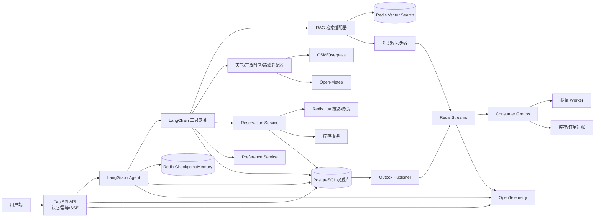
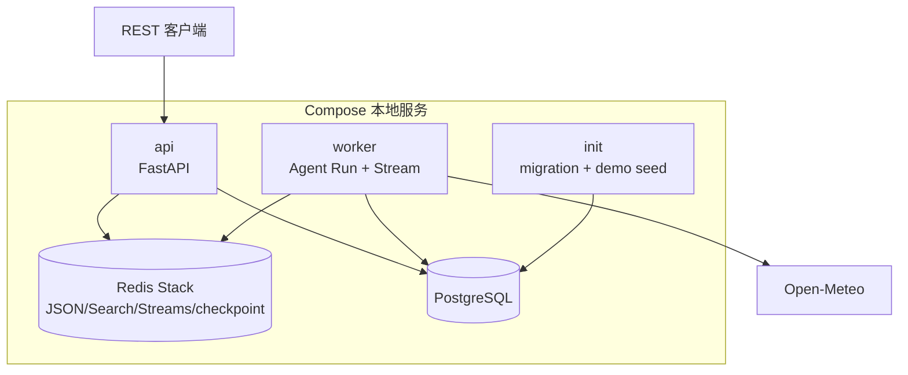
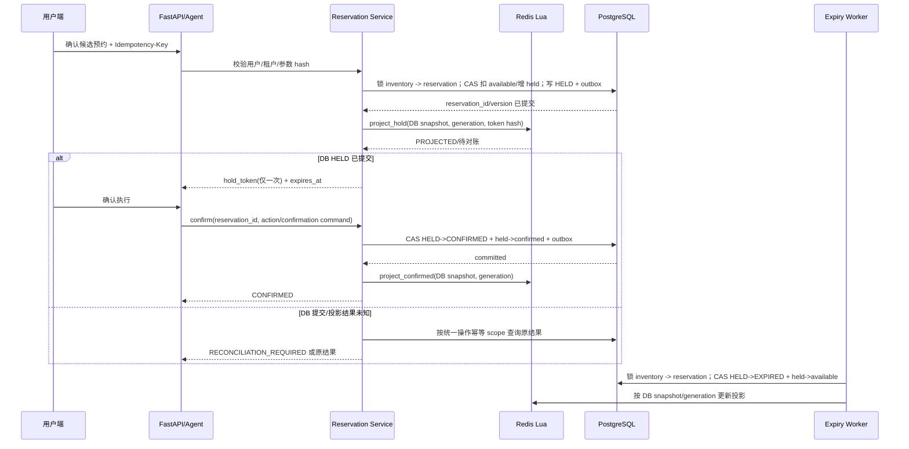
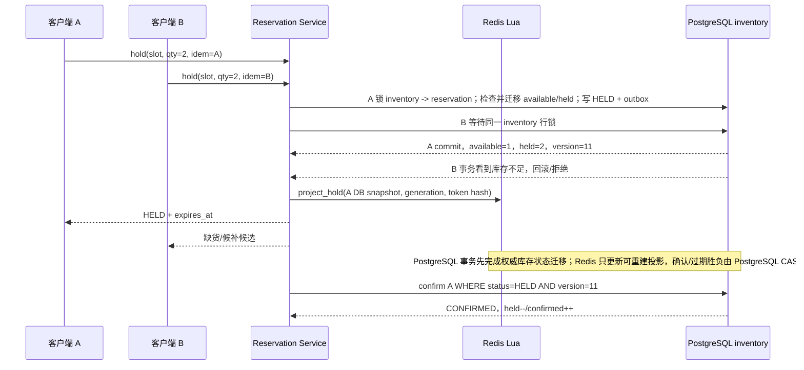
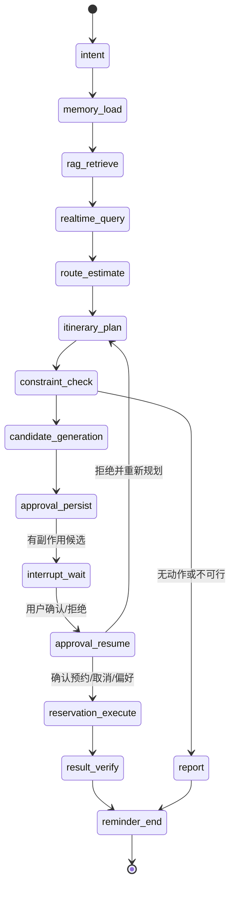
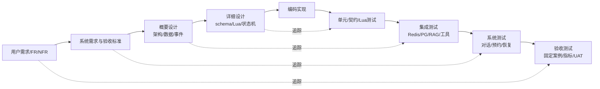

# TripMate 周末出游管家 Agent 概要设计说明书

| 项目 | 内容 |
|---|---|
| 项目名称 | TripMate 周末出游管家 Agent |
| 文档类型 | 概要设计说明书 |
| 文档版本 | 0.2 |
| 设计状态 | 目标概要设计；本地实现现状见 `docs/implementation-notes.md` |
| 需求基线 | `docs/requirements-analysis.md` v0.2 |
| 技术栈 | Python 3.12、FastAPI、LangChain、LangGraph、Redis Stack、PostgreSQL、OpenTelemetry、Docker Compose |

## 1. 文档目标、范围与设计依据

### 1.1 文档目标

本文把需求分析中的业务边界、FR-*、NFR-*、状态机、验收标准和 V 模型追踪关系转换为可直接指导详细设计、编码、联调、测试和演示的系统结构。文档给出服务边界、持久化模型、事件契约、Agent 状态图、工具契约、API、错误处理、一致性边界和部署方式，但不直接实现业务源码。

本文是目标架构说明，不是现状描述。TripMate 仅作为本地实习作品，不要求上线；已经实现或尚缺的能力以 `docs/implementation-notes.md` 为准。

### 1.2 设计范围

设计覆盖用户和租户隔离、行程规划、旅游知识检索、天气/开放时间/路线实时查询、模拟库存和预约、取消、候补、提醒、长期偏好、LangGraph 中断恢复、Redis Streams、RAG 同步、评估回放、可观测性和故障恢复。

首期只接入演示城市和本地模拟库存服务。不存在真实支付、真实身份证件或银行卡；不实现完整地图导航、交通预测、签证、医疗和保险服务。所有实时库存、价格、订单、天气和权限判断都由确定性服务完成，LLM 只编排和解释。

### 1.3 设计原则

1. **权威事实分层**：PostgreSQL 保存预约、库存、价格版本和状态的最终事实；Redis 用于缓存、协调、短期记忆、Stream、checkpoint 和向量索引，丢失后可重建。
2. **确定性优先**：金额、时间冲突、开放时间、库存、订单状态、权限和幂等由服务或数据库判断，模型不能覆盖工具结果。
3. **确认后副作用**：预约、取消和偏好修改先形成候选动作；仅在用户确认且授权、版本、状态、幂等校验全部通过后执行。
4. **最小权限**：Agent 只能调用注册工具；工具网关注入并校验用户、租户、资产范围、超时、限流和审计上下文。
5. **可恢复和可重放**：状态机、checkpoint、inbox/outbox、Stream pending、DLQ、版本 manifest 和固定 fixture 支持服务重启、故障注入和案例回放。
6. **证据可定位**：RAG 返回文档版本、URL、chunk、更新时间和引用片段；无证据时返回未知并引导官方渠道。
7. **租户隔离**：所有 PostgreSQL 查询、Redis key、Stream 消息、向量 metadata、日志和事件都携带 tenant/user scope，并在服务端强制过滤。

### 1.4 需求基线

需求分析文件是本设计的唯一业务基线。FR-USER、FR-TRIP、FR-KB、FR-REAL、FR-INV、FR-RES、FR-REM、FR-AGT、FR-MEM、FR-EVENT、FR-API、FR-AUDIT、FR-EVAL 和 NFR-PERF、NFR-QUALITY、NFR-REL、NFR-DATA、NFR-SEC、NFR-OBS、NFR-REPRO、NFR-MAINT 的逐项映射见第 19 节。需求中声明的验收数字在压测或固定评估完成前只能标记为“设计目标/待确认”。

## 2. 总体架构

### 2.1 逻辑组件

- **用户端**：Web/移动端或演示客户端，发送自然语言消息、行程确认、预约确认/取消请求，订阅 SSE。
- **FastAPI API 层**：认证、租户上下文、版本路由、Pydantic schema、request_id、幂等键、限流和 SSE；不执行模型推理以外的隐式副作用。
- **LangGraph Agent**：按显式状态图编排意图、记忆、RAG、实时工具、规划、约束校验、候选动作、人工确认、执行和结果验证。
- **LangChain 工具网关**：只暴露注册工具；统一 schema、权限、超时、重试、脱敏、trace 和审计。工具调用外部适配器或内部服务。
- **Redis Stack**：高频缓存、会话 memory、checkpoint、幂等短键、Stream/Consumer Group、ZSet 提醒、库存投影/协调 Lua、RAG Vector Search。
- **PostgreSQL**：用户、偏好、Trip、Attraction、ActivitySlot、Inventory、Reservation、AgentRun、审批、审计、inbox/outbox 和评估案例的权威存储。
- **知识库同步器**：读取 OpenStreetMap/Overpass、Open-Meteo 元数据、景点官方页面、城市旅游开放数据、项目规则和脱敏案例，构建带 manifest 的版本化向量索引。
- **库存服务**：首期为本地模拟服务；PostgreSQL 保存并事务维护可售库存和 reservation 状态，Redis Lua 只做高并发协调/投影/TTL 索引，最终结果由 PostgreSQL CAS 决定。
- **提醒 Worker**：扫描 ZSet 到期任务，写入提醒事件并通过通知适配器发送；以 inbox/唯一键防止重复发送。
- **Reservation Service**：封装库存预占、确认、释放、取消、候补、版本 CAS、幂等和对账。
- **Stream Worker**：消费 reservation/inventory/reminder/knowledge/agent 事件，事务完成后 ACK，失败重试并进入 DLQ。

### 2.2 总体架构图



### 2.3 关键一致性边界

| 边界 | 事实来源 | 允许的最终一致 | 失败行为 |
|---|---|---|---|
| 预约/取消/订单状态 | PostgreSQL `reservation` | Redis 库存投影、Stream、缓存短暂滞后 | 以版本 CAS 和唯一约束拒绝冲突；进入补偿/对账 |
| 可售库存 | PostgreSQL `inventory` | Redis `inventory:*` 版本化投影/hold 索引 | Lua 不得跨 hash slot；MVP DB 事务先提交，Redis 不可用时保留 DB 事实并进入投影重建/返回稍后重试 |
| 天气/路线 | 外部实时服务结果，带 `queried_at` | 短 TTL 缓存 | 超时返回 `UNKNOWN`，不得用 RAG 猜测 |
| 景点政策/介绍 | RAG active index 对应 manifest | 新索引构建期间继续旧版本 | 构建失败回滚 alias，返回来源版本 |
| Agent 状态 | PostgreSQL `agent_run` + Redis checkpoint | checkpoint 和数据库事件异步同步 | 恢复时校验 run 版本和人工确认状态 |

## 3. 本地运行架构、模块划分与包结构

### 3.1 本地依赖架构



Compose 仅用于本机启动 API、worker、PostgreSQL 和 Redis Stack 等开发依赖，不构成生产部署目标。此作品不要求扩容、集群或公网服务；外部数据访问由适配器限制。知识同步器、独立提醒 worker 和 OTel collector 仍是目标设计组件，不在当前 Compose 拓扑中。

### 3.2 模块划分

| 模块 | 主要职责 | 事务边界 |
|---|---|---|
| `api` | 路由、认证、版本、错误映射、SSE | 每个 HTTP 写请求一个 DB 事务或调用应用服务 |
| `agent` | LangGraph 节点、状态、checkpoint、interrupt/resume | 节点只提交确定性工具结果引用 |
| `tools` | LangChain 工具 schema、网关、allowlist 和 policy | 工具调用上下文不允许模型覆盖 |
| `domain` | Trip、Reservation、约束和状态转换 | 纯领域规则无 IO |
| `reservation` | 预占、确认、取消、释放、候补、幂等、对账 | 关键确认与 PostgreSQL CAS 在一个事务中 |
| `inventory` | 库存查询、Lua 投影脚本、版本和超时释放 | PostgreSQL 原子状态迁移 + Redis 可重建投影 |
| `knowledge` | 同步、清洗、chunk、embedding、manifest、alias、citation | manifest 事务化，active alias 原子切换 |
| `memory` | 会话短记忆、长期偏好脱敏/删除 | 用户/租户 scope 校验 |
| `events` | outbox 发布、Stream consumer、inbox、重试和 DLQ | 业务事务先提交，成功后 ACK |
| `workers` | 提醒、过期释放、对账、pending 恢复 | 每个任务使用幂等键 |
| `observability` | trace、指标、结构化日志和关联 ID | 不记录密钥和原文敏感字段 |

### 3.3 推荐 Python 包目录

```text
tripmate-agent/
├─ app/
│  ├─ main.py
│  ├─ config.py
│  ├─ api/                     # v1 路由、依赖、SSE
│  ├─ schemas/                 # Pydantic request/response/event
│  ├─ domain/                  # entities、enums、value objects、state rules
│  ├─ application/             # trip、reservation、preference、run use cases
│  ├─ agent/                   # graph、nodes、state、checkpoint、interrupt
│  ├─ tools/                   # LangChain schemas、gateway、adapters
│  ├─ knowledge/               # sync、chunk、embedding、manifest、citation
│  ├─ inventory/               # lua、repository、reconciliation
│  ├─ reservation/             # hold/confirm/cancel、idempotency、CAS
│  ├─ memory/                  # Redis memory、redaction、retention
│  ├─ events/                  # outbox、inbox、streams、dlq、consumers
│  ├─ workers/                 # reminder、hold expiry、pending recovery
│  ├─ persistence/
│  │  ├─ postgres/             # SQLAlchemy/asyncpg、repositories、migrations
│  │  └─ redis/                # clients、keys、scripts、vector index
│  ├─ observability/           # OpenTelemetry、logging、metrics
│  └─ security/                # auth、tenant policy、tool policy、redaction
├─ migrations/
├─ redis/scripts/              # project_hold.lua、release.lua、dedup.lua
├─ tests/{unit,api,integration,system,evaluation,load,security,fault}
├─ docker-compose.yml
└─ pyproject.toml
```

## 4. 领域模型与状态机

### 4.1 核心领域对象

| 对象 | 关键字段 | 不变量 |
|---|---|---|
| `Trip` | `trip_id`、`tenant_id`、`owner_user_id`、`destination`、`start_date`、`end_date`、`party_size`、`budget_limit`、`status`、`version` | 同一租户内成员可见；已确认预约对应项不能被规划器删除 |
| `Attraction` | `attraction_id`、城市、坐标、类别、介绍、`source_version`、`status`、`version` | 静态内容有来源和更新时间，政策引用可定位 |
| `ActivitySlot` | `slot_id`、`attraction_id`、开始/结束时间、容量、价格、`activity_version`、`status`、`version` | 时间段合法，活动版本变更需重新检查预约 |
| `Inventory` | `inventory_id`、`slot_id`、`total_quantity`、`available_quantity`、`held_quantity`、`confirmed_quantity`、`version`、`status` | 数量非负；`available + held + confirmed = total`，以 DB 事务/CAS 为准；外部占用必须显式建 bucket |
| `Reservation` | `reservation_id`、用户/Trip/slot、人数、价格快照、`hold_token_hash`、`hold_expires_at`、`status`、`operation`、`idempotency_key`、`request_hash`、`activity_version`、`inventory_version`、`policy_version`、`policy_snapshot`、`version` | `(tenant,user,operation,key)` 只产生一个业务结果；状态只能按允许边迁移 |
| `UserPreference` | `preference_id`、scope、`key`、脱敏值、来源、`effective_at`、`version`、`deleted_at` | 删除后过滤；用户/租户隔离；敏感值不进 prompt 原文 |
| `AgentRun` | `run_id`、`thread_id`、用户/租户、`intent`、`status`、`checkpoint_ref`、`awaiting_action_id`、`version` | `WAITING_CONFIRMATION` 只能由用户动作恢复，恢复不重复执行已完成工具 |
| `AgentAction` | `action_id`、类型、参数 hash、候选状态、确认时间、执行结果、`idempotency_key` | 候选动作不产生副作用；确认和执行可审计、可重放 |
| `ConstraintResult` | 硬/软约束列表、`feasible`、冲突码、计算来源 | 硬约束失败时方案不可执行 |
| `Citation` | `document_id`、`chunk_id`、来源、版本、URL、片段 hash、score | 只能引用检索返回的 chunk，不能虚构来源 |

### 4.2 预约状态机

```text
AVAILABLE -> HELD -> CONFIRMED -> COMPLETED
              |         |
              |         +-> CANCELLED
              +-> EXPIRED
AVAILABLE -> WAITLISTED -> CONFIRMED | CANCELLED
```

- `HELD` 必须有不可预测 `hold_token`（只存 hash）和 TTL；过期任务先在 PostgreSQL CAS `HELD -> EXPIRED`，再用 token/generation 更新 Redis 投影。
- `CONFIRMED` 必须存在已消费用户确认记录、价格快照、活动版本、库存版本、固化的 `policy_version/policy_snapshot` 和幂等键。
- `CANCELLED`、`COMPLETED` 是终态；重复取消返回同一结果或 `RESERVATION_ALREADY_CANCELLED`，不产生第二次释放。
- 状态转换由 `ReservationService` 和数据库行锁/版本 CAS 执行，LLM 不可直接写状态。

### 4.3 Agent Run 状态机

```text
RUNNING -> WAITING_CONFIRMATION -> RUNNING -> COMPLETED
                                      |-> FAILED
RUNNING -> CANCELLED
```

`thread_id` 采用服务端构造的租户命名空间，例如 `tenant:{tenant_id}:trip:{trip_id}` 或 `tenant:{tenant_id}:user:{user_id}:conversation:{conversation_id}`。同一 `(tenant_id, thread_id)` 由数据库 lease/fencing token 串行执行；不同消息排队或返回稳定 `THREAD_BUSY`，不使用隐式 last-write-wins。checkpoint 保存图状态、工具结果引用、待确认 action 和中断节点，不保存支付凭证或未脱敏敏感信息。用户拒绝后只生成替代方案，不能自动重提原动作。202 Run 创建和 `agent.run.requested.v1` outbox 在同一 PostgreSQL 事务提交，worker 启动扫描未完成 Run 并以版本 CAS 恢复。

### 4.4 其他关键状态

```text
Trip: DRAFT -> PLANNING -> READY | INFEASIBLE
READY -> CONFIRMED -> COMPLETED
READY/CONFIRMED -> CANCELLED

ActivitySlot: ACTIVE -> SOLD_OUT | CLOSED
Inventory: ACTIVE -> PAUSED -> RECONCILING -> ACTIVE
AgentAction: PROPOSED -> CONFIRMED -> EXECUTED | FAILED
                         \-> REJECTED
```

`DRAFT` 可以修改规划输入；`PLANNING` 只由 Agent Run 持有；`READY` 必须通过硬约束校验，`INFEASIBLE` 只能展示冲突或重新规划。`SOLD_OUT` 不等于预约失败以外的订单状态，候补使用 `WAITLISTED`。`PAUSED/RECONCILING` 期间禁止新的库存确认，直到对账恢复或运营人员关闭 slot。状态迁移均由领域服务、数据库约束和审计事件执行。

## 5. PostgreSQL 权威数据模型

### 5.1 通用约定

使用 PostgreSQL 16（版本以 Compose 镜像锁定），UUID 主键，`timestamptz`，金额使用 `numeric(12,2)`，人数/数量使用非负整数。所有业务表含 `tenant_id`、`created_at`、`updated_at`；可变实体含 `version bigint`，状态使用受限枚举或 CHECK。应用通过迁移管理 schema，并在写入时使用 `WHERE id=? AND version=?` 的 CAS。跨实体引用必须使用带 `tenant_id` 的复合唯一键和复合外键（例如 `(tenant_id, trip_id)` -> `trip`、`(tenant_id, user_id)` -> `user_profile`、`(tenant_id, slot_id)` -> `activity_slot`）；只引用 UUID 的示例不得直接实现。必要时启用 RLS，repository 和数据库约束双重执行租户边界。

### 5.2 主要表

| 表 | 关键字段（类型） | 主键/唯一约束 | 关键索引 |
|---|---|---|---|
| `tenant` | `tenant_id uuid`、`name`、`status`、`version` | PK `tenant_id`，UQ `name` | `status` |
| `user_profile` | `user_id uuid`、`tenant_id`、`display_name`、`locale`、`redacted_contact`、`status`、`version` | PK `user_id`；UQ `(tenant_id,user_id)` | `(tenant_id,status)` |
| `user_preference` | `preference_id`、`user_id`、`scope`、`key`、`value_json jsonb`、`source`、`effective_at`、`deleted_at`、`generation`、`version` | PK；UQ `(tenant_id,user_id,scope,key)` WHERE `deleted_at IS NULL` | `(tenant_id,user_id,updated_at)`、GIN `value_json` |
| `attraction` | `attraction_id`、城市、坐标、`name`、`category`、`source_version`、`status`、`version` | PK；UQ `(tenant_id,external_source,external_id)` | `(tenant_id,city,status)`；地理索引按 PostGIS 可选 |
| `activity_slot` | `slot_id`、`tenant_id`、`attraction_id`、`start_at`、`end_at`、`capacity`、`price`、`currency`、`activity_version`、`status`、`version` | PK；UQ `(tenant_id,slot_id)`、UQ `(tenant_id,external_id,start_at)`；复合 FK `(tenant_id,attraction_id)` | `(tenant_id,attraction_id,start_at)`、`status` |
| `inventory` | `inventory_id`、`slot_id`、`total_quantity`、`available_quantity`、`held_quantity`、`confirmed_quantity`、`version`、`status` | PK；UQ `(tenant_id,slot_id)` | `(tenant_id,slot_id,status)` |
| `trip` | `trip_id`、`owner_user_id`、目的地、日期、`party_size`、`budget_limit`、`status`、`version` | PK；UQ `(tenant_id,trip_id)`；复合 FK `(tenant_id,owner_user_id)` | `(tenant_id,owner_user_id,updated_at)` |
| `trip_member` | `tenant_id`、`trip_id`、`user_id`、`role`、`status` | PK `(tenant_id,trip_id,user_id)`；复合 FK 到 trip/user | `(tenant_id,user_id,status)` |
| `trip_item` | `trip_item_id`、`trip_id`、`slot_id/attraction_id`、时段、成本、`constraint_status`、`reservation_id`、`version` | PK；UQ `(trip_id,sequence_no)` | `(trip_id,start_at)` |
| `reservation` | `reservation_id`、`trip_id`、`user_id`、`slot_id`、`quantity`、`price_snapshot`、`status`、`hold_token_hash`、`hold_expires_at`、`route`、`operation`、`idempotency_key`、`request_hash`、`activity_version`、`inventory_version`、`version` | PK；UQ `(tenant_id,user_id,route,operation,idempotency_key)`；复合 FK 到 trip/user/slot | `(tenant_id,status,hold_expires_at)`、`(tenant_id,slot_id,status)` |
| `reservation_confirmation` | `confirmation_id`、`reservation_id`、`action_id`、`confirmed_by`、`confirmed_at`、`confirmation_hash`、`expires_at`、`consumed_at`、`status`、`version` | PK；UQ `(tenant_id,action_id)`；复合 FK 到 reservation/action/user | `(tenant_id,reservation_id,confirmed_at)` |
| `action_confirmation` | `confirmation_id`、`action_id`、`user_id`、`token_hash`、`parameters_hash`、`issued_at`、`expires_at`、`consumed_at`、`status`、`version` | PK；UQ `(tenant_id,action_id)`；复合 FK 到 agent_action/user | `(tenant_id,status,expires_at)` |
| `idempotency_record` | tenant/user、route、operation、key hash、request hash、HTTP status、稳定 result、resource、expires_at | PK `(tenant_id,user_id,route,operation,key_hash)` | `(expires_at)` |
| `agent_run` | `run_id`、`thread_id`、用户/Trip、`status`、`intent`、`checkpoint_ref`、`awaiting_action_id`、`lease_owner`、`lease_until`、`fencing_version`、`version` | PK；UQ `(tenant_id,run_id)`；active thread 唯一/lease | `(tenant_id,thread_id,created_at)`、`status` |
| `agent_action` | `action_id`、`run_id`、`action_type`、`parameters_hash`、`action_fingerprint`、`status`、`request_hash`、`result_json`、`version` | PK；UQ `(tenant_id,run_id,action_fingerprint)` | `(run_id,status)` |
| `agent_tool_call` | `tool_call_id`、`run_id`、工具名、输入/输出 hash、`started_at`、`ended_at`、`status`、`error_code` | PK；UQ `(run_id,tool_call_id)` | `(run_id,started_at)` |
| `audit_log` | `audit_id`、用户/租户、`run_id`、工具/订单、动作、参数 hash、结果、`request_id`、时间 | PK | `(tenant_id,created_at)`、`reservation_id` |
| `conversation_message` | `message_id`、会话、角色、脱敏内容、`content_hash`、`created_at` | PK；UQ `(conversation_id,sequence_no)` | `(tenant_id,conversation_id,created_at)` |
| `reminder` | `reminder_id`、`trip_id`、目标时间、类型、载荷 hash、`status`、`dedup_key`、`version` | PK；UQ `(tenant_id,dedup_key)` | `(tenant_id,status,scheduled_at)` |
| `knowledge_document` | `document_id`、类型、来源、URL、`source_version`、sha256、`retrieved_at`、`status` | PK；UQ `(tenant_id,source,source_id,source_version)` | `(source,source_version)` |
| `knowledge_chunk` | `chunk_id`、`document_id`、heading、文本 hash、`index_version`、metadata jsonb | PK；UQ `(document_id,chunk_no,index_version)` | `(index_version,document_id)` |
| `knowledge_manifest` | `index_version`、状态、chunk 数、embedding 模型、构建日志、`active`、created_at | PK；唯一一个 active alias | `(status,created_at)` |
| `inbox_event` | `event_id`、consumer、`status`、`attempt_count`、`lease_owner`、`lease_until`、`claim_token`、`fencing_version`、payload hash、`processed_at`、error | PK；UQ `(consumer,event_id)` | `(consumer,status,lease_until)` |
| `outbox_event` | `event_id`、aggregate、类型、payload、`status`、attempts、`replay_until`、`published_at` | PK；UQ `event_id` | `(status,created_at)` |
| `outbox_replay_cursor` | tenant、stream、cursor event/time、updated_at | PK `(tenant_id,stream_name)` | replay window |
| `stream_group_watermark` | tenant、stream、group、safe message ID、updated_at | PK `(tenant_id,stream_name,group_name)` | trim/rebuild safety |
| `evaluation_case` | `case_id`、版本、输入、期望工具序列/约束/引用/订单结果、`active` | PK；UQ `(case_id,version)` | `active` |

### 5.3 事务和并发

所有库存状态转换统一为 PostgreSQL 事务：先按 `inventory -> reservation` 固定顺序加行锁，再检查 action、token、活动/库存版本和幂等记录。hold 同时执行 `available -= qty; held += qty; reservation=HELD`；confirm 执行 `held -= qty; confirmed += qty; reservation=CONFIRMED`；expire/cancel 执行 `available += qty; held -= qty` 或 `confirmed -= qty`。每次迁移递增版本并与 outbox 同事务提交；任一 CAS 失败不改变数量。Redis Lua 只协调和投影，不能单独返回预约成功。

## 6. Redis 数据模型与命名

### 6.1 数据类型选择

| 类型 | 用途 | 选择理由 |
|---|---|---|
| String | 幂等结果、短 TTL 锁、限流计数、active alias | O(1) 读取，适合带 TTL 的原子 `SET NX EX` |
| Hash | 会话摘要、库存预占元数据、消费者租约 | 字段级更新，避免频繁重写整对象 |
| RedisJSON | AgentState/TripPlan 快照、结构化缓存、checkpoint payload 引用 | 保留嵌套结构并支持 JSONPath；敏感原文仅存脱敏版本 |
| Stream | reservation、inventory、reminder、knowledge、agent 事件 | 有序日志、Consumer Group、pending 和重放能力 |
| Consumer Group | 每类 worker 的负载分摊和 pending 认领 | 支持 `XREADGROUP`、`XAUTOCLAIM` 和故障恢复 |
| Sorted Set | reminder 到期时间、hold expiry、延迟重试 | score 为 Unix ms，按时间范围扫描 |
| Lua | 库存投影、协调和幂等检查 | Redis 内原子执行多 key 投影/检查；所有 key 同一 hash slot |
| Vector Search | RAG chunk embedding 和 metadata 过滤 | 低延迟 top-k，支持 `tenant/index_version/city/document_type` 过滤 |

### 6.2 key 规范与 hash tag

逻辑命名模板统一为 `tm:{domain}:v1:{env}:...`；其中 `domain`、`env` 是模板占位符。实际 Redis Cluster key 将租户或聚合 ID 放入 hash tag，使一次 Lua 操作涉及的 key 落在同一 slot。示例（`{tenant_id}` 为实际 hash tag）：

```text
tm:inventory:v1:prod:{tenant_id:slot_id}:stock:{activity_id}:{slot_id}
tm:inventory:v1:prod:{tenant_id:slot_id}:hold:{reservation_id}
tm:reservation:v1:prod:{tenant_id:slot_id}:idem:{idempotency_key_hash}
tm:reservation:v1:prod:{tenant_id}:stream:reservations
tm:inventory:v1:prod:{tenant_id}:stream:inventory
tm:reminder:v1:prod:{tenant_id}:zset:due
tm:memory:v1:prod:{tenant_id}:conversation:{conversation_id}
langgraph-saver:{tenant_id}:{thread_id}:checkpoint/*  # saver-owned namespace; actual keys由 setup 创建
tm:rag:v1:prod:{tenant_id}:index:{index_version}
tm:rag:v1:prod:{tenant_id}:alias:active
tm:events:v1:prod:{tenant_id}:dlq:{stream}:{event_id}
```

库存 Lua 的 hash tag 使用 `{tenant_id:slot_id}`，确保 stock/hold/idem/expiry 同 slot，同时避免把一个热门租户的所有库存压到单个 Cluster slot。Stream、checkpoint 和 alias 不参与库存 Lua，可使用各自可重建 key。禁止把用户输入未经规范化直接作为 key；长度、字符集和 TTL 必须受限。

### 6.3 TTL、删除和重建

会话短记忆默认 7 天（可配置），天气缓存 5 分钟，库存查询缓存不超过 2 秒且不能用于最终确认，幂等结果至少覆盖业务重试窗口（建议 24 小时），hold 元数据 TTL 等于业务 hold TTL 加 5 分钟。Redis 删除后由 PostgreSQL、manifest 和事件重放重建；Vector index 由 active manifest 重新构建。

## 7. 高并发预约设计

### 7.1 预约流程

1. `check_ticket_inventory` 从 PostgreSQL/经版本校验的 Redis 投影读取 `slot_id`、活动版本、时间段、价格快照和可用数量，响应含 `queried_at` 与 `inventory_version`。
2. 用户确认候选 action 后，Reservation Service 校验租户、用户权限、参数 hash、活动版本、价格和操作幂等键。
3. 服务生成高熵 `hold_token`，仅保存 hash。PostgreSQL 事务按固定锁顺序更新 inventory 和 reservation，并写 `reservation.held.v1` outbox；Redis Lua 在同一业务代际中更新可重建 stock/hold/expiry 投影。
4. PostgreSQL 事务提交结果未知时，先用 `(tenant,user,route,operation,key)` 查询结果；确认提交成功后才重试 Redis 投影，未知期间进入 `RECONCILIATION_REQUIRED`，不得盲目 release 或再次 hold。DB 未产生 reservation 的孤儿投影由带 fencing 的扫描任务清理。
5. confirm、expire、cancel 都先在 PostgreSQL CAS 竞争；只有 CAS 成功的一方更新 Redis。确认执行 `held -> confirmed`，过期执行 `held -> expired`，并写同一事务 outbox。
6. 库存不足返回 `INVENTORY_NOT_ENOUGH`，可生成 `WAITLISTED` 或满足约束的替代活动；不得伪造成功。



### 7.2 Lua 投影与协调约束

Lua 输入仅接受服务端生成的 key、DB snapshot、generation、token hash 和幂等结果；作用是投影已提交的 PostgreSQL 状态和快速拒绝，不创建预约事实。释放脚本只在 PostgreSQL CAS 成功后按 token/generation 删除或重建投影；确认与过期竞态不由 Redis 决定。脚本的单元测试覆盖数量边界、并发、重复 token、版本冲突、generation、孤儿 hold、Redis Cluster hash slot 和脚本重载，并同时断言 PostgreSQL 最终守恒。

### 7.3 库存并发时序



当两个请求竞争同一 slot 时，PostgreSQL 行锁和库存 CHECK/守恒约束保证只有有足够库存的事务能创建 HELD；Lua 用于协调/快速拒绝并不能构成成功事实。任何时点 PostgreSQL 均满足 `available + held + confirmed = total`。Redis 计数与数据库不一致时将 inventory 置为 `RECONCILING`，使用 pause generation/fencing 阻止旧 worker 和新 hold 交错写入，重建后再恢复。

### 7.4 幂等、重试、补偿和对账

- HTTP 写操作必须带 `Idempotency-Key`（长度和字符集受限）；先对完整 scope `(tenant_id,user_id,route,operation,Idempotency-Key)` 做 canonical SHA-256 得到 `key_hash`，再用数据库 UQ `(tenant_id,user_id,route,operation,idempotency_key)` 和 Redis idem key 双重保护，且保存/比较 request hash，重复请求返回第一次的 HTTP 语义和业务结果。
- 网络超时可以重试查询；确认/取消只按相同幂等键重试，指数退避并设上限，禁止生成新键。
- PostgreSQL 事务提交结果未知或失败：按操作幂等键查询 DB；确认未提交后不创建预约，确认已提交后重试 Redis 投影。若仍未知，进入 `RECONCILIATION_REQUIRED`，禁止盲目 release 或再次 hold；无 DB reservation 的孤儿投影由对账任务按 generation 清理。
- PostgreSQL 成功而事件发布失败：outbox publisher 重试；业务事务不回滚、不重复扣库存。
- 定时对账比较活动 slot 的 DB `available/held/confirmed`、Redis stock、未过期 hold 和 reservation 状态；差异生成审计和告警。对账期间以 PostgreSQL `RECONCILING` + fencing generation 阻止新 hold/confirm；PostgreSQL 值优先，Redis 计数可重建。

## 8. Redis Streams 事件设计

### 8.1 事件信封

所有事件为 JSON，字段如下：

```json
{
  "event_id": "uuid",
  "event_type": "reservation.confirmed.v1",
  "event_version": 1,
  "occurred_at": "2026-10-12T08:00:00Z",
  "tenant_id": "uuid",
  "aggregate_type": "reservation",
  "aggregate_id": "uuid",
  "aggregate_version": 4,
  "request_id": "uuid",
  "run_id": null,
  "operation": "reservation.confirm",
  "idempotency_key_hash": "sha256(...)",
  "original_event_id": null,
  "trace_id": "otel-trace-id",
  "attempt": 1,
  "producer": "reservation-service",
  "payload": {}
}
```

Payload 只包含业务所需的最小脱敏数据；密码、token 原文、地址和完整用户消息不进入 Stream。`event_id`、HTTP `Idempotency-Key`、`action_id`、`confirmation_token` 和 `hold_token` 是不同标识，不能互换。

### 8.2 Stream 与 Consumer Group

| Stream | 事件 | Group/消费者 |
|---|---|---|
| `tm:reservation:v1:prod:{tenant_id}:stream:reservations` | `reservation.proposed/held/confirmed/cancelled/expired/waitlisted.v1` | `reservation-projection`、`notification`、`audit` |
| `tm:inventory:v1:prod:{tenant_id}:stream:inventory` | `inventory.checked/held/released/reconciled.v1` | `inventory-reconcile`、`audit` |
| `tm:reminder:v1:prod:{tenant_id}:stream:reminders` | `reminder.scheduled/due/sent/failed.v1` | `reminder-sender`、`audit` |
| `tm:knowledge:v1:prod:{tenant_id}:stream:knowledge` | `knowledge.sync_started/index_built/alias_switched/rollback.v1` | `knowledge-monitor` |
| `tm:agent:v1:prod:{tenant_id}:stream:runs` | `agent.run.requested/run_started/tool_start/tool_end/citation/approval_required/done/error.v1` | `run-worker`、`run-observer` |

每个 group 使用 `XREADGROUP GROUP ... >`。消费者崩溃后由同组实例以 `XAUTOCLAIM` 认领 idle 超过阈值的 pending 消息；数据库 `inbox_event` 同时以 `lease_owner`、`lease_until`、`claim_token`、`fencing_version` 保护业务处理，PEL 转移不能替代该 lease。超过配置阈值写入 DLQ 并保留错误原因、最后消费者和原始事件引用。DLQ 重放使用新 replay event_id、`original_event_id`、原 aggregate 版本和幂等键，重放前需人工或运维授权。

### 8.3 inbox/outbox 与 ACK 时机

业务事务在 PostgreSQL 同一事务中写 `outbox_event`；publisher 发布成功后标记 outbox。消费者收到事件后先以 `(consumer,event_id)` 认领 inbox lease，再执行业务事务并提交，最后 `XACK`。数据库事务失败不 ACK，消息保持 pending；不可恢复错误进入 DLQ 后才 ACK 原消息，避免无限阻塞。Stream 裁剪只能删除所有 Consumer Group 都已确认的安全水位；已发布 outbox 保留 replay watermark，Redis 丢失后可从 outbox/归档重建 Stream。重复事件命中已处理 inbox 直接 ACK，不重复扣库存或发提醒。

## 9. LangGraph Agent 设计

### 9.1 状态图



节点职责和边界：

1. `intent` 解析创建/修改/问答/预约/取消/偏好/提醒意图，只输出枚举和缺失槽位。
2. `memory_load` 从 Redis 短记忆和 PostgreSQL 偏好读取脱敏上下文，校验租户/用户 scope。
3. `rag_retrieve` 检索景点、政策、退改和建议，生成 `Citation[]`；不得返回动态库存事实。
4. `realtime_query` 并行调用天气和开放时间，`route_estimate` 调用受控路线适配器；超时写 `UNKNOWN` 和依赖错误。
5. `itinerary_plan` 依据工具结果生成结构化 `TripPlan`；模型不得计算覆盖价格、库存或时间事实。
6. `constraint_check` 由确定性校验器检查日期、人数、预算、开放时间、冲突、库存和已确认预约；硬约束失败为 `INFEASIBLE`。
7. `candidate_generation` 生成 `ReservationAction`、取消或偏好候选，不产生副作用。
8. `approval_persist` 在一个可重放的幂等步骤中以 `(tenant_id,run_id,action_fingerprint)` 唯一约束创建/复用 `agent_action(PROPOSED)`，CAS 设置 `WAITING_CONFIRMATION`，写审批事件和 checkpoint；不执行预约副作用。
9. `interrupt_wait` 是只读节点：只读取已持久化 action，调用 `interrupt()` 返回审批内容。LangGraph resume 会从该节点起点重跑，因此该节点不得写 action、发重复业务事件或调用工具。
10. `approval_resume` 校验服务端签发的 confirmation command、主体、有效期和 action version；确认路由到 `reservation_execute`，拒绝路由到 `itinerary_plan`，过期路由到 `candidate_generation`/error。
11. `reservation_execute` 调用确认 API，进行权限、状态、版本、幂等和库存校验；前置只读工具引用可复用，但动态事实过期必须重新查询。
12. `result_verify` 重新读取订单/库存状态，将结果和错误码写入 Run；失败不被自然语言包装为成功。`reminder_end` 创建已确认提醒或结束 Run，发布 `done`/`error`。

### 9.2 结构化对象

```python
class AgentState(TypedDict):
    run_id: UUID
    thread_id: str
    tenant_id: UUID
    user_id: UUID
    trip_id: UUID | None
    intent: Literal["plan", "query", "reserve", "cancel", "preference", "reminder"]
    user_input_redacted: str
    memory_refs: list[str]
    retrieved_citations: list["Citation"]
    realtime_facts: "Annotated[list[RealtimeFact], merge_realtime_facts]"
    route_estimates: "Annotated[list[RouteEstimate], merge_route_estimates]"
    completed_tool_refs: "Annotated[dict[str, str], merge_tool_refs]"
    trip_plan: "TripPlan | None"
    constraint_result: "ConstraintResult | None"
    pending_actions: list["ReservationAction"]
    awaiting_action_id: UUID | None
    checkpoint_version: int
    errors: list[dict[str, str]]

class TripPlan(BaseModel):
    trip_id: UUID | None
    date: date
    timezone: str
    items: list["ActivityPlanItem"]
    total_cost: Decimal
    currency: str
    walking_minutes: int
    indoor_ratio: Decimal
    constraint_result: "ConstraintResult"
    citations: list["Citation"]
    generated_at: datetime

class ConstraintResult(BaseModel):
    feasible: bool
    hard_constraints: list[dict[str, object]]
    soft_preferences: list[dict[str, object]]
    conflicts: list[dict[str, str]]
    evaluated_at: datetime
    evaluator_version: str

class Citation(BaseModel):
    document_id: str
    chunk_id: str
    title: str
    source: str
    source_version: str
    source_url: str
    heading: str | None
    excerpt: str
    content_sha256: str
    retrieved_at: datetime

class ReservationAction(BaseModel):
    action_id: UUID
    action_type: Literal["propose_reservation", "confirm_reservation", "cancel_reservation", "save_preference"]
    reservation_id: UUID | None
    slot_id: UUID | None
    quantity: int | None
    parameters_hash: str
    price_snapshot: Decimal | None
    hold_expires_at: datetime | None
    policy_citations: list[Citation]
    requires_confirmation: bool = True
    status: Literal["PROPOSED", "CONFIRMED", "REJECTED", "EXECUTED", "FAILED"]
```

实际实现使用 Pydantic v2 和 LangGraph checkpoint serializer；代码示例只定义接口，不代表可直接运行的业务源码。

并行节点的 state key 必须显式声明 reducer：`merge_realtime_facts` 按 `fact_type + query_hash` 合并并拒绝旧版本覆盖新版本，`merge_route_estimates` 按查询指纹合并，`merge_tool_refs` 按 tool-call id 去重。不能使用普通 `list`/`dict` 让多个节点同时写入 `LastValue` channel；若不实现 reducer，则天气、开放时间和路线在一个节点内顺序查询后再写 state。

## 10. LangChain 工具网关

### 10.1 工具清单与副作用

| 工具 | 读/候选/副作用 | 输入要点 | 输出要点 |
|---|---|---|---|
| `search_attractions` | 只读 | 城市、日期、类别、人数、metadata filter | 景点摘要、ID、开放信息引用 |
| `search_travel_knowledge` | 只读 | query、城市、文档类型、top_k | `Citation[]`、index version |
| `get_weather` | 只读 | 地点、时间窗 | 预报、来源、查询时间、`UNKNOWN` |
| `get_opening_hours` | 只读 | 景点、日期 | 时区、开放区间、来源版本 |
| `estimate_route_time` | 只读 | 起终点、方式、出发时间 | 受控估算、距离、数据时间 |
| `check_ticket_inventory` | 只读 | slot、日期、人数（tenant/user 由服务端注入） | 活动版本、时间段、剩余、价格快照、库存版本 |
| `calculate_trip_budget` | 只读计算 | 行程项、人数、价格快照 | 确定性总价、币种、明细 |
| `propose_reservation` | 候选动作 | slot、人数、政策引用；不得提交价格/库存版本 | `ReservationAction(PROPOSED)`，无扣库存 |
| `confirm_reservation` | 副作用，必须确认 | 已批准 action/reservation、幂等键；token/版本由服务端 context 取得 | 订单状态、版本、审计引用 |
| `cancel_reservation` | 副作用，必须确认 | 已批准 action/reservation、原因、幂等键；token/版本由服务端 context 取得 | 取消状态、退款规则结果 |
| `save_user_preference` | 候选动作；写入需确认 | key、脱敏 value、来源 | 待确认 action；确认后写 DB/Redis |
| `create_trip_reminder` | 候选动作；写入需确认 | trip、时间、类型、幂等键 | 待确认 action；确认后写 DB/ZSet |

`confirm_reservation`、`cancel_reservation` 和偏好修改只能由用户确认后的 API/action 调用。`propose_*` 仅写 `agent_action` 候选记录。所有工具使用 Pydantic 输入输出，网关注入 `tenant_id/user_id/roles/request_id/run_id`，模型不能传入或覆盖这些字段，也不能传任意 URL、shell、SQL、支付凭证、价格、活动版本、库存版本、hold token 或 confirmation token。服务端重新读取权威价格/库存并计算参数 hash。

### 10.2 工具错误码

`INVALID_ARGUMENT`、`UNAUTHORIZED`、`TENANT_SCOPE_DENIED`、`TOOL_NOT_ALLOWED`、`RATE_LIMITED`、`DEPENDENCY_TIMEOUT`、`INVENTORY_NOT_ENOUGH`、`VERSION_CONFLICT`、`RESERVATION_STATE_CONFLICT`、`IDEMPOTENCY_REPLAY`、`UNKNOWN_FACT`、`INTERNAL_ERROR`。错误响应同时包含 `request_id`、`run_id`、可重试标记和脱敏详情。

## 11. RAG 知识库设计

### 11.1 数据源与静态/动态边界

同步器支持 OpenStreetMap/Overpass（地点、道路、坐标）、Open-Meteo（天气工具的来源元数据，不把当前预报写成静态事实）、景点官方页面和预约政策、城市旅游开放数据、项目自建旅游规则/模拟活动数据、用户历史行程和脱敏案例。景点介绍、预约政策、儿童要求、退改规则、游玩建议进入 RAG；当前天气、库存、价格和订单状态必须实时调用工具。向量检索结果永远不能直接作为实时库存、价格、天气或订单事实。

### 11.2 文档与 chunk

文档最小字段：`document_id`、`document_type`、`source`、`source_id`、`source_url`、`source_version`、`title`、`city`、`attraction_id`、`content_sha256`、`retrieved_at`。chunk 额外保存 `chunk_id`、`heading`、`chunk_no`、`text`、`text_sha256`、`index_version` 和 metadata（tenant、user、city、document_type、language、effective_from/to、authority、crawl_time、`deleted_at`、`generation`）。用户案例向量必须带 `tenant_id/user_id`，只允许同一主体过滤召回；删除先写 tombstone/递增 generation 并阻断召回，再异步物理删除或重建索引。

按 Markdown/HTML heading 和语义段落切分，目标 400–800 tokens，重叠 50–100 tokens；预约/退改表格按行或规则分 chunk，保留表头和适用日期；一个 chunk 不跨不同政策有效期。embedding 模型和维度写入 manifest；模型升级必须产生新 `index_version`。政策 citation 仅用于说明，退改/预约决策使用版本化确定性规则。

### 11.3 Redis Vector Search 与发布

每个 `index_version` 一个 RedisJSON/Hash 文档集合，向量字段建立 HNSW 索引；metadata 用 TAG/TEXT/NUMERIC 过滤。查询先从 `tm:{rag}:v1:{env}:alias:active` 取 active 版本，再做 tenant/city/document_type 过滤和 top-k，返回 chunk metadata、score 和 citation。同步流程为 `sync_started -> fetch -> normalize -> chunk -> embed -> validate -> build index -> write manifest -> atomic switch active alias -> emit index_built`。chunk 数、sha、embedding 模型、来源版本或校验不足时禁止切换；失败保留旧 alias，写 `rollback` 事件并告警。

citation 返回格式：

```json
{
  "document_id": "attraction:west-lake:booking-policy",
  "chunk_id": "...:chunk-03",
  "title": "预约与退改规则",
  "source_url": "https://example.invalid/policy",
  "source_version": "2026-10-12",
  "heading": "退票",
  "excerpt": "...",
  "content_sha256": "...",
  "index_version": "kb-2026-10-12-01",
  "retrieved_at": "2026-10-12T08:00:00Z"
}
```

知识源不可用时保留上一个 active 版本，并在回答中标注更新时间；没有证据时 `UNKNOWN`，不得生成看似确定的政策。

## 12. FastAPI API 设计

### 12.1 通用约定

API 以 `/v1` 版本化。请求头必须包含认证凭证和 `X-Request-Id`（缺失则服务生成），写操作需要 `Idempotency-Key`。所有响应包含 `request_id`、`trace_id`、`data` 或 `error`；错误结构如下：

```json
{
  "request_id": "uuid",
  "trace_id": "otel-trace-id",
  "error": {
    "code": "INVENTORY_NOT_ENOUGH",
    "message": "所选时段库存不足",
    "retryable": false,
    "details": {"slot_id": "..."}
  }
}
```

HTTP 映射：400 参数/schema、401 未认证、403 租户/资源/工具权限、404 不存在、409 状态/版本/幂等/`THREAD_BUSY`/`STALE_LEASE` 冲突、422 业务约束不可行、429 限流、502 外部依赖、503 Redis/PostgreSQL/Worker 不可用、500 未知错误。错误 message 不泄露内部 URL、SQL、密钥或提示词。

### 12.2 端点

| 方法与路径 | 请求关键字段 | 响应关键字段 |
|---|---|---|
| `GET /health/live` | 无 | `status=UP`、request_id |
| `GET /health/ready` | 无 | PostgreSQL、Redis、索引 alias、Worker 状态；未就绪返回 503 |
| `POST /v1/conversations/{conversation_id}/messages` | `message`、`trip_id?`、`resume_action_id?`；`X-Request-Id` | `run_id`、`status`、`thread_id`、初始事件或 `approval_required` |
| `GET /v1/runs/{run_id}` | path；scope 校验 | AgentRun 状态、TripPlan、ConstraintResult、Citation、错误、版本 |
| `POST /v1/actions/{action_id}/confirmation` | `Idempotency-Key`、expected confirmation version | 当前主体绑定的一次性 confirmation command；不执行业务副作用 |
| `GET /v1/runs/{run_id}/events` | `Last-Event-ID?` | SSE `run_started/tool_start/tool_end/citation/approval_required/done/error` |
| `POST /v1/trips` | 目的地、日期、人数、预算、同行类型、偏好 | `trip_id`、version、初始草案和约束状态 |
| `POST /v1/trips/{trip_id}/confirm` | `action_id`、confirmation command、幂等键、expected_version | 行程方案或 action `CONFIRMED`；不直接修改库存 |
| `GET /v1/trips/{trip_id}` | path | Trip、items、预约状态、预算和约束结果 |
| `POST /v1/reservations` | 已确认 `action_id`、`slot_id`、数量、expected_version、`confirmation_token`、幂等键 | 预占/预约状态、`reservation_id`、hold token（仅一次）、过期时间、价格快照 |
| `POST /v1/reservations/{reservation_id}/confirm` | 已批准 action、可选短期 confirmation command、expected_version、幂等键 | `CONFIRMED` 状态、订单版本、确认事件 |
| `POST /v1/reservations/{reservation_id}/cancel` | 已批准 action、原因、可选 confirmation command、expected_version、幂等键 | reservation status、版本、退改校验结果 |
| `GET /v1/knowledge/search` | query、city、type、top_k、index_version? | `Citation[]`、active index、检索耗时 |

API 层不接受模型提供的 `tenant_id/user_id`；从认证上下文解析。`/trips/{id}/confirm` 只确认 Trip 方案或把候选 `AgentAction` 标记为 `CONFIRMED`，不直接执行 reservation/cancel/preference/reminder 副作用。`POST /v1/reservations` 只能接收已存在且未过期、已由用户批准的 `AgentAction(CONFIRMED)`；服务端先在 PostgreSQL 事务中完成库存/预约 `HELD` 状态和 outbox，再更新 Redis 投影，不能把 Lua 成功当作预约成功。若返回 `HELD`，响应返回一次性 hold token；响应丢失时使用同一认证主体和操作幂等键查询原结果，不能要求用户凭不可恢复的 token 继续。`POST /v1/reservations/{id}/confirm` 只接受服务端签发的短期 confirmation command/主体绑定 token（或已认证 action_id），不得接受任意客户端价格、库存版本或身份字段。

## 13. 业务事件契约

| 事件 | 生产者 | 消费者 | 关键 payload |
|---|---|---|---|
| `trip.created/updated.v1` | Trip API | Agent、audit | trip_id、version、日期、人数、约束输入 |
| `reservation.proposed.v1` | Agent | audit、SSE | action_id、slot、数量、价格、policy citation |
| `reservation.held.v1` | Reservation Service | inventory/audit | reservation_id、slot、qty、hold_expires_at、inventory_version |
| `reservation.confirmed.v1` | Reservation Service | reminder、audit、SSE | reservation_id、price、activity_version、version |
| `reservation.cancelled.v1` | Reservation Service | inventory、reminder、audit | reservation_id、reason、refund_result、version |
| `reservation.expired.v1` | Expiry Worker | audit、inventory | reservation_id、hold token hash、version |
| `inventory.checked/held/released/reconciled.v1` | Inventory/Recon | audit、metrics | slot、available/held/confirmed、version、source |
| `reminder.scheduled/due/sent/failed.v1` | Reminder Service/Worker | notification、audit | reminder_id、trip_id、scheduled_at、dedup_key |
| `knowledge.index_built/alias_switched/rollback.v1` | Syncer | monitor、audit | index_version、manifest、reason |
| `agent.run.requested.v1` | Conversation API | Run worker | run_id、thread_id、message_id、request hash |
| `agent.run_started/tool/approval_required/done/error.v1` | Agent | SSE、evaluation、audit | run_id、node/tool、action_id、citation refs、error |

事件必须使用第 8 节信封、版本化类型和幂等 event_id。Reservation、取消、库存、提醒、知识同步和 Agent Run 都必须有对应事件，并在 PostgreSQL outbox 成功提交后发布。`agent.run.requested.v1` 与 `agent_run` 创建同事务；已发布 outbox 记录保留 replay watermark，Stream trim 按所有 group 的安全水位执行。

## 14. 可靠性与故障处理

| 故障 | 检测 | 处理 | 一致性要求 |
|---|---|---|---|
| API/Worker 重启 | healthcheck、容器退出 | Compose restart；Agent 从 checkpoint/run 状态恢复；Stream 用 pending claim | 不跳过人工确认，不重复副作用 |
| Redis 故障 | 连接错误、延迟、`PING` 失败 | 短暂重试；只读缓存失效回源；预约可降级到 DB 锁或返回 503；恢复后重建 key/消费组 | PostgreSQL 不受 Redis 丢失影响；不从旧缓存确认订单 |
| PostgreSQL 故障 | 连接池、事务错误 | 熔断、退避、503；禁止仅写 Redis 作为成功 | 不 ACK 依赖 DB 的事件，不报告确认成功 |
| LLM 超时/限额 | client timeout、token error | 保留 checkpoint；降级为结构化查询或返回可重试；不执行副作用工具 | 未确认 action 不执行 |
| 天气/外部服务超时 | adapter timeout | 返回 `UNKNOWN`、来源和时间；允许用户继续非天气硬约束方案 | RAG 不替代实时天气 |
| Stream pending | `XPENDING`/idle 指标 | `XAUTOCLAIM`，递增 attempts；超过阈值 DLQ | 成功事务后 ACK |
| DLQ | DLQ 长度/告警 | 修复后授权重放；原事件保留，重放用幂等键 | 不能绕过 inbox/CAS |
| checkpoint 损坏 | checksum、schema version | 使用上一个 checkpoint 或 agent_run 数据；标记 FAILED/需用户重试 | 不从不完整状态执行预约 |
| 库存不一致 | 定时对账 | PostgreSQL 权威回写 Redis；保留差异审计并暂停异常 slot | 不超卖；疑似不一致时拒绝新确认 |

服务启动顺序：迁移/连接检查 -> Redis scripts/index/consumer groups 初始化 -> 真实 LangGraph Redis saver `setup()`/索引检查 -> API/Worker ready。所有超时和熔断带 trace、request、run、aggregate 关联。Worker 领取 Run、inbox 和提醒任务都使用 lease/fencing；Redis PEL 的 pending claim 不能单独代表业务任务已安全认领。

## 15. 安全与隐私设计

1. **用户和租户隔离**：JWT/session 提供 tenant/user/roles；repository、Redis key、向量过滤和事件消费二次校验；共享 Trip 仅按 `trip_member` 权限读取。
2. **工具 allowlist**：网关只注册第 10 节工具；工具名、版本、输入 schema、角色和资源范围均白名单，默认拒绝。
3. **参数校验**：Pydantic 长度/枚举/范围校验，服务端重新查询 slot、活动版本、价格和权限；模型不能覆盖 ID、token、URL、SQL、Shell 或支付字段。
4. **Prompt Injection 防护**：用户消息、网页、攻略和 citation 文本均视为不可信数据；与系统指令分隔；工具参数从 schema 解析；外部文本不能改变审批、权限、状态机或 allowlist。对抗案例纳入安全测试。
5. **敏感偏好**：饮食限制、同行健康信息、地址等最小化、脱敏或加密；长期记忆只存摘要/标签和来源；日志存 hash/类别，不存原文；删除操作同步 DB、Redis memory 和向量索引 tombstone。
6. **网络边界**：模型没有任意 HTTP、Shell、数据库或支付接口；外部访问只能经固定 adapter URL allowlist、DNS/超时/响应大小限制。
7. **审计和保留**：预约、取消、工具调用、审批、状态转换、DLQ 重放记录 audit；审计按租户隔离并设保留策略。密钥只在 secret manager/Compose secret 中注入。

## 16. 可观测性设计

OpenTelemetry SDK 为 API、Agent、工具、PostgreSQL、Redis、Stream worker 和外部 adapter 建立 trace/span。统一传播字段：`trace_id`、`span_id`、`request_id`、`run_id`、`thread_id`、`tenant_id`（必要时 hash）、`user_id`（hash）、`trip_id`、`reservation_id`、`event_id`、`idempotency_key_hash`。

结构化日志字段含时间、服务、级别、错误码、耗时、结果状态和关联 ID；禁止记录 token、密钥、完整偏好、地址、原始 prompt 和 hold token。关键 span：`http.request`、`agent.run/node`、`tool.call`、`rag.retrieve`、`redis.lua.inventory_projection`、`postgres.reservation.tx`、`stream.consume/ack`、`reservation.request`、`inventory.operation`。指标包括请求计数/延迟、LLM 首 token/完整方案、工具超时、RAG top-k、Stream pending/DLQ、库存状态迁移/投影/超卖计数、幂等命中、checkpoint 恢复和库存对账差异。metric label 只允许 route/status/operation/tool/event_type/result 等低基数值；tenant/user/slot/reservation/thread 等 ID 只作为 hash 后的 trace/span attribute。

AgentRun 记录节点序列、工具调用 input/output hash、citation refs、约束结果、审批时间和最终订单状态，可与 trace 和 evaluation case 关联。SSE 事件仅发脱敏的运行进展。

## 17. 性能、容量与压测设计

以下均为首期**设计目标**，不是已完成结果：

| 指标 | 设计目标/测量方式 |
|---|---|
| 预约请求吞吐 | 固定硬件、固定活动和 500 并发，记录成功/拒绝/重试吞吐；目标支持至少 500 并发且库存不负、不超卖 |
| Redis Stream 吞吐 | 使用与生产字段相同的 reservation/inventory payload，测每秒写入、消费、ACK 和 pending；目标由基线压测确定 |
| Redis 命中率 | 库存查询/天气/会话/知识 alias 分项统计；目标由流量模型和压测确认，不预先宣称数值 |
| 库存操作 P95 | `check`、DB hold、Redis 投影/release、DB confirm 分开统计；只读 P95 目标 ≤300ms，预约写路径 P95 目标 ≤800ms（不含不可控外部 LLM 时延的单独分项） |
| Agent 完整方案 P95 | 首 token、工具耗时、完整方案分别统计；目标 ≤15s，LLM 异常走结构化降级 |
| RAG 检索 P95 | Redis Vector Search 和 metadata filter 单独测量；目标由索引大小基准确定 |
| checkpoint 恢复耗时 | 服务重启/interrupt 后从读取到可继续节点的时间，记录 P50/P95；目标由压测确定 |

压测方法：固定 Docker Compose 镜像、CPU/内存、PostgreSQL/Redis 配置、模拟库存种子、数据源版本、LLM stub 响应和时间；使用 `tests/load/reservation_load.py` 产生重复键、不同键、库存耗尽、超时释放、重启和网络抖动；用 OTel trace 与数据库/Redis reconciliation 脚本验证正确性。每次报告包含环境、参数、样本、P50/P95/P99、错误分类和是否达标。

MVP 拓扑固定为单机 Redis Stack + PostgreSQL Compose；文档不对 Redis Cluster 容量作承诺。若后续启用 Cluster，单次 Lua 的 stock/hold/idem/expiry key 必须使用同一库存 aggregate tag（推荐 `{tenant_id:slot_id}`），Stream、checkpoint 和 alias 使用各自可重建 key；需压测热门租户的 slot 分布、CPU、队列和 P95/P99 后再冻结拓扑。达到容量阈值先限流和排队，不能通过降低一致性放大吞吐。

## 18. V 模型测试方案

### 18.1 测试层级

| 层级 | 内容 | 代表用例 |
|---|---|---|
| 单元测试 | 领域状态、schema、约束、key、脱敏、错误映射、Agent 节点 | `test_itinerary_constraints.py`、`test_memory_policy.py`、`test_agent_graph.py` |
| 工具契约测试 | 每个 LangChain 工具输入/输出、超时、权限、禁止字段和错误码 | `test_tool_contracts.py`、`test_tool_boundary.py` |
| Redis Lua 测试 | 协调投影、TTL、token/代际、版本、重复执行、Cluster slot | `test_inventory_lua.py` |
| Repository 测试 | PostgreSQL 约束、迁移、CAS、库存守恒、状态转换、复合租户外键 | `test_reservation_repository.py`、`test_tenant_fk.py` |
| RAG 评估 | Recall@5、MRR、citation 可定位率/正确率、旧 alias 回滚 | `test_rag_quality.py`、`test_knowledge_index.py` |
| LangGraph 回放 | 固定输入、期望节点/工具序列、interrupt/resume、拒绝分支 | `test_replay.py`、`test_approval_resume.py` |
| API 测试 | schema、鉴权、错误码、request_id、幂等、SSE | `test_trip_api.py`、`test_reservation_api.py` |
| 集成测试 | Redis/PostgreSQL/RAG/工具联调、outbox/inbox lease/Stream replay、真实 checkpoint saver | `test_event_recovery.py`、`test_reservation_idempotency.py`、`test_checkpoint_resume.py` |
| 系统测试 | 自然语言规划、确认预约、取消、提醒、恢复完整闭环 | `test_trip_planning.py`、`test_system_reservation_flow.py` |
| 并发压测 | 500 并发预约、重复/超时/重启、P95 和不超卖 | `reservation_load.py` |
| 故障注入 | Redis/PG/LLM/天气超时、消费者退出、checkpoint 损坏、Run 重启、DLQ 重放、Stream 重建和裁剪 | `tests/fault/` |
| 安全测试 | Prompt Injection、越权、跨租户、参数篡改、日志泄漏、任意接口 | `tests/security/test_tool_boundary.py` |
| 用户验收测试 | UC-01 至 UC-07、12 规划、20 政策、10 并发、10 记忆、10 安全案例 | 需求验收报告 |

### 18.2 固定评估集与验收

至少维护需求规定的 12 个规划、20 个政策问答、10 个并发库存、10 个记忆和 10 个安全案例。每个案例保存输入、期望工具序列、硬约束、citation、订单结果、允许未知项和数据版本。验收报告不得只比较最终自然语言相似度，必须验证工具来源、状态、库存、幂等、审计和引用。编码门禁另外要求真实 PostgreSQL migration 并发测试、真实 Redis Stack + LangGraph saver 的 interrupt/resume 重放、202 Run lease/重启、Stream replay/trim/claim 和 OpenAPI/EventEnvelope 契约测试。MVP 验收标准逐项对应需求分析第 14 节，性能数值在实际压测报告前标为目标。

### 18.3 V 模型图



## 19. 需求追踪矩阵

下表逐项覆盖需求分析中的 30 个 FR 和 14 个 NFR。包路径是推荐实现位置；测试名称是应建立的用例/报告，不表示已经完成。

### 19.1 功能需求

| 需求 | 设计模块 | 数据表或 Redis key | API/事件 | 实现包 | 测试用例 | 验收指标 |
|---|---|---|---|---|---|---|
| FR-USER-001 | 用户档案、租户策略 | `user_profile`、`tenant`、`tm:{memory}:...` | `POST /v1/trips`；`trip.created` | `domain/user.py`、`security/tenant.py` | `test_user_scope.py` | 档案可创建；跨租户拒绝 |
| FR-USER-002 | 偏好服务、删除流程 | `user_preference`、`tm:{memory}:...` | `POST /v1/conversations/...`；`preference.changed` | `memory/preference_service.py` | `test_memory_policy.py` | 有来源/时间/版本；删除后不可召回 |
| FR-TRIP-001 | Trip 应用服务 | `trip`、`trip_member` | `POST /v1/trips`；`trip.created` | `application/trip_service.py` | `test_trip_api.py` | 目的地/日期/人数/预算可保存 |
| FR-TRIP-002 | Planner、TripPlan | `trip_item`、`agent_run`、checkpoint | `GET /v1/runs/{id}`；`agent.done` | `agent/planner.py` | `test_trip_planning.py` | 每时段含地点/时间/依据/成本/约束 |
| FR-TRIP-003 | 硬约束校验器 | `trip_item.constraint_status` | `trip.updated`；报告 | `domain/constraints.py` | `test_itinerary_constraints.py` | 硬约束失败为 `INFEASIBLE` |
| FR-TRIP-004 | 方案比较器 | `trip_item`、plan JSON | `GET /v1/trips/{id}`；`agent.done` | `agent/compare.py` | `test_plan_compare.py` | 展示预算/步行/室内/风险/取舍 |
| FR-TRIP-005 | 重规划节点 | `agent_run`、`trip_item` | 对话 API；`trip.updated` | `agent/replan.py` | `test_replan_preserves_booking.py` | 保留已确认预约并列差异 |
| FR-KB-001 | RAG 检索 | `knowledge_chunk`、`tm:{rag}:...` | `GET /v1/knowledge/search`；`citation` | `knowledge/retriever.py` | `test_knowledge_index.py` | 支持关键词/ID/metadata；citation 可定位 |
| FR-KB-002 | 同步器/manifest | `knowledge_document`、`knowledge_manifest` | `knowledge.index_built` | `knowledge/sync.py` | `test_manifest_version.py` | 保存 source/URL/version/hash/time/index |
| FR-KB-003 | alias 回滚 | `knowledge_manifest`、`tm:{rag}:...:alias:active` | `knowledge.rollback` | `knowledge/publisher.py` | `test_index_rollback.py` | 新索引失败仍使用旧 active |
| FR-REAL-001 | 实时适配器 | 天气/开放时间缓存 String/Hash | `GET /v1/runs/{id}`；`tool_end` | `tools/realtime.py` | `test_realtime_tools.py` | 带时间/来源；超时为 UNKNOWN |
| FR-REAL-002 | 事实边界策略 | `agent_run.realtime_facts` | `agent.error/unknown` | `agent/fact_policy.py` | `test_static_dynamic_boundary.py` | RAG 不提供库存/价格/天气事实 |
| FR-INV-001 | 库存查询 | `inventory`、`activity_slot`、stock key | `check_ticket_inventory`；`inventory.checked` | `inventory/service.py` | `test_inventory_query.py` | 返回版本/时段/剩余/价格快照 |
| FR-INV-002 | PostgreSQL 库存状态迁移 + Redis 投影/TTL 索引 | inventory/reservation + stock/hold/zset keys | `inventory.held/released/reconciled.v1` | `inventory/service.py`、`inventory/lua.py`、`workers/expiry.py` | `test_inventory_lua.py`、`test_inventory_reconciliation.py` | DB 守恒且并发不超卖；投影可重建；过期自动释放 |
| FR-RES-001 | 确认服务、幂等/CAS | `reservation`、idempotency_record、`reservation.confirmed` | `POST /v1/reservations`、`POST /v1/reservations/{id}/confirm`、`POST /v1/trips/{id}/confirm` | `reservation/service.py` | `test_reservation_idempotency.py` | 确认后一个订单；响应丢失可恢复；重复返回原结果 |
| FR-RES-002 | 取消状态机/退改 | `reservation`、`reservation.cancelled` | `POST /v1/reservations/{id}/cancel` | `reservation/cancel.py` | `test_cancel_state.py` | 非法/重复取消无副作用 |
| FR-RES-003 | 候补/替代策略 | `reservation.status=WAITLISTED`、`trip_item` | `reservation.waitlisted` | `reservation/waitlist.py` | `test_waitlist_fallback.py` | 缺货返回候补或满足约束替代 |
| FR-REM-001 | Reminder Service/Worker | `reminder`、due ZSet | `reminder.scheduled/sent` | `workers/reminder.py` | `test_reminder_idempotency.py` | 到期发送一次；重复消费不重复 |
| FR-AGT-001 | LangGraph 图和节点 | `agent_run`、checkpoint key | 对话 API；run events | `agent/graph.py` | `test_agent_graph.py` | 意图到报告节点完整编排 |
| FR-AGT-002 | 工具网关/策略 | allowlist、tool audit | `tool_start/tool_end` | `tools/gateway.py` | `test_tool_boundary.py` | schema/scope/限流/超时均校验 |
| FR-AGT-003 | approval/interruption | `agent_action`、confirmation | `approval_required`；confirm API | `agent/approval.py` | `test_approval_required.py` | 未确认无预约/取消/偏好副作用 |
| FR-AGT-004 | checkpoint resume | checkpoint JSON、`agent_run` | message resume；`agent.done` | `agent/checkpoint.py` | `test_approval_resume.py` | 恢复不重复前置工具/扣库存 |
| FR-MEM-001 | 会话记忆 | RedisJSON conversation key、`conversation_message` | conversation API | `memory/short_term.py` | `test_memory_ttl.py` | 行程/选择/问题/引用有 TTL |
| FR-MEM-002 | 长期偏好/案例 | `user_preference`、脱敏 vector | `preference.changed/deleted` | `memory/long_term.py` | `test_preference_recall.py` | 隔离、删除、过期、来源有效 |
| FR-EVENT-001 | Stream/Consumer Group | streams、groups、pending | reservation/inventory/reminder events | `events/consumer.py` | `test_event_recovery.py` | 消费、pending 恢复可运行 |
| FR-EVENT-002 | inbox/DLQ/幂等 | `inbox_event`、DLQ keys | `event.error`、replay | `events/dlq.py` | `test_event_dedup_dlq.py` | 重复不副作用；超阈值进 DLQ |
| FR-API-001 | FastAPI v1/错误层 | `audit_log`、request IDs | health/conversation/trip/reservation | `api/v1/*.py` | `test_trip_api.py` | OpenAPI 稳定；错误有 request_id/code |
| FR-API-002 | SSE run event publisher | run stream、checkpoint | `GET /v1/runs/{id}/events` | `api/sse.py` | `test_run_sse.py` | tool/citation/approval/done/error 可订阅 |
| FR-AUDIT-001 | 审计服务 | `audit_log`、tool call | 所有关键事件 | `observability/audit.py` | `test_audit_correlation.py` | 用户/run/tool/order/参数 hash 可关联 |
| FR-EVAL-001 | 回放器/评估集 | `evaluation_case`、run trace | `agent.done/error` | `evaluation/replay.py` | `test_replay.py` | 固定案例产出工具/约束/引用/订单报告 |

### 19.2 非功能需求

| 需求 | 设计模块 | 数据表或 Redis key | API/事件 | 实现包 | 测试用例 | 验收指标 |
|---|---|---|---|---|---|---|
| NFR-PERF-001 | Lua/Reservation/限流/压测 | stock、reservation、stream | reservation events | `tests/load/reservation_load.py` | 500 并发场景 | 记录吞吐；不超卖 |
| NFR-PERF-002 | API/DB/Redis latency | query/idem/stock keys | API response | `observability/metrics.py` | `test_latency_benchmark.py` | 只读 P95≤300ms、写 P95≤800ms为目标 |
| NFR-PERF-003 | Agent 降级/计时 | agent_run/checkpoint | run events | `agent/runtime.py` | `test_agent_timeout.py` | 完整方案 P95≤15s为目标，记录首 token |
| NFR-QUALITY-001 | RAG chunk/citation/eval | vector index/manifest | citation events | `evaluation/rag.py` | `test_rag_quality.py` | Recall@5/MRR/可定位率/正确率待基线确认 |
| NFR-QUALITY-002 | 硬约束确定性校验 | trip_item、inventory、reservation | constraint result | `domain/constraints.py` | `test_constraint_satisfaction.py` | 固定场景硬约束满足率目标100% |
| NFR-REL-001 | 幂等键/inbox/CAS | idem keys、inbox、reservation | confirm/cancel/events | `reservation/idempotency.py` | `test_idempotency_replay.py` | 重复无副作用 |
| NFR-REL-002 | checkpoint/pending/DLQ | checkpoint、pending、DLQ | run/stream events | `agent/checkpoint.py`、`events/recovery.py` | `test_recovery_faults.py` | 重启恢复且不跳过确认 |
| NFR-DATA-001 | PostgreSQL authority/reconcile | inventory/reservation、stock keys | inventory.reconciled | `inventory/reconcile.py` | `test_authority_boundary.py` | Redis/Stream/memory/index 可重建 |
| NFR-SEC-001 | policy/allowlist/tenant | tenant/user、scoped keys | tool events | `security/policy.py` | `test_tool_boundary.py` | scope/rate/timeout/allowlist 强制 |
| NFR-SEC-002 | redaction/encryption/delete | preference、memory、audit | preference.deleted | `security/redaction.py` | `test_privacy_delete.py` | 敏感数据最小化/脱敏/可删除 |
| NFR-SEC-003 | injection guard/network boundary | tool policy、citation metadata | agent.error/security audit | `security/injection.py` | `test_prompt_injection.py` | 外部文本不能改权限/提示/审批 |
| NFR-OBS-001 | OTel/log correlation | agent_run/tool/audit | all events with trace IDs | `observability/otel.py` | `test_trace_correlation.py` | request/run/tool/stream/order/inventory 可关联 |
| NFR-REPRO-001 | seed/manifest/replay | evaluation_case、manifest | index/run events | `evaluation/repro.py` | `test_replay.py` | 数据版本和压测参数可固定重放 |
| NFR-MAINT-001 | schema/migration/Lua tests | migrations、script versions | error codes/events | `tests/`、`persistence/` | CI 全套自动化 | schema/tool/state/Lua/migration 有测试 |

## 20. 实施阶段与范围控制

### MVP / P0

完成用户/租户、Attraction、ActivitySlot、Trip、Inventory、Reservation、AgentRun/Action 和状态机；PostgreSQL migration、复合租户外键和 outbox；Redis Stream/Consumer Group、inbox lease/fencing、幂等、Lua 协调投影、过期/对账；LangGraph 意图-记忆-RAG-实时查询-规划-约束-审批/恢复-报告闭环；官方政策/OSM 知识同步和 citation；只读工具、确认预约/取消；真实 Redis checkpoint saver；Run worker lease 和同 thread 串行化；审计、健康 API、固定案例回放和基础 OTel。

### P1

加入方案比较和天气重规划、长期偏好与脱敏案例向量、候补/替代、提醒 Worker、SSE 运行事件、知识索引回滚演示、完整故障面板、并发压测报告、提示注入测试和指标面板。P1 不改变 P0 的确认、库存守恒、租户隔离或恢复语义。

### 后续扩展

在确认数据保护、供应商 SLA 和容量后，再考虑真实第三方库存适配器、地图路线引擎、多城市分片、通知渠道、推荐学习、离线向量服务和更细粒度的运营后台。真实支付、证件、保险和高风险旅行决策仍需独立安全/合规评审，不纳入本设计的默认实现。

## 21. P0 覆盖检查

逐项对照需求分析第 14 节，本文已定义：自然语言建行程及硬约束结构化结果（FR-TRIP/AGT）、带来源/版本/URL/chunk 的政策 citation（FR-KB）、天气/开放时间/库存实时工具边界（FR-REAL/INV）、幂等和并发不超卖（FR-INV/RES）、确认前无副作用及 interrupt/resume（FR-AGT）、取消/过期/非法状态和审计（FR-RES/AUDIT）、Stream pending/DLQ（FR-EVENT）、偏好召回/删除/隔离（FR-USER/MEM）、固定评估指标（FR-EVAL/NFR-QUALITY）以及所有性能目标须以压测报告为准（NFR-PERF）。第 19 节提供了每个 FR-* 和 NFR-* 的模块、数据、接口/事件、包、测试和验收指标映射。

## 22. 未决问题与后续需确认的设计决策

本地实习作品无需解决生产配额、集群、备份恢复目标和生产容量等问题；当前 Agent 迭代优先明确本地模型接入方式与评测案例。

1. 首期演示城市、时区、币种和默认语言；是否启用 PostGIS。
2. Redis Stack 和 PostgreSQL 的具体版本、单机 Compose 资源上限、是否需要 Redis Cluster/哨兵演示。
3. hold TTL、幂等结果保留期、Stream 重试阈值、DLQ 审批和数据保留周期。
4. 生产环境天气/路线/官方页面的访问配额、缓存 TTL、法律允许的抓取范围和官方数据授权。
5. embedding 模型、向量维度、HNSW 参数、chunk token 目标和 RAG 评估基线阈值。
6. 认证方式、共享 Trip 成员角色、租户管理员能力和敏感偏好加密密钥管理。
7. PostgreSQL 连接池、Redis memory policy、Stream 最大长度、audit/event 归档和备份恢复目标（RPO/RTO）。
8. 提醒渠道（站内、邮件或模拟通知）、用户时区变更规则和发送失败重试策略。
9. LLM 供应商/模型、超时和 fallback 模型；完整方案 P95、RAG 指标和 Stream 吞吐的最终目标需由固定环境压测确认。
10. 是否在 P1 实现候补自动转正；若实现，需要补充用户再次确认、价格变化和活动版本变更规则。
11. 真实第三方库存接入前，需要重新确认供应商幂等契约、库存预占语义、退改规则和合规审查。

## 23. 设计契约与实现状态

以下是目标设计契约，不表示所有条款均已实现或验证。与现状有关的结论以 `docs/implementation-notes.md` 为准。

1. **库存事实**：PostgreSQL 在一个事务中锁定 `inventory -> reservation`，维护 `available/held/confirmed` 和 Reservation 状态，满足 `available + held + confirmed = total`；Redis Lua 只维护可重建协调投影。confirm/expire/cancel 先由同一 PostgreSQL CAS 决定胜负，再更新 Redis。
2. **审批恢复**：action 持久化和 `WAITING_CONFIRMATION` CAS 是幂等可重放步骤；调用 `interrupt()` 的节点只读 action。恢复从节点起点重跑也不会创建 action、发布重复审批或执行工具副作用。
3. **Run 调度**：202 请求与 `agent.run.requested.v1` 同事务；worker 通过 `lease_owner/lease_until/fencing_version` 恢复；同一 `(tenant_id,thread_id)` 串行，checkpoint/Run 写入使用版本 CAS。
4. **租户和幂等**：跨表使用复合租户外键；幂等键保存 request hash，scope 为 tenant/user/route/operation/key；action、HTTP 幂等键、confirmation token、hold token 和 event_id 分开管理。
5. **事件恢复**：inbox 有业务 lease/fencing；Stream 裁剪按所有 group 安全水位；已发布 outbox 有 replay watermark，Redis 丢失后可重建；外部通知使用稳定 dedup key。
6. **RAG 隐私和规则**：用户案例向量带 tenant/user、generation 和 tombstone；删除先阻断召回再物理清理；政策 citation 不能替代版本化确定性退改规则。
7. **本地运行**：PostgreSQL、Redis Stack 和 Compose 用于本机验证，不是上线拓扑；集群、分片和容量指标不属于当前作品范围。
8. **依赖矩阵**：仓库已锁定 Python 3.12、PostgreSQL/Redis 服务镜像及 Python 依赖；Redis checkpoint 包名为 `langgraph-checkpoint-redis`。测试覆盖情况见实现现状记录。

设计中列出的 Redis Vector Search、RAG 数据流水线和 SSE 已有本地实现；真实 Redis Stack/Compose 集成、故障恢复和性能指标仍需按实现说明中的隔离验证证据确认，不应据本文单独宣称达标。
